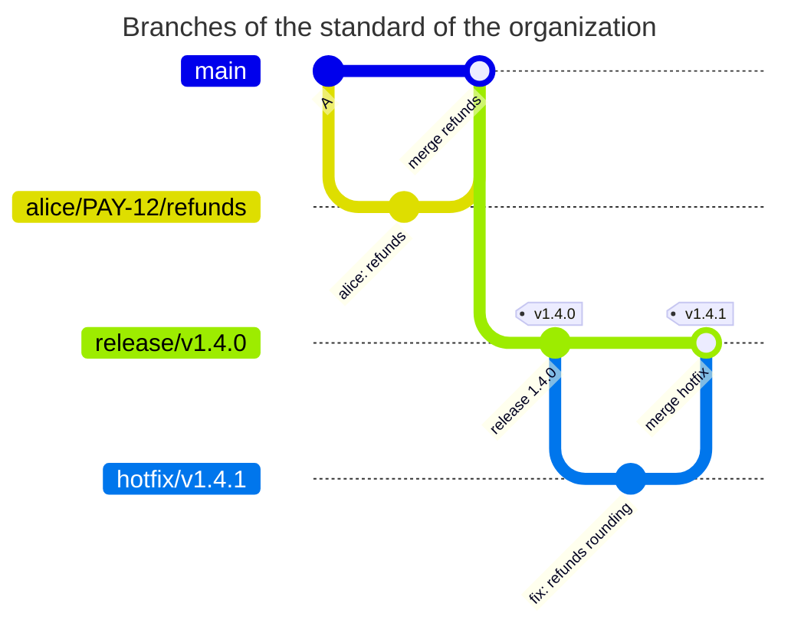

[](branchpolicy.md)
[](branchpolicy.en.md)

# BRANCHPOLICY

## In short

BRANCHPOLICY checks the name of every new branch and that branches of certain classes are protected in GitLab. The agreement of the team on names becomes a rule on the server, and a release branch nobody remembered to protect does not stay without protected CI/CD variables and runners. The file is in the root of the repository under the name `BRANCHPOLICY`, the content is YAML. The smallest working file:

```yaml
version: 1
rules:
  no-master:
    match: [master]
    priority: 10
    deny: true
    message: This project uses main; master must not be created.
```

Here the branch `master` must not be created. All other names are not checked.

## Quick start

1. Describe the classes of branches as rules with `priority` and check the file: `gitlab-repopolicy validate --branch <name>` shows which rule applies to a name ([below](#checking-without-a-push))
2. Start with `mode: warn`: violations are only shown and written to audit
3. Merge the file into the default branch. Only new branches are checked, existing ones stay as they are
4. When there are almost no warnings, remove `mode: warn`

Who may change BRANCHPOLICY itself is decided by a rule of PATHPOLICY ([pathpolicy.en.md](pathpolicy.en.md#6-who-changes-the-other-policy-files)).

## The name of a branch

The name of a branch may contain `/`, and teams use that so the name tells at once what the branch is:
- `release/v1.4.0` - the release 1.4.0
- `hotfix/v1.4.1` - an urgent fix of a release
- `kpn/disable_auth` - a work branch of the developer `kpn`
- `kpn/PAY-12/refunds` - a work branch of `kpn` for the issue `PAY-12`

BRANCHPOLICY checks a branch when it appears on the server: at the first `git push` with a new name or at a creation in the GitLab UI. Locally a branch may have any name.

```sh
git switch -c kpn/disable_auth            # create a branch and switch to it
git branch -m old-name kpn/disable_auth   # rename a branch
git push -u origin kpn/disable_auth       # create the branch on the server
```

After a denial the branch is not on the server, only on your machine. Rename it as the denial suggests and push again, nothing has to be deleted on the server.

## Field reference

| Field | Required | Value |
| --- | --- | --- |
| `version` | yes | `1` |
| `mode` | no | `enforce` (the default) or `warn`. `warn` turns every denial into a warning |
| `extends` | no | the name of a preset of the server config or a list of names ([configuration.en.md](configuration.en.md#presets)) |
| `rules` | no | rules, up to 50: rule name → rule |
| `rules.<name>.match` | yes | the names of branches of the class ([match.en.md](match.en.md)). There is no `default` here |
| `rules.<name>.priority` | yes | the order of the rules, an integer from 0 to 1 000 000. A new branch falls into the rule with the lowest `priority` whose `match` matched. Unique after the merge with presets |
| `rules.<name>.deny` | no | `true` - branches of this class must not be created. Together with `user_prefix` or `protected` - an error |
| `rules.<name>.user_prefix` | no | `true` - the part of the name before the first `/` is the username of an active GitLab user |
| `rules.<name>.protected` | no | `true` - a new branch of this class must be protected by the project in GitLab (Settings > Repository > Protected branches) |
| `rules.<name>.message` | yes | text in a denial, up to 1000 characters. An example of a right name, and for `protected` which roles to set |
| `rules.<name>.help` | no | `contact` and `docs_url`, as in [PATHPOLICY](pathpolicy.en.md#field-reference) |

Checks of the list of rules after the merge with presets, at the acceptance of a new version and in `validate`:
- `priority` does not repeat: otherwise the order of the rules would be random
- no rules come after a rule with `match: all`: they would never apply
- two rules with the same `match` (as sets) are an error: the second would never apply

Unknown keys, YAML anchors and aliases are an error. The file is up to 64 KiB.

## What is checked

Only the creation of a branch. A new commit in an existing branch and its deletion are not checked. The default branch is not checked, the hook compares its name with `default_branch` of the server config ([configuration.en.md](configuration.en.md#default_branch)). Tags are not checked.

For a new branch, in order:
1. The rule is the one with the lowest `priority` among the rules whose `match` matches the name. No rule matches - the name is not checked
2. `deny: true` - denied with `branch_name_violation`
3. `user_prefix: true` - the part before the first `/` must be a username. When a person creates a branch with their own username as the prefix, the API is not needed. Otherwise the hook asks GitLab once whether an active user with this name exists. None - denied with `branch_name_violation`. A branch for a colleague can be created: `bob/fix` by alice passes when bob exists
4. `protected: true` - the hook asks GitLab whether the project protects this branch. No - denied with `branch_not_protected`

A name of no class is not checked on purpose: a standard describes only the classes that matter. To forbid everything that is not described, add a last rule with `match: all` and `deny: true` ([example 3](#3-strict-mode)).

A branch created in the UI or the API of GitLab (New branch, a branch from an issue, the Web IDE, revert and cherry-pick into a new MR) is checked the same way. The names GitLab suggests (`123-title`, `user-main-patch-48213`) usually do not follow a standard: rename the branch in the dialog.

## Examples

### 1. The standard of the organization as a preset

The task: the organization has the same classes of branches in all projects: release, hotfix, epic, demo and work branches of developers. The standard lives in the server config, projects take it with the line `extends`.



The preset (a fragment of `examples/presets.yaml`, the key `presets.branchpolicy`):

```yaml
presets:
  branchpolicy:
    org-branches:
      rules:
        release:
          match: ['/^release\/v(0|[1-9][0-9]*)\.(0|[1-9][0-9]*)\.(0|[1-9][0-9]*)(-[a-z][a-z0-9]*)?$/']
          priority: 100
          protected: true
          message: Release branches look like release/v1.4.0. Protect release/* with "Allowed to push and merge Maintainers".
        release-bad:
          match: ['/^release\//']
          priority: 110
          deny: true
          message: Release branches look like release/v1.4.0.
        hotfix:
          match: ['/^hotfix\/v(0|[1-9][0-9]*)\.(0|[1-9][0-9]*)\.(0|[1-9][0-9]*)(-[a-z][a-z0-9]*)?$/']
          priority: 200
          protected: true
          message: Hotfix branches look like hotfix/v1.4.1. Protect hotfix/* with "Allowed to push and merge Maintainers".
        hotfix-bad:
          match: ['/^hotfix\//']
          priority: 210
          deny: true
          message: Hotfix branches look like hotfix/v1.4.1.
        epic:
          match: ['/^epic\/[a-z0-9][a-z0-9._-]*$/']
          priority: 300
          protected: true
          message: Epic branches look like epic/payments. Protect epic/* in Protected branches.
        epic-bad:
          match: ['/^epic\//']
          priority: 310
          deny: true
          message: Epic branches look like epic/payments.
        demo:
          match: ['/^demo\/[a-z0-9][a-z0-9._-]*$/']
          priority: 400
          protected: true
          message: Demo branches look like demo/client-a. Protect demo/* in Protected branches.
        demo-bad:
          match: ['/^demo\//']
          priority: 410
          deny: true
          message: Demo branches look like demo/client-a.
        work:
          match: ['/^[a-z0-9][a-z0-9._-]*\/(([0-9]+|[A-Z][A-Z0-9]+-[0-9]+)\/)?[a-z0-9][a-z0-9._-]*$/']
          priority: 900
          user_prefix: true
          message: Work branches are <username>/[<issue>/]<name>, for example kpn/disable_auth or kpn/PAY-12/refunds.
```

The file of a project that takes the standard and changes it a little ([example 4](#4-a-project-on-top-of-a-preset)):

```yaml
# examples/branch-standard/BRANCHPOLICY
# The branch standard of the organization comes from the preset org-branches
# of the server config. This project also forbids master, has no demo
# branches and names its own work branches in the message.
version: 1
extends: org-branches

rules:
  no-master:
    match: [master]
    priority: 10
    deny: true
    message: This project uses main; master must not be created.
  demo: null
  demo-bad: null
  work:
    message: Work branches are <username>/[<issue>/]<name>, for example kpn/PAY-12/refunds; PAY is the Jira project of this team.
```

The project protects `main` and `hotfix/*`, but has not protected `release/*` yet. alice creates the branches.

<!-- check: branch-push examples/branch-standard/BRANCHPOLICY main,hotfix/* -->
| New branch | Who creates it | Rule | Result | Why |
| --- | --- | --- | --- | --- |
| `hotfix/v1.4.1` | alice | `hotfix` | allowed | the name follows the standard, `hotfix/*` is protected |
| `release/v1.4.0` | alice | `release` | denied | the name follows the standard, but the project does not protect `release/*` |
| `release/foo` | alice | `release-bad` | denied | `release` did not match, the name is not `release/vX.Y.Z`. The next by `priority` is `release-bad` with `deny` |
| `alice/disable_auth` | alice | `work` | allowed | the prefix is the username of whoever pushes |
| `alice/PAY-12/refunds` | alice | `work` | allowed | the prefix and an issue key |
| `bob/fix` | alice | `work` | allowed | bob is an active GitLab user |
| `ghost/fix` | alice | `work` | denied | `ghost` is not a GitLab user |
| `fix-login` | alice | - | allowed | no rule matched, the name is not checked |

The denial for `release/v1.4.0`:

```text
remote: BRANCHPOLICY rule "release", branch release/v1.4.0: the branch must be protected, but the project does not protect it
remote:   Release branches look like release/v1.4.0. Protect release/* with "Allowed to push and merge Maintainers".
remote:   how to fix: a Maintainer protects release/v1.4.0 in Settings > Repository > Protected branches, then push again
```

### 2. An exact rule and `deny` for the whole family

In the preset every class is a pair of rules: an exact one (`release`) and a `deny` for the whole family (`release-bad`) with a higher `priority`. The exact rule catches the right names, and `deny` everything else that starts with `release/`.

Without `release-bad` the name `release/foo` would not match `release` and would go on by `priority` to the rule `work`: `release/foo` looks like `<username>/<name>`. Then the hook would check whether a user `release` exists and, if not, deny with a reason that tells a person little, `release is not a GitLab user`. And without a rule `work` `release/foo` would match nothing and be created unchecked.

The denial of `release-bad` tells how to do it right:

```text
remote: BRANCHPOLICY rule "release-bad", branch release/foo: creating this branch is forbidden
remote:   Release branches look like release/v1.4.0.
```

### 3. Strict mode

The task: the project may create only release branches and work branches, everything else is forbidden. The last rule is `match: all` with `deny: true` and the highest `priority`.

```yaml
# examples/strict-branches/BRANCHPOLICY
# Strict mode: only release and work branches may be created. The last rule
# has match: all and deny, so a name of no other class is refused instead of
# passing unchecked.
version: 1

rules:
  release:
    match: ['/^release\/v\d+\.\d+\.\d+$/']
    priority: 10
    protected: true
    message: Release branches look like release/v1.4.0.
  work:
    match: ['/^[a-z0-9.]+\/[a-z0-9._-]+$/']
    priority: 20
    message: Work branches are <prefix>/<name>, for example kpn/disable_auth.
  other:
    match: all
    priority: 1000
    deny: true
    message: Use release/vX.Y.Z or <prefix>/<name>.
```

<!-- check: branch-push examples/strict-branches/BRANCHPOLICY main,release/* -->
| New branch | Who creates it | Rule | Result | Why |
| --- | --- | --- | --- | --- |
| `release/v1.4.0` | bob | `release` | allowed | the name follows the standard, `release/*` is protected |
| `bob/disable_auth` | bob | `work` | allowed | the name is `<prefix>/<name>` |
| `fix-login` | bob | `other` | denied | no other rule matched |
| `master` | bob | `other` | denied | the same |

The rule with `match: all` must be the last: `validate` rejects a file with more rules after it.

### 4. A project on top of a preset

The task: the project takes the standard of the organization ([example 1](#1-the-standard-of-the-organization-as-a-preset)) and changes it:
- adds `no-master` with `priority: 10`, lower than every rule of the preset, so it applies first
- removes demo branches: `demo: null` and `demo-bad: null` remove the rules of the preset
- changes the `message` of the rule `work`, the other fields of `work` come from the preset

`validate --config` shows where every rule and field comes from (a fragment):

```text
$ gitlab-repopolicy validate --config presets.yaml
BRANCHPOLICY: valid
  extends: org-branches
  ...
  rule work: preset:org-branches, file
    match: preset:org-branches
    message: file
    priority: preset:org-branches
    user_prefix: preset:org-branches
  rule no-master: file
    match: file
    priority: file
    deny: file
    message: file
```

`validate --branch` answers which rule applies to a name:

```text
$ gitlab-repopolicy validate --config presets.yaml --branch master
...
branch master: rule no-master (match: [master]; from file)
  result: denied, branches of this class may not be created
  message: This project uses main; master must not be created.

$ gitlab-repopolicy validate --config presets.yaml --branch demo/client-a
...
branch demo/client-a: rule work (match: [/^[a-z0-9][a-z0-9._-]*\/(([0-9]+|[A-Z][A-Z0-9]+-[0-9]+)\/)?[a-z0-9][a-z0-9._-]*$/]; from preset:org-branches, file)
  requires: demo is an active GitLab user (checked with --online)
  result: allowed when the requirements hold
```

After `demo` and `demo-bad` are removed, the name `demo/client-a` falls into the next rule, `work`. Now `demo` has to be a username: worth knowing when you remove a rule of a preset.

<!-- check: branch-push examples/branch-standard/BRANCHPOLICY main,hotfix/* -->
| New branch | Who creates it | Rule | Result | Why |
| --- | --- | --- | --- | --- |
| `master` | alice | `no-master` | denied | `deny` |
| `demo/client-a` | alice | `work` | denied | there is no rule `demo`, and `demo` is not a GitLab user |

### 5. `user_prefix`

The task: a work branch starts with the username of its author, so the list of branches shows whose it is.

The rule `work` of the preset ([example 1](#1-the-standard-of-the-organization-as-a-preset)) has `user_prefix: true`:
- `alice/disable_auth` by alice passes without a request to GitLab: GitLab has just authenticated alice
- `bob/fix` by alice passes when bob is an active user. So a branch for a colleague can be created
- `ghost/fix` is rejected when the user `ghost` does not exist or is blocked

```text
remote: BRANCHPOLICY rule "work", branch ghost/fix: the name does not follow the branch standard
remote:   ghost is not a GitLab user; the name starts with a GitLab username and /
remote:   Work branches are <username>/[<issue>/]<name>, for example kpn/PAY-12/refunds; PAY is the Jira project of this team.
remote:   how to fix: rename the branch locally (git branch -m) and push again
```

Offline `validate --branch` only says that the prefix must be a user. With `--online` it asks GitLab ([validate.en.md](validate.en.md)).

### 6. `protected: true`

The task: release branches are deployed, and the pipeline of an unprotected branch does not see protected CI/CD variables and protected runners. The branch is created, CI deploys nothing, and the cause is hard to find. `protected: true` catches this when the branch is created.

What happens when the branch is created before the protection is set up: the hook rejects the push with `branch_not_protected` ([the denial above](#1-the-standard-of-the-organization-as-a-preset)). What to do:
1. A Maintainer adds `release/*` in Settings > Repository > Protected branches with the right roles (the `message` of the rule tells which)
2. The branch is pushed again

The hook does not see protection removed after the branch was created: it checks only new branches. `settings-check` finds it: for projects with BRANCHPOLICY it takes the existing branches whose rule has `protected: true` and checks that GitLab protects them ([operations.en.md](operations.en.md#settings-check)).

### 7. A mistake: an exception `!` instead of `deny`

The task: forbid branches `tmp/...`. Someone writes an exception into the `match` of the work rule:

```yaml
# a fragment of BRANCHPOLICY
rules:
  work:
    match: ['/^[a-z0-9.]+\/[a-z0-9._-]+$/', '!/^tmp\//']
    priority: 20
    message: Work branches are <prefix>/<name>.
```

`tmp/x` does not match `work` now. But it matches no other rule either, so the name is not checked and the branch is created:

```text
$ gitlab-repopolicy validate --branch tmp/x
BRANCHPOLICY: valid
branch tmp/x: no rule matches, the name is not checked
```

An exception only removes a name from a class. To forbid it, a separate rule with `deny: true` is needed:

```yaml
# a fragment of BRANCHPOLICY
rules:
  no-tmp:
    match: ['/^tmp\//']
    priority: 10
    deny: true
    message: Temporary branches are not pushed; keep them local.
```

## Denials

| Situation | Result |
| --- | --- |
| `mode: enforce`, a violation | denied with the code of the violation |
| `mode: warn`, a violation | the push goes through, a warning in the output and in audit |
| the API did not answer during `user_prefix` or `protected` | the check is skipped, a warning |
| the preset of `extends` is missing from the server config, broken, or the rules after the merge fail the checks | the module is skipped with a warning, only for pushes that create a branch |
| BRANCHPOLICY in the default branch is invalid | the same, the audit event `invalid_branch_policy` |
| a push changes BRANCHPOLICY to an invalid version | denied with `invalid_policy_update` |

BRANCHPOLICY keeps order, it does not guard access. So when the check cannot be made, the branch is created with a warning.

| Code | Title in the output | When |
| --- | --- | --- |
| `branch_name_violation` | creating this branch is forbidden | a rule with `deny: true` |
| `branch_name_violation` | the name does not follow the branch standard | the prefix is not the username of an active user |
| `branch_not_protected` | the branch must be protected, but the project does not protect it | a new branch of a rule with `protected: true`, and the project does not protect it |

The whole denial for `master`:

```text
remote: gitlab-repopolicy: push rejected by the rules of this repository (1 problem)
remote:
remote: BRANCHPOLICY rule "no-master", branch master: creating this branch is forbidden
remote:   This project uses main; master must not be created.
remote:
remote: rules: BRANCHPOLICY in main (72ad41f)
remote: checked as: alice (SSH)
remote: GL-HOOK-ERR: gitlab-repopolicy: branch master is forbidden by BRANCHPOLICY rule no-master
```

- the title - the rule, the branch and what the problem is
- then the `message` of the rule and, when there is one, what to do (`how to fix`)
- `rules` - which commit of the default branch the hook read BRANCHPOLICY from
- `checked as` - who pushed and how
- `GL-HOOK-ERR` - the short line for the GitLab UI

## Common mistakes

| Symptom | Cause | What to do |
| --- | --- | --- |
| `priority 100 is also the priority of rule ...` from `validate` | the same `priority` in two rules, often after the merge with a preset | change the `priority` of the rule in the file |
| `comes after rule other with match: all and is never used` | the rule with `match: all` is not the last | give the rule with `match: all` the highest `priority` |
| `release/foo` was created unchecked | no `deny` for the family `release/` | add the rule `release-bad` ([example 2](#2-an-exact-rule-and-deny-for-the-whole-family)) |
| `tmp/x` was created although `!/^tmp\//` is in `match` | an exception only removes a name from a class | a separate rule with `deny` ([example 7](#7-a-mistake-an-exception--instead-of-deny)) |
| `git push --mirror` of an old repository is rejected as a whole | one branch with a wrong name rejects the whole push | add BRANCHPOLICY after the import |
| after `demo: null` branches `demo/...` need a user `demo` | the name moves to the next rule, `work` | check names with `validate --branch` |

## Checking without a push

```sh
gitlab-repopolicy validate -f BRANCHPOLICY
gitlab-repopolicy validate -f BRANCHPOLICY --config presets.yaml --branch release/v1.4.0
gitlab-repopolicy validate -f BRANCHPOLICY --config config.yaml --online --branch kpn/disable_auth
```

`validate` makes the same checks as the acceptance of a new version of the file. `--branch` shows which rule applies to a name and with what result. The exit code is 0 for any result: it is a query, not a check. With `--online` the prefix of `user_prefix` is checked through the GitLab API. Step by step - [validate.en.md](validate.en.md), all flags - [cli.en.md](cli.en.md).
