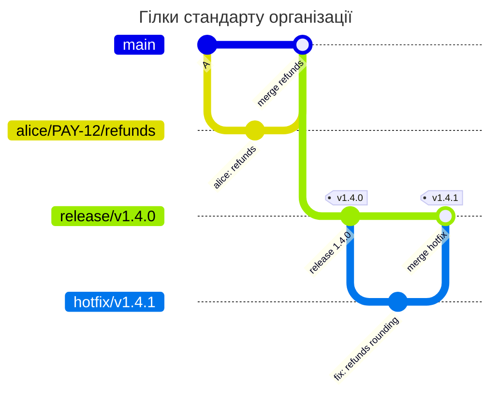

[](branchpolicy.md)
[](branchpolicy.en.md)

# BRANCHPOLICY

## Коротко

BRANCHPOLICY перевіряє ім'я кожної нової гілки і те, що гілки певних класів захищені в GitLab. Так домовленість команди про імена стає правилом на сервері, а release-гілка, яку забули захистити, не залишається без protected CI/CD variables і runners. Файл лежить у корені репозиторію з ім'ям `BRANCHPOLICY`, вміст - YAML. Найменший робочий файл:

```yaml
version: 1
rules:
  no-master:
    match: [master]
    priority: 10
    deny: true
    message: This project uses main; master must not be created.
```

Тут заборонено створювати гілку `master`. Усі інші імена не перевіряються.

## Швидкий старт

1. Опишіть класи гілок правилами з `priority` і перевірте файл: `gitlab-repopolicy validate --branch <ім'я>` показує, яке правило спрацює для імені ([нижче](#перевірка-без-push))
2. Почніть з `mode: warn`: порушення лише показуються і пишуться в audit
3. Злийте файл у default branch. Перевіряються лише нові гілки, наявні залишаються як є
4. Коли попереджень майже немає, приберіть `mode: warn`

Хто може змінювати сам BRANCHPOLICY, задає правило PATHPOLICY ([pathpolicy.md](pathpolicy.md#6-хто-змінює-інші-файли-політик)).

## Ім'я гілки

Ім'я гілки може містити `/`, і команди користуються цим, щоб ім'я одразу казало, що це за гілка:
- `release/v1.4.0` - реліз 1.4.0
- `hotfix/v1.4.1` - термінове виправлення релізу
- `kpn/disable_auth` - робоча гілка розробника `kpn`
- `kpn/PAY-12/refunds` - робоча гілка `kpn` за задачею `PAY-12`

BRANCHPOLICY перевіряє гілку, коли вона з'являється на сервері: під час першого `git push` з новим ім'ям або створення в UI GitLab. Локально гілку можна називати як завгодно.

```sh
git switch -c kpn/disable_auth            # створити гілку і перейти на неї
git branch -m old-name kpn/disable_auth   # перейменувати гілку
git push -u origin kpn/disable_auth       # створити гілку на сервері
```

Після відмови гілки на сервері немає, вона лише у вас. Перейменуйте її за підказкою з відмови і запуште ще раз, видаляти на сервері нічого не треба.

## Довідник полів

| Поле | Обов'язкове | Значення |
| --- | --- | --- |
| `version` | так | `1` |
| `mode` | ні | `enforce` (за замовчуванням) або `warn`. `warn` робить з кожної відмови попередження |
| `extends` | ні | ім'я пресета серверного конфігу або список імен ([configuration.md](configuration.md#presets)) |
| `rules` | ні | правила, до 50: ім'я правила → правило |
| `rules.<ім'я>.match` | так | імена гілок класу ([match.md](match.md)). `default` тут немає |
| `rules.<ім'я>.priority` | так | порядок правил, ціле від 0 до 1 000 000. Нова гілка потрапляє в правило з найменшим `priority`, чий `match` збігся. Унікальне після злиття з пресетами |
| `rules.<ім'я>.deny` | ні | `true` - гілки цього класу створювати заборонено. Разом з `user_prefix` чи `protected` - помилка |
| `rules.<ім'я>.user_prefix` | ні | `true` - частина імені до першого `/` має бути username активного користувача GitLab |
| `rules.<ім'я>.protected` | ні | `true` - нову гілку цього класу проєкт має захищати в GitLab (Settings > Repository > Protected branches) |
| `rules.<ім'я>.message` | так | текст у відмові, до 1000 символів. Приклад правильного імені, а для `protected` - які ролі ставити |
| `rules.<ім'я>.help` | ні | `contact` і `docs_url`, як у [PATHPOLICY](pathpolicy.md#довідник-полів) |

Перевірки списку правил після злиття з пресетами, під час приймання нової версії і в `validate`:
- `priority` не повторюється: інакше порядок правил був би випадковим
- після правила з `match: all` правил немає: вони ніколи не спрацюють
- два правила з однаковим `match` (як множини) - помилка: друге ніколи не спрацює

Невідомі ключі, YAML anchors і aliases - помилка. Розмір файлу - до 64 KiB.

## Що перевіряється

Лише створення гілки. Новий коміт у наявну гілку і її видалення не перевіряються. Default branch не перевіряється, її ім'я hook звіряє з `default_branch` серверного конфігу ([configuration.md](configuration.md#default_branch)). Теги не перевіряються.

Для нової гілки, по порядку:
1. Правило - те, у якого найменший `priority` серед правил, чий `match` збігся з ім'ям. Не збіглося жодне - ім'я не перевіряється
2. `deny: true` - відмова `branch_name_violation`
3. `user_prefix: true` - частина до першого `/` має бути username. Якщо гілку створює людина зі своїм username як префіксом, API не потрібен. Інакше hook один раз питає GitLab, чи є активний користувач з таким ім'ям. Немає - відмова `branch_name_violation`. Гілку для колеги створити можна: `bob/fix` від імені alice проходить, якщо bob існує
4. `protected: true` - hook питає GitLab, чи захищає проєкт цю гілку. Ні - відмова `branch_not_protected`

Ім'я без класу не перевіряється навмисно: стандарт описує лише ті класи, які важливі. Щоб заборонити все, що не описано, додайте останнім правило з `match: all` і `deny: true` ([приклад 3](#3-строгий-режим)).

Гілку, створену в UI чи API GitLab (New branch, гілка з issue, Web IDE, revert і cherry-pick з новим MR), перевіряють так само. Імена, які пропонує GitLab (`123-title`, `user-main-patch-48213`), стандарту зазвичай не відповідають: перейменуйте гілку в діалозі.

## Приклади

### 1. Стандарт організації як пресет

Задача: в організації однакові класи гілок для всіх проєктів: release, hotfix, epic, demo і робочі гілки розробників. Стандарт лежить у серверному конфігу, проєкти підключають його рядком `extends`.



Пресет (уривок `examples/presets.yaml`, ключ `presets.branchpolicy`):

```yaml
presets:
  branchpolicy:
    org-branches:
      rules:
        release:
          match: ['/^release\/v(0|[1-9][0-9]*)\.(0|[1-9][0-9]*)\.(0|[1-9][0-9]*)(-[a-z][a-z0-9]*)?$/']
          priority: 100
          protected: true
          message: Release branches look like release/v1.4.0. Protect release/* with "Allowed to push and merge Maintainers".
        release-bad:
          match: ['/^release\//']
          priority: 110
          deny: true
          message: Release branches look like release/v1.4.0.
        hotfix:
          match: ['/^hotfix\/v(0|[1-9][0-9]*)\.(0|[1-9][0-9]*)\.(0|[1-9][0-9]*)(-[a-z][a-z0-9]*)?$/']
          priority: 200
          protected: true
          message: Hotfix branches look like hotfix/v1.4.1. Protect hotfix/* with "Allowed to push and merge Maintainers".
        hotfix-bad:
          match: ['/^hotfix\//']
          priority: 210
          deny: true
          message: Hotfix branches look like hotfix/v1.4.1.
        epic:
          match: ['/^epic\/[a-z0-9][a-z0-9._-]*$/']
          priority: 300
          protected: true
          message: Epic branches look like epic/payments. Protect epic/* in Protected branches.
        epic-bad:
          match: ['/^epic\//']
          priority: 310
          deny: true
          message: Epic branches look like epic/payments.
        demo:
          match: ['/^demo\/[a-z0-9][a-z0-9._-]*$/']
          priority: 400
          protected: true
          message: Demo branches look like demo/client-a. Protect demo/* in Protected branches.
        demo-bad:
          match: ['/^demo\//']
          priority: 410
          deny: true
          message: Demo branches look like demo/client-a.
        work:
          match: ['/^[a-z0-9][a-z0-9._-]*\/(([0-9]+|[A-Z][A-Z0-9]+-[0-9]+)\/)?[a-z0-9][a-z0-9._-]*$/']
          priority: 900
          user_prefix: true
          message: Work branches are <username>/[<issue>/]<name>, for example kpn/disable_auth or kpn/PAY-12/refunds.
```

Файл проєкту, який бере стандарт і трохи його змінює ([приклад 4](#4-проєкт-поверх-пресета)):

```yaml
# examples/branch-standard/BRANCHPOLICY
# The branch standard of the organization comes from the preset org-branches
# of the server config. This project also forbids master, has no demo
# branches and names its own work branches in the message.
version: 1
extends: org-branches

rules:
  no-master:
    match: [master]
    priority: 10
    deny: true
    message: This project uses main; master must not be created.
  demo: null
  demo-bad: null
  work:
    message: Work branches are <username>/[<issue>/]<name>, for example kpn/PAY-12/refunds; PAY is the Jira project of this team.
```

Проєкт захищає `main` і `hotfix/*`, але ще не захистив `release/*`. Гілки створює alice.

<!-- check: branch-push examples/branch-standard/BRANCHPOLICY main,hotfix/* -->
| Нова гілка | Хто створює | Правило | Результат | Чому |
| --- | --- | --- | --- | --- |
| `hotfix/v1.4.1` | alice | `hotfix` | дозволено | ім'я за стандартом, `hotfix/*` захищено |
| `release/v1.4.0` | alice | `release` | відмова | ім'я за стандартом, але проєкт не захищає `release/*` |
| `release/foo` | alice | `release-bad` | відмова | `release` не збігся, бо ім'я не `release/vX.Y.Z`. Наступне за `priority` - `release-bad` з `deny` |
| `alice/disable_auth` | alice | `work` | дозволено | префікс - username того, хто пушить |
| `alice/PAY-12/refunds` | alice | `work` | дозволено | префікс і ключ задачі |
| `bob/fix` | alice | `work` | дозволено | bob - активний користувач GitLab |
| `ghost/fix` | alice | `work` | відмова | `ghost` - не користувач GitLab |
| `fix-login` | alice | - | дозволено | жодне правило не збіглося, ім'я не перевіряється |

Відмова для `release/v1.4.0`:

```text
remote: BRANCHPOLICY rule "release", branch release/v1.4.0: the branch must be protected, but the project does not protect it
remote:   Release branches look like release/v1.4.0. Protect release/* with "Allowed to push and merge Maintainers".
remote:   how to fix: a Maintainer protects release/v1.4.0 in Settings > Repository > Protected branches, then push again
```

### 2. Точне правило і `deny` для всієї родини

У пресеті кожен клас - пара правил: точне (`release`) і `deny` для всієї родини (`release-bad`) з більшим `priority`. Точне правило ловить правильні імена, а `deny` - усе інше, що починається з `release/`.

Без `release-bad` ім'я `release/foo` не збіглося б з `release` і пішло б далі за `priority`, до правила `work`: `release/foo` схоже на `<username>/<name>`. Тоді hook перевірив би, чи є користувач `release`, і, якщо такого немає, відмовив би з незрозумілою для людини причиною `release is not a GitLab user`. А якщо правила `work` немає, `release/foo` не збіглося б ні з чим і створилося б без перевірки.

Відмова з `release-bad` пояснює, як правильно:

```text
remote: BRANCHPOLICY rule "release-bad", branch release/foo: creating this branch is forbidden
remote:   Release branches look like release/v1.4.0.
```

### 3. Строгий режим

Задача: у проєкті можна створювати лише release-гілки і робочі гілки, усе інше заборонено. Останнє правило - `match: all` з `deny: true` і найбільшим `priority`.

```yaml
# examples/strict-branches/BRANCHPOLICY
# Strict mode: only release and work branches may be created. The last rule
# has match: all and deny, so a name of no other class is refused instead of
# passing unchecked.
version: 1

rules:
  release:
    match: ['/^release\/v\d+\.\d+\.\d+$/']
    priority: 10
    protected: true
    message: Release branches look like release/v1.4.0.
  work:
    match: ['/^[a-z0-9.]+\/[a-z0-9._-]+$/']
    priority: 20
    message: Work branches are <prefix>/<name>, for example kpn/disable_auth.
  other:
    match: all
    priority: 1000
    deny: true
    message: Use release/vX.Y.Z or <prefix>/<name>.
```

<!-- check: branch-push examples/strict-branches/BRANCHPOLICY main,release/* -->
| Нова гілка | Хто створює | Правило | Результат | Чому |
| --- | --- | --- | --- | --- |
| `release/v1.4.0` | bob | `release` | дозволено | ім'я за стандартом, `release/*` захищено |
| `bob/disable_auth` | bob | `work` | дозволено | ім'я `<prefix>/<name>` |
| `fix-login` | bob | `other` | відмова | жодне інше правило не збіглося |
| `master` | bob | `other` | відмова | так само |

Правило з `match: all` має бути останнім: `validate` відхиляє файл, де після нього є ще правила.

### 4. Проєкт поверх пресета

Задача: проєкт бере стандарт організації ([приклад 1](#1-стандарт-організації-як-пресет)) і змінює його:
- додає `no-master` з `priority: 10`, меншим за всі правила пресета, щоб воно спрацьовувало першим
- прибирає demo-гілки: `demo: null` і `demo-bad: null` видаляють правила пресета
- змінює `message` правила `work`, решта полів `work` приходить з пресета

`validate --config` показує, звідки кожне правило і поле (уривок):

```text
$ gitlab-repopolicy validate --config presets.yaml
BRANCHPOLICY: valid
  extends: org-branches
  ...
  rule work: preset:org-branches, file
    match: preset:org-branches
    message: file
    priority: preset:org-branches
    user_prefix: preset:org-branches
  rule no-master: file
    match: file
    priority: file
    deny: file
    message: file
```

`validate --branch` відповідає, яке правило спрацює для імені:

```text
$ gitlab-repopolicy validate --config presets.yaml --branch master
...
branch master: rule no-master (match: [master]; from file)
  result: denied, branches of this class may not be created
  message: This project uses main; master must not be created.

$ gitlab-repopolicy validate --config presets.yaml --branch demo/client-a
...
branch demo/client-a: rule work (match: [/^[a-z0-9][a-z0-9._-]*\/(([0-9]+|[A-Z][A-Z0-9]+-[0-9]+)\/)?[a-z0-9][a-z0-9._-]*$/]; from preset:org-branches, file)
  requires: demo is an active GitLab user (checked with --online)
  result: allowed when the requirements hold
```

Після видалення `demo` і `demo-bad` ім'я `demo/client-a` потрапляє в наступне правило, `work`. Тепер `demo` має бути username: це варто знати, коли прибираєте правило пресета.

<!-- check: branch-push examples/branch-standard/BRANCHPOLICY main,hotfix/* -->
| Нова гілка | Хто створює | Правило | Результат | Чому |
| --- | --- | --- | --- | --- |
| `master` | alice | `no-master` | відмова | `deny` |
| `demo/client-a` | alice | `work` | відмова | правила `demo` немає, а `demo` - не користувач GitLab |

### 5. `user_prefix`

Задача: робоча гілка починається з username свого автора, щоб у списку гілок було видно, чия вона.

Правило `work` з пресета ([приклад 1](#1-стандарт-організації-як-пресет)) має `user_prefix: true`:
- `alice/disable_auth` від alice проходить без запиту до GitLab: GitLab щойно автентифікував alice
- `bob/fix` від alice проходить, якщо bob - активний користувач. Так можна створити гілку для колеги
- `ghost/fix` відхиляється, якщо користувача `ghost` немає або його заблоковано

```text
remote: BRANCHPOLICY rule "work", branch ghost/fix: the name does not follow the branch standard
remote:   ghost is not a GitLab user; the name starts with a GitLab username and /
remote:   Work branches are <username>/[<issue>/]<name>, for example kpn/PAY-12/refunds; PAY is the Jira project of this team.
remote:   how to fix: rename the branch locally (git branch -m) and push again
```

Офлайн `validate --branch` лише каже, що префікс має бути користувачем. З `--online` він питає GitLab ([validate.md](validate.md)).

### 6. `protected: true`

Задача: release-гілки деплоять, а pipeline незахищеної гілки не бачить protected CI/CD variables і protected runners. Гілку створили, CI нічого не задеплоїв, і причину шукають довго. `protected: true` ловить це, коли гілку створюють.

Що буде, якщо гілку створюють до налаштування захисту: hook відхиляє push з `branch_not_protected` ([відмова вище](#1-стандарт-організації-як-пресет)). Що зробити:
1. Maintainer додає `release/*` у Settings > Repository > Protected branches з потрібними ролями (`message` правила підказує які)
2. Гілку пушать ще раз

Захист, який зняли вже після створення гілки, hook не бачить: він перевіряє лише нові гілки. Це знаходить `settings-check`: для проєктів з BRANCHPOLICY він бере наявні гілки, чиє правило має `protected: true`, і перевіряє, що GitLab їх захищає ([operations.md](operations.md#settings-check)).

### 7. Помилка: виняток `!` замість `deny`

Задача: заборонити гілки `tmp/...`. Хтось пише виняток у `match` робочого правила:

```yaml
# фрагмент BRANCHPOLICY
rules:
  work:
    match: ['/^[a-z0-9.]+\/[a-z0-9._-]+$/', '!/^tmp\//']
    priority: 20
    message: Work branches are <prefix>/<name>.
```

`tmp/x` тепер не збігається з `work`. Але й з жодним іншим правилом теж, тож ім'я не перевіряється і гілка створюється:

```text
$ gitlab-repopolicy validate --branch tmp/x
BRANCHPOLICY: valid
branch tmp/x: no rule matches, the name is not checked
```

Виняток лише прибирає ім'я з класу. Щоб заборонити, потрібне окреме правило з `deny: true`:

```yaml
# фрагмент BRANCHPOLICY
rules:
  no-tmp:
    match: ['/^tmp\//']
    priority: 10
    deny: true
    message: Temporary branches are not pushed; keep them local.
```

## Відмови

| Ситуація | Результат |
| --- | --- |
| `mode: enforce`, порушення | відмова з кодом порушення |
| `mode: warn`, порушення | push проходить, попередження у виводі й audit |
| API не відповів під час `user_prefix` чи `protected` | перевірку пропущено, попередження |
| пресета з `extends` немає в серверному конфігу, він зламаний, або правила після злиття не проходять перевірки | модуль пропускається з попередженням, лише для push, що створюють гілку |
| BRANCHPOLICY у default branch невалідна | так само, audit-подія `invalid_branch_policy` |
| push змінює BRANCHPOLICY на невалідну версію | відмова `invalid_policy_update` |

BRANCHPOLICY стежить за порядком, а не за доступом. Тому, коли перевірку неможливо виконати, гілка створюється з попередженням.

| Код | Заголовок у виводі | Коли |
| --- | --- | --- |
| `branch_name_violation` | creating this branch is forbidden | правило з `deny: true` |
| `branch_name_violation` | the name does not follow the branch standard | префікс не є username активного користувача |
| `branch_not_protected` | the branch must be protected, but the project does not protect it | нова гілка правила з `protected: true`, а проєкт її не захищає |

Відмова для `master` повністю:

```text
remote: gitlab-repopolicy: push rejected by the rules of this repository (1 problem)
remote:
remote: BRANCHPOLICY rule "no-master", branch master: creating this branch is forbidden
remote:   This project uses main; master must not be created.
remote:
remote: rules: BRANCHPOLICY in main (72ad41f)
remote: checked as: alice (SSH)
remote: GL-HOOK-ERR: gitlab-repopolicy: branch master is forbidden by BRANCHPOLICY rule no-master
```

- заголовок - правило, гілка і в чому проблема
- далі `message` правила і, якщо є, що робити (`how to fix`)
- `rules` - з якого коміту default branch hook прочитав BRANCHPOLICY
- `checked as` - хто робив push і як
- `GL-HOOK-ERR` - короткий рядок для UI GitLab

## Часті помилки

| Симптом | Причина | Що зробити |
| --- | --- | --- |
| `priority 100 is also the priority of rule ...` у `validate` | однаковий `priority` у двох правилах, часто після злиття з пресетом | змініть `priority` правила у файлі |
| `comes after rule other with match: all and is never used` | правило з `match: all` не останнє | дайте правилу з `match: all` найбільший `priority` |
| `release/foo` створилася без перевірки | немає `deny` для родини `release/` | додайте правило `release-bad` ([приклад 2](#2-точне-правило-і-deny-для-всієї-родини)) |
| `tmp/x` створилася, хоча `!/^tmp\//` є в `match` | виняток лише прибирає ім'я з класу | окреме правило з `deny` ([приклад 7](#7-помилка-виняток--замість-deny)) |
| `git push --mirror` старого репозиторію відхиляється цілком | одна гілка з неправильним ім'ям відхиляє весь push | додавайте BRANCHPOLICY після імпорту |
| після `demo: null` гілки `demo/...` вимагають користувача `demo` | ім'я переходить у наступне правило, `work` | перевірте імена командою `validate --branch` |

## Перевірка без push

```sh
gitlab-repopolicy validate -f BRANCHPOLICY
gitlab-repopolicy validate -f BRANCHPOLICY --config presets.yaml --branch release/v1.4.0
gitlab-repopolicy validate -f BRANCHPOLICY --config config.yaml --online --branch kpn/disable_auth
```

`validate` виконує ті самі перевірки, що й приймання нової версії файлу. `--branch` показує, яке правило спрацює для імені і з яким результатом. Код виходу 0 за будь-якого результату: це запит, а не перевірка. З `--online` префікс `user_prefix` перевіряється через API GitLab. Покроково - [validate.md](validate.md), усі прапорці - [cli.md](cli.md).
