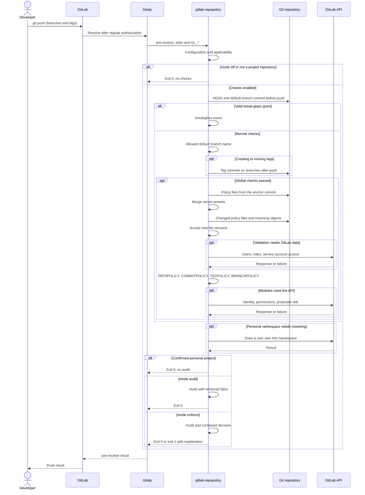

[](architecture.md)
[](architecture.en.md)

# Architecture

## Overview

gitlab-repopolicy is a Go binary for the global `pre-receive` server hook of Gitaly. When someone makes changes to a project repository (push, merge, Web IDE, API), the hook checks them against rules that live in the repository itself. Repositories of projects in groups are checked. Not checked:
- wiki, design and snippet repositories
- projects in a personal namespace of a user
- the whole instance if the config has `mode: off`. With `mode: audit` the hook checks everything and writes decisions to audit, but does not deny a push

Rule files:

| File | What it checks |
| --- | --- |
| `PATHPOLICY` | who may change certain files: CI configuration, deploy and infra configuration, other sensitive paths |
| `COMMITPOLICY` | the format of commit messages in branches |
| `TAGPOLICY` | who may release: a tag under a rule is accepted only with a signature of an allowed OpenPGP or SSH key |
| `BRANCHPOLICY` | how new branches are named and which classes of branches must be protected in GitLab |

The hook supplements GitLab authorization by checking changes and the user introducing them. For example, permission to push to a feature branch need not include permission to change its CI configuration. Client checks are not a trust source: local settings do not affect the server decision.

Principles:
- **hard enforcement on the server**: a rule cannot be bypassed by a local setting, another client or the merge button
- **rules in the repository**: policy files are versioned and reviewed like code
- **GitLab AND gitlab-repopolicy**: the hook can only deny, it grants no new rights
- **different owners for different rules**: PATHPOLICY delegates the other policy files to their owners
- **compute on demand**: untouched rules need no evaluation of their own; global checks and namespace resolution can have separate API needs
- **no permanent lockout**: losing all admins is fixed by an explicit, audited recovery
- **clear messages**: a denial says what is broken and how to fix it

## System context

```text
 git push, merge, Web IDE, API
              |
              v
     GitLab Rails / Workhorse ----- /internal/allowed: regular GitLab permissions
              |
              v
           Gitaly --- custom_hooks_dir/pre-receive.d/50-gitlab-repopolicy
              |                      |
              |                      v
              |            gitlab-repopolicy hook pre-receive
              |              |            |              |
              |      git (Gitaly)   REST/GraphQL API   audit.log
              |              |      (only when needed)
              v              v
       repository and quarantine objects of the push
```

Gitaly runs the hook only after the regular GitLab permission check. Until the hook answers, the new objects of the push are kept in a temporary directory (quarantine): they get into the repository only if the push is accepted. The hook gets the branch and tag updates on stdin and the identity of whoever makes the change in the `GL_*` variables, and reads the repository with the same git as Gitaly. It talks to the outside only through the GitLab API and only when the decision depends on the role of a user, the type of an SSH key or whether a branch or tag is protected; the API also checks usernames and resolves personal namespaces.

## Responsibilities

In scope:
- an allow or deny decision for every push by the policy files from the default branch
- acceptance of new versions of policy files in any branch
- one aggregated message per push and an audit event per decision
- helper commands: installing the hook, self-test, token rotation, comparison of project settings, emergency bypass

Out of scope:
- project settings (the CI configuration path, protected branches): the hook does not see them, `settings-check` only detects changes. The hook compares the name of the default branch with `default_branch` on every push
- the quality of changes: the project checks who and in which format, not what
- history from before a policy appeared
- projects in personal namespaces
- GitLab.com and GitLab Dedicated

## Main components

```text
cmd/gitlab-repopolicy     main: signals, exit code
internal/cli              subcommands, assembly of config, clients and modules
internal/config           server config
internal/core             anchor, policy reading, acceptance, module order, budgets, aggregation
internal/module           module contract: Module, Policy, Input, Result
internal/modules          the module list of the hook
internal/modules/path     PATHPOLICY
internal/modules/commit   COMMITPOLICY
internal/modules/tag      TAGPOLICY
internal/modules/branch   BRANCHPOLICY
internal/changes          which paths and commits a push changes
internal/gitx             child git processes in an isolated environment
internal/hookenv          the environment and stdin that Gitaly passes to the hook
internal/refs             default, protected or another branch
internal/identity         who makes the change, SSH key type, namespace type
internal/gitlab           REST and GraphQL client, call budget
internal/report           messages to the user, GL-HOOK-ERR
internal/audit            JSON events
internal/strictyaml       strict YAML parsing: no anchors, unknown keys or duplicates
internal/spec, schema     the format of policy files, the validator, the merge with presets, JSON Schema
internal/buildinfo        version and commit of the build
internal/install, settings, coverage, token, breakglass   helper commands
internal/testmodule       a test module for checks of the core, only in tests
```

The core does not know what a module checks, a module does not know how changes and identity are obtained. A module declares its file, its behaviour on an invalid policy (fail closed or skip) and the data it needs; the core computes only that. The linter (`depguard`, `forbidigo`) in `make code-lint` checks the dependency rules between packages.

A new kind of rules is a new module and a new file; the core, the trust model and operations do not change. The module file is not protected by itself: only a PATHPOLICY rule that covers the file protects it. Without such a rule the hook accepts a new version of the file with the warning `anyone who can push may change it`.

## External dependencies

| Dependency | What for | When |
| --- | --- | --- |
| the git that Gitaly passes in the `PATH` of the hook | reading policies from the anchor, paths, commits, tag objects | on every push to a project |
| GitLab REST API v4 | the role of a user in the project, personal or deploy SSH key, protected branches and tags, project visibility for the service account | only when a rule is touched, on policy acceptance and on bootstrap. TAGPOLICY - only on the creation of a tag under a rule with `protected: true` |
| GitLab GraphQL | whether usernames added to a policy exist and are active | acceptance of a new version, counting admins, `settings-check` |

The API is reached through the Workhorse unix socket on the same node or over HTTPS if Gitaly runs on a separate node. One request takes up to 3 s, a push up to 30 calls. Caching is limited to one invocation; responses are not retained between pushes. Permission changes appear in subsequent API answers, not in results already obtained by a running invocation.

The Go dependencies of the binary are `go.yaml.in/yaml/v3`, `github.com/bmatcuk/doublestar/v4`, `github.com/ProtonMail/go-crypto` and `golang.org/x/crypto` (only tag signatures). The full list of versions is `go.mod` and the SBOM of the release. The build is static, `CGO_ENABLED=0`.

## How changes are checked

When a user sends changes to GitLab, Gitaly, the service that manages Git repositories, starts the server-side `pre-receive` hook. This hook runs before branches and tags are updated. The application receives the old and new value of each changed reference, checks policies and decides whether to accept the changes.

One `git push` can update several branches and tags. They are checked in one hook invocation, with shared time and API budgets and one set of active policies. A denial for any update rejects the entire push at the `pre-receive` stage.

### Component interactions

The diagram follows the core's order. A global check failure stops later stages. Denials during file acceptance and module evaluation are collected for a combined message.



Startup failures before the core is called, such as invalid configuration or inability to start git, also deny in `audit` mode. The diagram describes this hook: other hooks or subsequent Git ref updates can still reject the operation.

### 1. Determining applicability

The CLI first reads the server configuration. With `mode: off`, it exits without checks or audit. Otherwise it reads the Gitaly environment; wiki, design and snippets are skipped. From stdin the core keeps only branches (`refs/heads/...`) and tags (`refs/tags/...`). A ref, or Git reference, is the general term for these names; branches and tags have different checks.

A personal namespace is resolved through the API when needed, rather than through a mandatory request at the start of every push. A confirmed personal project is skipped without messages or audit. A failed namespace lookup does not establish that a project is personal.

### 2. Fixing the active policy version

The project's default branch is configured in GitLab and reflected in the repository's symbolic `HEAD`. The core remembers its commit before the push. This commit is the **anchor**. Every enabled policy file is read exclusively from it; a missing default branch means no anchor.

For example, bob pushes a change to `.gitlab-ci.yml` together with a PATHPOLICY that adds bob to `allow`. The current push is still checked against the old PATHPOLICY. The new rules apply to later invocations after reaching the default branch. A policy in a feature branch does not become that branch's source of rules.

Fixing the anchor makes rules consistent within an invocation. It does not lock concurrent pushes or guarantee that another push cannot update the default branch before the check finishes.

### 3. Emergency break-glass grant

After resolving the anchor, the core checks the temporary grant for the project ID. A valid grant stops normal checking before global restrictions, file acceptance and modules. The hook records `breakglass` and permits the push; GitLab permissions still apply.

Root creates the grant on the Gitaly node for at most 24 hours. The hook checks ownership, file and directory permissions, project ID and expiry. A missing, expired or untrusted file does not enable the bypass. The [operations guide](../user/administration/operations.en.md#break-glass) describes recovery procedures.

### 4. Global default branch restriction

If the server's `default_branch` list is nonempty (by default `[main, master]`), the project's default branch name must be in it. Otherwise the core produces `default_branch_not_allowed` without loading policies. This prevents switching the default to an arbitrary branch without rules, but also affects projects without policies.

In an empty repository with no branches or tags, a push that creates its first branches must include the branch named by `HEAD`. An empty `default_branch` list disables these checks. A tag-only push does not violate the first-branch check, but the following tag reachability check still applies.

### 5. Reachability of tag commits

For each created or moved tag, the core checks that it peels to a commit and that at least one branch will hold that commit after the push. All created, updated and deleted branches in the same push are considered. This prevents introducing unchecked commits through tags alone.

A tag that does not peel to a commit produces `tag_object_invalid`; a commit outside all branches produces `tag_not_on_branch`. A denial stops subsequent stages. Tag deletions are not checked by this mechanism. It applies to group projects even without TAGPOLICY or with the `tagpolicy` module disabled.

### 6. Loading and accepting policy files

After global checks, the core loads enabled modules' files from the anchor. `extends` includes named rule sets, **presets**, from the server configuration. Presets merge in the specified order, with the project file last.

Separately, new policy versions touched by the push are validated, including files in feature branches and commits reachable through tags. Validation checks file type, size, schema and module-specific requirements: users, working admins and keys. Deletion is not parsed as a new version; modules check permission to delete.

An invalid new version produces `invalid_policy_update`, no working admin produces `lockout_prevented`, and an unconfirmed required API answer produces `authorization_backend_failure`. Acceptance neither activates new rules for the current push nor replaces authorization under the old PATHPOLICY.

### 7. Missing policies and bootstrap

When a policy file is absent from the anchor, its rules do not run. The exception is the first PATHPOLICY a push adds to the default branch. A recognized user with the Maintainer or Owner role must add it. This is **bootstrap**, the initial assignment of policy owners when there is no previous `admins` list.

The first PATHPOLICY also undergoes acceptance: it must have at least one active admin with Maintainer or higher access. A draft in a feature branch does not trigger bootstrap, but new-version validation still applies. A permitted bootstrap records `policy_bootstrap`. Even without any policies, the global checks in steps 4-5 and acceptance of new files still run.

### 8. Evaluating modules

`modules.Default` defines the order: PATHPOLICY, COMMITPOLICY, TAGPOLICY, BRANCHPOLICY. PATHPOLICY checks its own administrators and access to other modules' files; subsequent modules check commit messages, tag signatures and branch creation. One module cannot override another's denial, and a denial does not stop the collection of other violations.

Modules request only the data they need. `match` of a PATHPOLICY or COMMITPOLICY rule only selects branches, and the set of changes is set by `check_history` of the rule: `new-content` takes the commits new to the repository, `incoming` every commit that enters the branch. The status of a branch in GitLab does not change this set. What exactly a module counts as a change in each set differs between the two modules. See [path change rules](../user/policies/pathpolicy.en.md#what-counts-as-a-change) and [commit selection](../user/policies/commitpolicy.en.md#which-commits-are-checked). TAGPOLICY checks created and moved tags; BRANCHPOLICY checks only created branches other than the default.

PATHPOLICY and TAGPOLICY signature checks deny under uncertainty (**fail-closed**). COMMITPOLICY and BRANCHPOLICY skip checks with warnings in documented cases (**fail-open**). A failed TAGPOLICY `protected` lookup also produces a warning. This does not apply to acceptance of new invalid policy files.

### 9. Combined decision and audit

Results combine as a logical AND: every blocking check must allow the push. `mode: warn` in COMMITPOLICY or BRANCHPOLICY turns that module's violations into warnings; it does not cancel other modules' denials.

Global `enforce` applies denials and returns exit code 1 with one message divided into problem blocks. Warnings alone return 0. Global `audit` records decisions with `enforced: false`, returns 0 and suppresses normal policy messages in push output. `off` already ended checking at entry.

Audit is a JSON event log. Decision, failure and recovery events share a `receive_id`. A push that touches no rule and produces no events creates no ordinary `decision` entry. `policy_change`, `policy_bootstrap` and `policy_recovery` are written only when this hook permits the push, including in `audit`. Because events are written before refs are updated, they do not confirm successful completion of the entire GitLab operation. An audit write failure is reported to the user but does not change the decision.

## Check performance

Checks run while GitLab processes changes, so they increase `git push` time. Duration depends on files and commits, policies, server performance and required API calls.

In measurements on 28 October 2026, the additional full `git push` latency without API calls was 14-55 ms. Median `duration_ms` values for the hook itself in those scenarios were 12-46 ms. These are different metrics: client time covers the whole GitLab operation, while `duration_ms` covers checking up to event creation.

PATHPOLICY scenarios with API authorization added 151-223 ms to push time. BRANCHPOLICY and TAGPOLICY scenarios with `protected: true` added 93-115 ms. API call frequency depends on rules and changes; the user's own prefix, another prefix and SSH identity can follow different paths.

GitLab and the Git client ran on one server. Separate Gitaly nodes add network latency to Rails. The [README](../../README.en.md#performance) records methodology, hardware, protocols and parallel load results. These numbers describe the measured environment and are not response-time guarantees.

`make test-load` runs synthetic hook benchmarks on test repositories. They do not measure a full push through GitLab and do not replace those measurements.

## Resource limits

Limits bound work on untrusted data and protect Gitaly nodes from excessive load. Time and API values below are program defaults configurable on the server. Policy format limits are defined by the modules.

| Resource | Limit | Effect of exceeding it |
| --- | --- | --- |
| policy file | 64 KiB; TAGPOLICY - 256 KiB | invalid file; new version is not accepted |
| path rules / patterns per rule | 100 / 50 | invalid file |
| one core invocation | 10 s | `limit_exceeded`; outcome depends on where the failure occurred and module mode |
| one HTTP request | 3 s | unconfirmed API response; the module applies its failure mode |
| API calls per push | 30 | exhausted budget, `limit_exceeded` |
| commits entering a branch, PATHPOLICY | 50 000 | check limit exceeded, `limit_exceeded` |
| incoming COMMITPOLICY commits | 10 000 | `limit_exceeded`: denial in `enforce`, warning in `warn` |
| user output | 8 KiB | truncated |
| one audit event | 4 KiB | details truncated, `truncated: true` |

Personal namespace resolution during final decision rendering can use a separate context of up to 3 s. Therefore `timeouts.total` must not be described as a hard limit on the complete client-side `git push`.

## Deployment model

- the binary and the config on every Gitaly node; the hook is connected with `install-hook` into `custom_hooks_dir`
- the deb or rpm package puts files only into its own directories and does not change GitLab
- a separate process for every push, no daemon and no state between runs
- the hook account is an instance service account with the Maintainer role in every top-level group and a `read_api` + `self_rotate` token

The [installation guide](../user/administration/install.en.md) covers nodes, service accounts and the wrapper. After startup, use the [operations guide](../user/administration/operations.en.md) for logs, rotation and recovery.

## Security considerations

- **Trust model.** A policy is read only from the default branch before the push. PATHPOLICY protects itself (`admins`) and, through path rules, the other policy files
- **Identity.** The principal is whoever GitLab accepted the push on behalf of: a person or a bot. The hook determines it only from `GL_ID` and `GL_USERNAME`, which GitLab sets. Author, committer and commit signatures are not used for authorization. A deploy key is not a person. Client push options do not affect the decision
- **Deny under uncertainty.** When the hook cannot get the answer it needs, a module either denies the push (fail closed) or skips the check with a warning (fail open). PATHPOLICY and TAGPOLICY guard access and fail closed: an API failure, an invalid policy, an internal error deny a protected change. For TAGPOLICY this concerns the signature: the `protected` check gives a warning on an API failure, because it is hygiene, not access. COMMITPOLICY and BRANCHPOLICY skip the check with a warning on a failure, because it is hygiene, not access. A broken BRANCHPOLICY on the default branch writes the event `invalid_branch_policy`, a broken COMMITPOLICY `invalid_commit_policy`. The exception is the acceptance of a new COMMITPOLICY version with `except.users`: if the API did not answer, the push is denied with `authorization_backend_failure`, because it is unknown whether these users exist. An API failure never turns recovery on
- **Git isolation.** Child git processes run without replace refs and without system and global config: `refs/replace/*` cannot hide a change from the check
- **Untrusted input.** Policy files, stdin, commit messages and tag objects are parsed strictly and with limits; the parsers are covered by fuzz tests
- **Confidential messages.** The user sees rules from the policy file (they are in the repository anyway), but not API results: roles, account state, error details. These go only to audit
- **Minimal rights.** The service account can only read and rotate its own token, it has no administrator rights

Actors, bypasses and what is out of scope are described in [threat-model.en.md](../user/administration/threat-model.en.md).

## Known limitations

- The hook sees only changes of branches and tags. A Maintainer changes project settings (the CI configuration path, the default branch, protected branches, push with `CI_JOB_TOKEN`) around it; `settings-check` only detects them on its schedule. The exception is the default branch: if `default_branch` is set, a push to a project with another default branch is denied at once
- With `check_history: new-content` a merge into any branch, the default branch too, brings only content and commits the repository already has. PATHPOLICY checks only new content, COMMITPOLICY only new commits, the merge commit itself among them (unless `except.merge_commit` is on), not the merged commits. Rules with `check_history: incoming` check the merged commits fully ([commitpolicy.en.md](../user/policies/commitpolicy.en.md#which-commits-are-checked))
- Tags do not undergo PATHPOLICY or COMMITPOLICY checks; reachability is checked globally and TAGPOLICY checks signatures when required. New branches select changes by `check_history` of the rule; a commit existing in another branch is not a universal exemption
- A username can become free after a rename or deletion of a user and be taken by another person. `settings-check` reports principals that no longer exist
- The service account token does not see blocked or banned users. A personal project of such a user is treated as a group project (fail closed)
- Web operations (the merge button) hold a Puma worker while the hook calls back into Rails. Under peak load on one node this can give `authorization_backend_failure` by timeout
- The Helm chart (Kubernetes) is not supported
