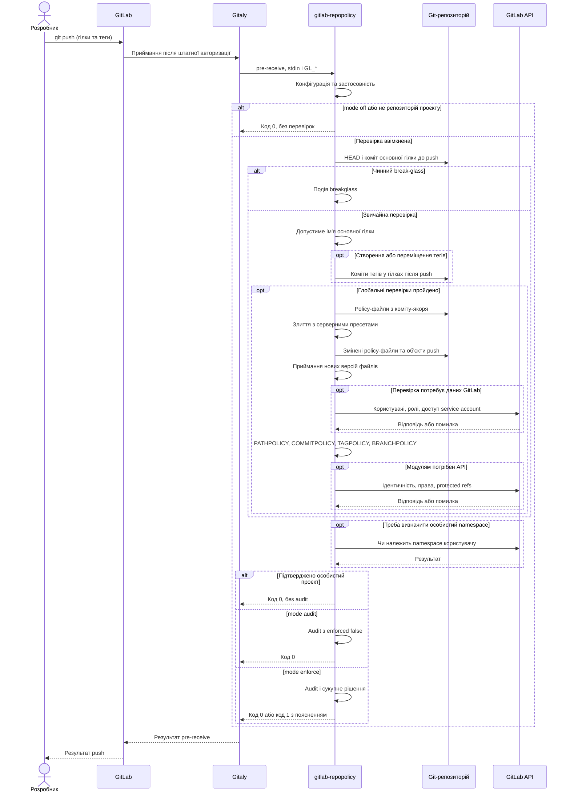

[](architecture.md)
[](architecture.en.md)

# Архітектура

## Огляд

gitlab-repopolicy - Go-бінарник для глобального server hook `pre-receive` у Gitaly. Коли хтось вносить зміни в репозиторій проєкту (push, merge, Web IDE, API), hook перевіряє їх за правилами, які лежать у самому репозиторії. Перевіряються репозиторії проєктів у групах. Не перевіряються:
- wiki, design і snippet-репозиторії
- проєкти в особистому namespace користувача
- увесь інстанс, якщо в конфігурації `mode: off`. За `mode: audit` hook перевіряє все і пише рішення в audit, але push не відхиляє

Файли правил:

| Файл | Що перевіряє |
| --- | --- |
| `PATHPOLICY` | хто може змінювати певні файли: CI-конфігурацію, deploy- та infra-конфігурацію, інші чутливі шляхи |
| `COMMITPOLICY` | формат commit messages у гілках |
| `TAGPOLICY` | хто може випускати релізи: тег під правилом приймається лише з підписом дозволеного ключа OpenPGP або SSH |
| `BRANCHPOLICY` | як називаються нові гілки і які класи гілок мають бути захищені в GitLab |

Hook доповнює штатну авторизацію GitLab перевіркою вмісту змін і користувача, який їх надсилає. Наприклад, право push у feature-гілку не обов'язково означає право змінювати її CI-конфігурацію. Клієнтські перевірки не є джерелом довіри: локальні налаштування не впливають на серверне рішення.

Принципи:
- **жорстка перевірка на сервері**: правило не обійти локальним налаштуванням, іншим клієнтом чи кнопкою merge
- **правила в репозиторії**: policy-файли версіонуються і проходять review, як код
- **GitLab AND gitlab-repopolicy**: hook може лише відмовити, нових прав він не дає
- **різні власники різних правил**: PATHPOLICY делегує інші policy-файли їхнім власникам
- **обчислення за потреби**: незачеплені правила не потребують власної перевірки; глобальні перевірки й визначення namespace можуть мати окремі потреби API
- **без вічного блокування**: втрату всіх admins відновлює явний recovery з audit
- **зрозумілі повідомлення**: з тексту відмови видно, що порушено і як виправити

## Системний контекст

```text
 git push, merge, Web IDE, API
              |
              v
     GitLab Rails / Workhorse ----- /internal/allowed: штатні права GitLab
              |
              v
           Gitaly --- custom_hooks_dir/pre-receive.d/50-gitlab-repopolicy
              |                      |
              |                      v
              |            gitlab-repopolicy hook pre-receive
              |              |            |              |
              |      git (Gitaly)   REST/GraphQL API   audit.log
              |              |      (лише коли треба)
              v              v
       репозиторій і quarantine-об'єкти push
```

Gitaly запускає hook лише після штатної перевірки прав GitLab. Поки hook не відповів, нові об'єкти push лежать у тимчасовому каталозі (quarantine): у репозиторій вони потрапляють, лише якщо push прийнято. Hook отримує зміни гілок і тегів на stdin, ідентичність того, хто вносить зміну, - у змінних `GL_*`, і читає репозиторій тим самим git, що й Gitaly. Назовні він звертається лише до API GitLab і лише тоді, коли рішення залежить від ролі користувача, типу SSH-ключа або того, чи захищена гілка чи тег; API також потрібен для перевірки username й визначення особистого namespace.

## Відповідальність

Входить:
- рішення allow або deny для кожного push за policy-файлами з default branch
- приймання нових версій policy-файлів у будь-якій гілці
- одне агреговане повідомлення на push і audit-подія на кожне рішення
- допоміжні команди: встановлення hook, самоперевірка, ротація токена, звірка налаштувань проєктів, аварійний обхід

Не входить:
- налаштування проєктів (шлях CI-конфігурації, protected branches): hook їх не бачить, `settings-check` лише виявляє зміни. Ім'я default branch hook звіряє з `default_branch` на кожному push
- якість змін: проєкт перевіряє, хто і в якому форматі, а не що
- історія, яка була до появи policy
- проєкти в особистому namespace
- GitLab.com і GitLab Dedicated

## Основні компоненти

```text
cmd/gitlab-repopolicy     main: сигнали, код виходу
internal/cli              підкоманди, складання конфігурації, клієнтів і модулів
internal/config           конфігурація сервера
internal/core             якір, читання policy, приймання, порядок модулів, бюджети, агрегація
internal/module           контракт модуля: Module, Policy, Input, Result
internal/modules          список модулів hook
internal/modules/path     PATHPOLICY
internal/modules/commit   COMMITPOLICY
internal/modules/tag      TAGPOLICY
internal/modules/branch   BRANCHPOLICY
internal/changes          які шляхи й коміти змінює push
internal/gitx             дочірні процеси git в ізольованому оточенні
internal/hookenv          оточення й stdin, які Gitaly передає hook
internal/refs             default, protected чи інша гілка
internal/identity         хто вносить зміну, тип SSH-ключа, тип namespace
internal/gitlab           клієнт REST і GraphQL, бюджет викликів
internal/report           повідомлення користувачу, GL-HOOK-ERR
internal/audit            JSON-події
internal/strictyaml       строгий розбір YAML: без anchors, невідомих ключів і дублікатів
internal/spec, schema     формат policy-файлів, валідатор, злиття з пресетами, JSON Schema
internal/buildinfo        версія і коміт збірки
internal/install, settings, coverage, token, breakglass   допоміжні команди
internal/testmodule       тестовий модуль для перевірок ядра, лише в тестах
```

Ядро не знає, що перевіряє модуль, модуль не знає, як отримано зміни й ідентичність. Модуль оголошує свій файл, режим при невалідній policy (закритися чи пропустити) і потрібні дані; ядро обчислює лише їх. Правила залежностей між пакетами перевіряє лінтер (`depguard`, `forbidigo`) у `make code-lint`.

Новий тип правил - це новий модуль і новий файл; ядро, модель довіри й експлуатація не змінюються. Сам по собі файл модуля не захищений: його захищає лише правило PATHPOLICY, яке охоплює цей файл. Якщо такого правила немає, hook приймає нову версію файлу з попередженням `anyone who can push may change it`.

## Зовнішні залежності

| Залежність | Для чого | Коли |
| --- | --- | --- |
| git, який Gitaly передає в `PATH` hook | читання policy з якоря, шляхів, комітів, об'єктів тегів | на кожен push у проєкт |
| GitLab REST API v4 | роль користувача в проєкті, особистий чи deploy SSH-ключ, protected branches і tags, видимість проєкту для service account | лише коли зачеплено правило, під час приймання policy і bootstrap. TAGPOLICY - лише на створенні тегу під правилом з `protected: true` |
| GitLab GraphQL | чи існують і активні username, додані в policy | приймання нової версії, підрахунок admins, `settings-check` |

API доступний через unix socket Workhorse на тій самій ноді або через HTTPS, якщо Gitaly на окремій ноді. Один запит - до 3 s, на push - до 30 викликів. Кеш є лише всередині запуску; між окремими push відповіді не зберігаються. Зміни прав видно в наступних відповідях API, а не в уже отриманому результаті поточного запуску.

Go-залежності бінарника - `go.yaml.in/yaml/v3`, `github.com/bmatcuk/doublestar/v4`, `github.com/ProtonMail/go-crypto` і `golang.org/x/crypto` (лише підписи тегів). Повний список версій - `go.mod` і SBOM релізу. Збірка статична, `CGO_ENABLED=0`.

## Як відбувається перевірка змін

Коли користувач надсилає зміни до GitLab, Gitaly, служба роботи з Git-репозиторіями, запускає серверний `pre-receive` hook. Цей hook виконується до оновлення гілок і тегів. Застосунок отримує старе й нове значення кожного зміненого посилання, перевіряє політики та повертає рішення, чи можна прийняти зміни.

Один `git push` може містити зміни кількох гілок і тегів. Вони перевіряються в межах одного запуску hook, зі спільними лімітами часу й API та одним набором чинних політик. Відмова хоча б для одного оновлення відхиляє весь push на етапі `pre-receive`.

### Взаємодія компонентів

Діаграма показує порядок ядра. Відмова глобальної перевірки зупиняє наступні етапи. Відмови під час приймання файлів і виконання модулів накопичуються для спільного повідомлення.



Помилки запуску до виклику ядра, наприклад невалідна конфігурація або неможливість запустити git, дають відмову й у `audit`. Діаграма описує саме цей hook: інші hooks або подальше оновлення Git refs також можуть відхилити операцію.

### 1. Визначення застосовності

CLI спершу читає серверну конфігурацію. Для `mode: off` він завершується без перевірок і audit. Для іншого режиму читає оточення Gitaly; wiki, design і snippets пропускаються. Зі stdin ядро бере лише гілки (`refs/heads/...`) і теги (`refs/tags/...`). Ref, або Git-посилання, є загальною назвою для таких імен; гілка й тег мають різні правила перевірки.

Особистий namespace визначається за потреби через API, а не окремим обов'язковим запитом на початку кожного push. Підтверджений особистий проєкт пропускається без повідомлень і audit. Невдала перевірка namespace не означає, що проєкт особистий.

### 2. Фіксація чинної версії політик

Основна гілка проєкту (`default branch`) задається в GitLab і відображається символічним `HEAD` репозиторію. Ядро запам'ятовує її коміт до push. Цей коміт називається **якорем (anchor)**. Усі ввімкнені policy-файли читаються тільки з нього; відсутня основна гілка означає відсутність якоря.

Наприклад, bob надсилає зміну `.gitlab-ci.yml` разом із PATHPOLICY, яка додає bob до `allow`. Поточний push усе одно перевіряється за старою PATHPOLICY. Нові правила почнуть діяти для наступних запусків після потрапляння в основну гілку. Policy у feature-гілці не стає джерелом правил для цієї гілки.

Фіксація якоря узгоджує правила всередині одного запуску. Вона не блокує паралельні push і не гарантує, що інший push не змінить основну гілку до завершення перевірки.

### 3. Аварійний дозвіл break-glass

Після визначення якоря ядро перевіряє тимчасовий дозвіл для ID проєкту. Чинний дозвіл зупиняє звичайну перевірку до глобальних обмежень, приймання файлів і модулів. Hook записує `breakglass` і допускає push; права GitLab залишаються обов'язковими.

Дозвіл створює root на вузлі Gitaly, максимум на 24 години. Hook перевіряє власника, права файлу й каталогу, ID проєкту та строк дії. Відсутній, прострочений або недовірений файл не вмикає обхід. Порядок відновлення наведено в [експлуатаційному керівництві](../user/administration/operations.md#break-glass).

### 4. Глобальне обмеження основної гілки

Якщо серверний `default_branch` непорожній, ім'я основної гілки має входити до цього списку. Інакше ядро формує `default_branch_not_allowed` і не завантажує policy. Це заважає перемкнути default branch на довільну гілку без правил, але діє також у проєктах без policy.

Для порожнього репозиторію без гілок і тегів перевіряється перша створювана гілка: push має містити гілку, на яку вказує `HEAD`. Порожній `default_branch` вимикає ці перевірки. Наявність лише тегів не порушує перевірку першої гілки, але наступна перевірка досяжності тегів усе одно діє.

### 5. Досяжність комітів тегів

Для кожного створеного або переміщеного тегу ядро перевіряє, що він розкривається до коміту й цей коміт лежатиме хоча б в одній гілці після push. Враховуються всі створені, змінені й видалені гілки цього самого push. Це не дозволяє принести неперевірений коміт лише через тег.

Тег не на коміт дає `tag_object_invalid`, коміт поза гілками дає `tag_not_on_branch`. Відмова зупиняє наступні етапи. Видалення тегів не перевіряється цим механізмом. Перевірка діє в групових проєктах навіть без TAGPOLICY або з вимкненим модулем `tagpolicy`.

### 6. Завантаження та приймання policy-файлів

Після глобальних перевірок ядро завантажує файли ввімкнених модулів з якоря. `extends` підключає іменовані набори правил, **пресети**, із серверної конфігурації. Пресети зливаються в заданому порядку, файл проєкту останнім.

Окремо перевіряються нові версії policy-файлів, яких торкнувся push, зокрема у feature-гілках і в досяжних через теги комітах. Перевіряються тип файлу, розмір, схема та специфічні вимоги модуля: користувачі, робочі admins, ключі. Видалення файлу не розбирається як нова версія; право на видалення перевіряють модулі.

Невалідна нова версія дає `invalid_policy_update`, відсутність робочого admin - `lockout_prevented`, непідтверджена потрібна відповідь API - `authorization_backend_failure`. Приймання не робить нові правила чинними для поточного push і не замінює авторизацію за старою PATHPOLICY.

### 7. Відсутні політики й bootstrap

Якщо policy-файлу немає в якорі, відповідні правила не виконуються. Виняток - перша PATHPOLICY, яку push додає в основну гілку. Її має додати розпізнаний користувач із роллю Maintainer або Owner. Це **bootstrap**, початкове встановлення власників політики, коли старого списку `admins` ще немає.

Перша PATHPOLICY також проходить приймання: у ній має бути хоча б один активний admin із роллю Maintainer або вище. Для чернетки у feature-гілці bootstrap не виконується, але перевірка нової версії залишається. Після допущеного bootstrap пишеться `policy_bootstrap`. Без жодної policy глобальні перевірки кроків 4-5 і приймання нових файлів усе одно виконуються.

### 8. Виконання модулів

Порядок задає `modules.Default`: PATHPOLICY, COMMITPOLICY, TAGPOLICY, BRANCHPOLICY. PATHPOLICY перевіряє власних адміністраторів і доступ до файлів інших модулів; далі перевіряються повідомлення комітів, підписи тегів та створення гілок. Відмова одного модуля не дозволяє іншому скасувати її й не зупиняє збір інших порушень.

Модулі запитують тільки потрібні їм дані. PATHPOLICY і COMMITPOLICY перевіряють різні множини змін залежно від гілки та `match`; одна спільна формула для обох була б неточною. Деталі наведено в [правилах зміни шляхів](../user/policies/pathpolicy.md#що-вважається-зміною) і [виборі комітів](../user/policies/commitpolicy.md#які-коміти-перевіряються). TAGPOLICY перевіряє створені й переміщені теги, BRANCHPOLICY - лише створені гілки, крім основної.

PATHPOLICY і перевірка підписів TAGPOLICY за невизначеності відмовляють (**fail-closed**). COMMITPOLICY та BRANCHPOLICY у документованих випадках пропускають перевірку з попередженням (**fail-open**). Збій перевірки `protected` у TAGPOLICY також дає попередження. Це не стосується приймання нових невалідних policy-файлів.

### 9. Сукупне рішення й audit

Результати поєднуються як логічне AND: кожна перевірка, що може блокувати push, має дозволити його. `mode: warn` у COMMITPOLICY чи BRANCHPOLICY перетворює порушення цього модуля на попередження; воно не скасовує відмов інших модулів.

Глобальний `enforce` застосовує відмову й повертає код 1 з одним повідомленням, поділеним на блоки проблем. Якщо є лише попередження, hook повертає 0. Глобальний `audit` записує рішення з `enforced: false`, повертає 0 та не показує звичайних повідомлень політик у push. `off` завершив перевірку ще на вході.

Audit є журналом JSON-подій. Події рішень, помилок і відновлення мають спільний `receive_id`. Push без зачеплених правил і подій не створює звичайного запису `decision`. `policy_change`, `policy_bootstrap` і `policy_recovery` записуються, лише якщо цей hook допускає push, зокрема в `audit`. Оскільки запис відбувається до оновлення refs, це не підтвердження успішного завершення всієї операції GitLab. Помилка запису audit повідомляється користувачу, але рішення не змінює.

## Продуктивність перевірок

Перевірка виконується під час обробки змін у GitLab, тому збільшує час `git push`. Тривалість залежить від кількості файлів і комітів, політик, сервера та потрібних звернень до API.

У вимірюваннях від 28 жовтня 2026 року додаткова затримка повного `git push` без API становила 14-55 мс. Медіани поля `duration_ms` самого hook у цих сценаріях становили 12-46 мс. Це різні метрики: клієнтський час охоплює весь процес GitLab, а `duration_ms` - інтервал виконання перевірки до формування події.

У сценаріях PATHPOLICY з перевіркою доступу через API додаткова затримка push становила 151-223 мс. Для `protected: true` у BRANCHPOLICY і TAGPOLICY вона становила 93-115 мс. Частота API-запитів залежить від правил і змін; власний префікс користувача, інший префікс і SSH-ідентичність можуть давати різні шляхи перевірки.

GitLab і Git-клієнт працювали на одному сервері. На окремих вузлах Gitaly додається мережна затримка до Rails. Методика, обладнання, протоколи та результати паралельного навантаження наведено в [README](../../README.md#продуктивність). Ці числа описують виміряне середовище, а не гарантію часу відповіді.

`make test-load` запускає синтетичні бенчмарки hook на тестових репозиторіях. Вони не вимірюють повний push через GitLab і не замінюють наведених вимірювань.

## Обмеження ресурсів

Ліміти обмежують роботу з недовіреними даними й захищають вузли Gitaly від надмірного навантаження. Значення часу й API нижче є програмними defaults; їх можна змінити в серверній конфігурації. Ліміти форматів policy задає реалізація модулів.

| Ресурс | Ліміт | Наслідок перевищення |
| --- | --- | --- |
| policy-файл | 64 KiB; TAGPOLICY - 256 KiB | файл невалідний; нова версія не приймається |
| path-правила / шаблони одного правила | 100 / 50 | файл невалідний |
| один запуск ядра hook | 10 s | `limit_exceeded`; результат залежить від місця збою й режиму модуля |
| один HTTP-запит | 3 s | непідтверджена відповідь API; модуль застосовує свій режим відмови |
| виклики API на push | 30 | вичерпаний бюджет, `limit_exceeded` |
| коміти, що входять у гілку, PATHPOLICY | 50 000 | перевищення ліміту перевірки, `limit_exceeded` |
| вхідні коміти COMMITPOLICY | 10 000 | `limit_exceeded`: відмова в `enforce`, попередження в `warn` |
| повідомлення користувачу | 8 KiB | обрізається |
| одна audit-подія | 4 KiB | деталі обрізаються, `truncated: true` |

Під час визначення особистого namespace у фінальному формуванні рішення можливий окремий контекст до 3 s. Тому `timeouts.total` не слід описувати як жорстку межу повного клієнтського `git push`.

## Модель розгортання

- бінарник і конфігурація на кожній ноді Gitaly; hook підключається командою `install-hook` у `custom_hooks_dir`
- пакет deb або rpm кладе файли лише у свої каталоги і GitLab не змінює
- окремий процес на кожен push, без daemon і без стану між викликами
- обліковий запис hook - instance service account з роллю Maintainer у кожній top-level групі і токеном `read_api` + `self_rotate`

Підготовку вузлів, service account і wrapper описано у [встановленні](../user/administration/install.md). Після запуску використайте [експлуатаційне керівництво](../user/administration/operations.md) для журналів, ротації й відновлення.

## Безпека

- **Модель довіри.** Policy читається лише з default branch до push. PATHPOLICY захищає сама себе (`admins`) і через path-правила - інші policy-файли
- **Ідентичність.** Principal - той, від чийого імені GitLab прийняв push: людина або бот. Hook визначає його лише з `GL_ID` і `GL_USERNAME`, які задає GitLab. Author, committer і підписи комітів для авторизації не використовуються. Deploy key - не людина. Push options клієнта на рішення не впливають
- **Відмова за невизначеності.** Коли hook не може отримати потрібну відповідь, модуль або відхиляє push (fail closed), або пропускає перевірку з попередженням (fail open). PATHPOLICY і TAGPOLICY стежать за доступом і закриваються: збій API, невалідна policy, внутрішня помилка - відмова на захищеній зміні. Для TAGPOLICY це стосується підпису: перевірка `protected` при збої API дає попередження, бо це гігієна, а не доступ. COMMITPOLICY і BRANCHPOLICY за збою пропускають перевірку з попередженням, бо це гігієна, а не доступ. Зламаний BRANCHPOLICY у default branch пише подію `invalid_branch_policy`, зламаний COMMITPOLICY - `invalid_commit_policy`. Виняток - приймання нової версії COMMITPOLICY з `except.users`: якщо API не відповів, push відхиляється з `authorization_backend_failure`, бо невідомо, чи існують ці користувачі. Збій API ніколи не вмикає recovery
- **Ізоляція git.** Дочірні git запускаються без replace refs і без системної та глобальної конфігурації: `refs/replace/*` не може сховати зміну від перевірки
- **Недовірений вхід.** Policy-файли, stdin, повідомлення комітів і об'єкти тегів розбираються строго і з лімітами; парсери покрито fuzz-тестами
- **Конфіденційність повідомлень.** Користувач бачить правила з policy-файлу (вони й так у репозиторії), але не результати API: ролі, стан облікового запису, деталі помилок. Ці дані - лише в audit
- **Мінімальні права.** Service account може лише читати і ротувати власний токен, прав адміністратора не має

Акторів, обходи і те, що поза моделлю, описано в [threat-model.md](../user/administration/threat-model.md).

## Відомі обмеження

- Hook бачить лише зміни гілок і тегів. Зміни налаштувань проєкту (шлях CI-конфігурації, default branch, protected branches, push через `CI_JOB_TOKEN`) Maintainer робить в обхід; `settings-check` лише виявляє їх за розкладом. Виняток - default branch: якщо задано `default_branch`, push у проєкт з іншою default branch відхиляється одразу
- Merge у звичайну гілку під `match: all` приносить лише вміст, який уже є в репозиторії. PATHPOLICY перевіряє тільки новий вміст, COMMITPOLICY - лише сам merge-коміт (якщо не ввімкнено `except.merge_commit`), але не влиті коміти. Merge у default branch і гілки зі списку `match` перевіряють обидва модулі повністю ([commitpolicy.md](../user/policies/commitpolicy.md#які-коміти-перевіряються))
- Теги не проходять PATHPOLICY і COMMITPOLICY; їхня досяжність перевіряється глобально, а підпис за потреби перевіряє TAGPOLICY. Для нових гілок множина перевірених змін залежить від класу й `match`; наявність коміту в іншій гілці не є універсальним винятком
- Username може звільнитися після rename або видалення користувача і бути зайнятий іншою людиною. `settings-check` повідомляє про principals, яких більше немає
- Токен service account не бачить заблокованого чи забаненого користувача. Особистий проєкт такого користувача обробляється як груповий (fail closed)
- Web-операції (merge кнопкою) тримають Puma-worker, поки hook звертається назад до Rails. Під піковим навантаженням на одній ноді це може дати `authorization_backend_failure` через таймаут
- Helm chart (Kubernetes) не підтримується
