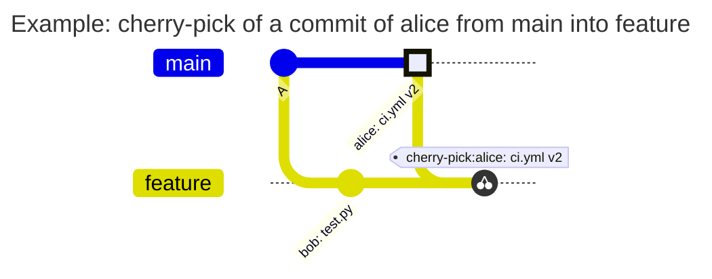

[](match.md)
[](match.en.md)

# The `match` field

`match` says which branches a rule applies to; in TAGPOLICY, which tags. Every rule of all four policy files has the field, and it is required: a rule without `match` is not accepted, there is no implicit "all branches".

```yaml
rules:
  ci-config:
    match: all                        # every branch
  agents:
    match: default                    # only the default branch of the project
  prod-values:
    match: [main, '/^release\//']     # main and the release/... branches
```

This is a fragment of PATHPOLICY, the other fields of the rules are left out.

## Values

| Value | What it means | In which files |
| --- | --- | --- |
| `all` | every branch, in TAGPOLICY every tag | all |
| `default` | the default branch of the project (usually `main`) | PATHPOLICY, COMMITPOLICY |
| a list | the branches or tags that the elements of the list describe | all |

`default` takes the branch that is the default branch in the settings of the project, so the file does not change when `master` is renamed to `main`. In BRANCHPOLICY and TAGPOLICY `default` makes no sense: the default branch already exists, and a tag is not a branch. There it is an error.

## Elements of the list

| Element | What it means | Example |
| --- | --- | --- |
| a name | the exact name of a branch or a tag, without `refs/heads/` and `refs/tags/` | `main`, `v1.0.0` |
| `/regex/` | a regular expression in RE2 syntax (the same as in GitLab CI). Like `=~` in GitLab CI, it looks for a match anywhere in the name: write `^` and `$` yourself | `/^release\//` |
| `/regex/i` | the same, case-insensitive. There are no other flags | `/^wip\//i` |
| `!name`, `!/regex/`, `!/regex/i` | an exception | `!release/legacy` |

A list matches a name when at least one plain element matches and no exception does. A list of exceptions only means "all but": `['!main']` is every branch except `main`.

A name that itself starts with `!` can be written only as a regex: `'/^!draft$/'`.

Put regular expressions in single YAML quotes. Then `\d` and `\/` reach the hook as they are, without YAML escaping.

## Name → matches or not

| `match` | Name | Match | Why |
| --- | --- | --- | --- |
| `[main]` | `main` | yes | the exact name |
| `[main]` | `main-old` | no | an exact name matches only as a whole |
| `['/^v\d+\.\d+\.\d+$/']` | `v1.2.3` | yes | the regex describes the whole name from `^` to `$` |
| `['/^v\d+\.\d+\.\d+$/']` | `v1.2.3-rc1` | no | `-rc1` follows `3`, and `$` requires the end of the name |
| `['/v\d+/']` | `build-v2` | yes | without `^` and `$` the regex looks for a match anywhere in the name |
| `['/^wip\//i']` | `WIP/login` | yes | the flag `i` ignores case |
| `['/^wip\//']` | `WIP/login` | no | without `i` case matters |
| `['/^release\//', '!release/legacy']` | `release/v2` | yes | the regex matched, the exception did not |
| `['/^release\//', '!release/legacy']` | `release/legacy` | no | the exception matched |
| `['!main']` | `feature/login` | yes | a list of exceptions only: all but `main` |
| `['!main']` | `main` | no | the exception matched |
| `['/^!draft$/']` | `!draft` | yes | a name that starts with `!` is given as a regex |

## Moving a regex from `.gitlab-ci.yml`

A regex of `rules:if` goes into `match` unchanged:

```yaml
# .gitlab-ci.yml
deploy-prod:
  rules:
    - if: $CI_COMMIT_TAG =~ /^v\d+\.\d+\.\d+$/
```

```yaml
# TAGPOLICY, a fragment
rules:
  prod:
    match: ['/^v\d+\.\d+\.\d+$/']
```

Both match the same tags: the RE2 syntax is the same, and neither GitLab nor the hook adds `^` and `$` by itself.

One difference. When a regex is invalid, GitLab CI quietly searches for it as a plain substring. The hook does not: an invalid regex is an error of the file, and such a file is not accepted.

## Several rules for one branch

| | PATHPOLICY | COMMITPOLICY | BRANCHPOLICY | TAGPOLICY |
| --- | --- | --- | --- | --- |
| Several rules match | all apply: a change is allowed only when the person is in the `allow` of each | all apply: an error of any of them is a denial | the first by `priority` applies | all apply: only a key in the `signers` of each may sign the tag |
| No rule matches | the file is not protected | commits are not checked | the name is not checked | the tag is not checked |

## `match: all` and a list in PATHPOLICY

In PATHPOLICY `all` and a list that describes the same branches behave differently. The difference is what counts as a change of a protected file.

- A branch of a `match` list (and the default branch and the branches protected in GitLab) is changed by every commit that enters it, no matter who made the commit and whether another branch already holds it
- An ordinary branch under `match: all` is changed only by new content of the file. When bob rebases a branch with a commit of alice, the content of `ci.yml` is the one the branch already had, and that is not a change. Details are in [pathpolicy.en.md](pathpolicy.en.md)

An example. alice may change `ci.yml`, bob may not. The branch `feature` has a commit of alice that changes `ci.yml`, and bob rebases this branch onto a fresh `main`:

| Rule | Push of bob | Result | Why |
| --- | --- | --- | --- |
| `match: all` | rebase of `feature` | allowed | after the rebase `ci.yml` has the content `feature` already had |
| `match: ['/./']` | rebase of `feature` | denied | `feature` is in the list, so every commit that enters it is a change, and bob pushes |

So `all` fits files that people work with in any branch (the CI configuration), and a list fits branches where every commit matters (`main`, release branches).

## Common mistakes

| What is written | Error of `validate` | How to fix |
| --- | --- | --- |
| `match: ['release/*']` | `match: "release/*": a glob is not supported; use a regex such as /^release\//` | globs are not supported, write the regex `'/^release\//'` |
| `match: ['v\d+']` | `match: "v\\d+": not a branch or tag name; did you mean the regex /v\d+/?` | a regex goes between `/`: `'/v\d+/'` |
| `match: ['/v\d+/']` for release tags | no error | a regex without `^` and `$` also catches `build-v2`. Write `'/^v\d+\.\d+\.\d+$/'` |
| `match: [all]` | `match: all is a value of match, not an element of a list; write match: all` | `all` is a value of the field, not an element of a list: `match: all` |
| `match: ['!']` | `match: "!": ! must be followed by a name or a regex` | a name or a regex follows `!` |
| `match: ['!draft']` for a branch named `!draft` | no error | `!draft` is an exception for the branch `draft`. A name with `!` is given by the regex `'/^!draft$/'` |
| `match: []` | `match: the list is empty` | give at least one element or `match: all` |
| `match: ['/v(/']` | ``match: "/v(/": not a valid RE2 regex: error parsing regexp: missing closing ): `v(` `` | fix the regex |
| `match: ['/v/x']` | `match: "/v/x": flag "x" is not supported; the only flag is i` | the only flag is `i` |
| `match: default` in BRANCHPOLICY | `match: default is not allowed here; use all or a list of names` | BRANCHPOLICY and TAGPOLICY have no `default`, name the branch |

Before each error `validate` prints the line and the rule: `line 4: rule r: match: ...`.

## History diagrams

The documents of the modules show scenarios with a history of commits as diagrams. The notation is the same in all documents:
- a highlighted commit (`HIGHLIGHT`) - a change of a protected file by a person who may make it
- a commit with the other mark (`REVERSE`) - the commit the push is denied for
- ordinary commits have no mark
- `tag:` - a tag on a commit, `cherry-pick` - a commit brought over from another branch

In the diagrams and tables alice may change the protected file, bob may not. A rebase and a squash are shown as two diagrams, before and after. A rewritten commit is marked with a prime: `alice: ci.yml v2'`.


