[](pathpolicy.md)
[](pathpolicy.en.md)

# PATHPOLICY

## In short

PATHPOLICY decides who may change certain files of a repository: the CI configuration, deploy scripts, production values. When a person who is not in the rule changes a protected file, GitLab rejects the push. The permissions of GitLab stay as they are: PATHPOLICY only narrows them and never grants new ones.

The file is in the root of the repository under the name `PATHPOLICY` (no extension, case matters), the content is YAML. The smallest working file:

```yaml
version: 1
admins: [alice]
rules:
  ci:
    match: all
    paths: [".gitlab-ci.yml"]
    allow: [alice]
    message: CI belongs to alice.
```

## Quick start

1. Create `PATHPOLICY` in a branch, check it with `gitlab-repopolicy validate` ([validate.en.md](validate.en.md)) and merge it into the default branch. The first PATHPOLICY is added by a Maintainer or an Owner of the project
2. From then on the hook reads the rules from the default branch. Only alice may change `.gitlab-ci.yml`, in any branch. GitLab authorizes the other files as usual
3. `PATHPOLICY` itself is now changed only by `admins`. Protect the other policy files (`COMMITPOLICY`, `TAGPOLICY`, `BRANCHPOLICY`) with a rule of PATHPOLICY, otherwise anyone who can push may change them ([example 6](#6-who-changes-the-other-policy-files))

What bob, who is not in `allow`, sees when they push a branch with a changed `.gitlab-ci.yml` is in [Denials](#denials).

## Field reference

| Field | Required | Value |
| --- | --- | --- |
| `version` | yes | only `1` |
| `extends` | no | the name of a preset of the server config or a list of names ([configuration.en.md](configuration.en.md#presets)) |
| `admins` | yes | 1-5 usernames. Only they change PATHPOLICY itself. Presets have no `admins`, it is always in the file of the project |
| `rules` | no | rules, up to 100: rule name → rule. The name is `[a-z0-9-]{1,63}`, it is shown in denials and in audit |
| `rules.<name>.match` | yes | the branches the rule applies to: `all`, `default` or a list of branches ([match.en.md](match.en.md)) |
| `rules.<name>.paths` | yes | 1-50 path patterns ([below](#path-patterns)) |
| `rules.<name>.allow` | yes | 1-50 usernames of those who may change these paths |
| `rules.<name>.message` | yes | text for the person who is denied, up to 1000 characters |
| `rules.<name>.help` | no | `contact` (up to 200 characters) and `docs_url` (an `http(s)://` address). A denial by the rule prints `who can help with this rule:` and `docs of this rule:` |

"Required" means required after the merge with the presets: in the file a rule may change only some fields of a rule of a preset ([example 7](#7-a-preset-of-the-organization)). Any field of a rule in the file may be `null`, then it is removed from the result of the merge.

Unknown keys, YAML anchors and aliases are an error. The file is up to 64 KiB.

### Path patterns

A path in `paths` is a pattern relative to the root of the repository:
- `*` - any characters within one part of the path, it does not cross `/`
- `**` - any number of directories, including none
- `?` - one character, `[abc]` - one character from the list

| Pattern | Covers | Does not cover |
| --- | --- | --- |
| `Makefile` | `Makefile` | `src/Makefile`, `makefile` |
| `*.tf` | `main.tf` | `infra/main.tf` |
| `ci/**` | `ci/a.yml`, `ci/x/y.yml` | `x/ci/a.yml` |
| `helm/**/values-prod.yaml` | `helm/values-prod.yaml`, `helm/app/values-prod.yaml` | `helm/app/values-stage.yaml` |

- a pattern always starts at the root: `terraform/prod/**` does not cover `x/terraform/prod/a.tf`
- there is no negation (`!`) and no braces `{a,b}`
- matching is case-sensitive, as git sees the path
- no leading `/`, no `\`, `.`, `..` or empty parts, up to 256 bytes and at most four `**`
- a rename is a deletion of the old path and an addition of the new one, both are checked. A change of the file mode, a symlink and a submodule are changes of the path too

**Every rule that matches applies.** When a path is in two rules, the change is allowed only to someone who is in the `allow` of both. A new rule can only narrow the circle of people. GitLab authorizes a path that no rule matches as usual: PATHPOLICY is not an allowlist of the repository.

### Who makes the change

`admins` and `allow` hold only usernames of people or bots. There are no groups or roles on purpose: membership in a group changes outside the review of the policy file, and a person added to a group for another task would get the right silently. Usernames are compared case-insensitively.

| How the push is made | Who makes the change |
| --- | --- |
| HTTPS, Web IDE, merge and other actions in the UI and the API | the user the action runs as |
| SSH with a personal key | the owner of the key |
| SSH deploy key | nobody: a deploy key is not a person, on a protected path the denial is `unknown_principal` |
| project or group access token, service account | the bot, when its username is in the rule |
| the merge button, auto-merge | who pressed merge or turned auto-merge on. The author of the commits does not count |
| a push from CI with `CI_JOB_TOKEN` | the user who started the pipeline |

The author and the committer of a commit and the signatures of commits are not used for the decision, they are easy to fake. Automation that needs a protected path gets a project access token whose bot username is in the rule.

### What counts as a change

| Where | What counts as a change of a protected file |
| --- | --- |
| the default branch, branches protected in GitLab, branches of the `match` list of the rule | every commit that this push brings into the branch, and the difference of the content of the branch before and after the push. It does not matter who made the commit and whether another branch already holds it: the change is made by whoever pushes or merges it into the branch |
| other branches (under `match: all`) | new content of the file. A commit changes the file only when the content after it (together with the file mode) differs from every version of the file in this branch before the push and from the default branch |
| tags | not checked: a tag can point only to a commit that a branch already holds ([tagpolicy.en.md](tagpolicy.en.md#3-a-tag-outside-of-branches)), and that commit was checked with the branch |

This has two consequences, both shown in the examples:
- in `main` a change reverted in the same push is still a change ([example 5](#5-changed-and-reverted-in-one-push))
- in an ordinary branch a rebase, a squash and a cherry-pick of commits of alice are not a change while the content of the file is the same ([example 4](#4-working-together-on-a-branch))

`PATHPOLICY` itself does not fall under the second rule: only `admins` change it, in any branch.

When more than 50 000 commits enter a branch in one push, the hook does not check them and rejects the push with `limit_exceeded`. Such pushes do not happen in practice.

### Where a file takes effect

The right `match` depends on where GitLab reads the file from:

| Files | Where GitLab reads them | `match` |
| --- | --- | --- |
| `.gitlab-ci.yml`, `.gitlab/ci/**`, scripts that CI calls | the pipeline of any branch runs the CI configuration of that branch, with the runners and variables of the project | `all` |
| the agent configuration `.gitlab/agents/**`, `CODEOWNERS`, policy files | only from the default branch | `default` |
| deploy values (`values-prod.yaml`) | from the branches deployments run from | a list of branches, for example `[main, '/^release\//']` |

## Examples

### 1. Only the platform team changes CI

The task: only alice and sre-lead change `.gitlab-ci.yml` and the deploy scripts, in any branch.

```yaml
# examples/ci-config/PATHPOLICY
# The platform team, alice and sre-lead, owns the CI configuration and the
# deploy scripts in every branch and the production values in main and
# release branches. Everything else is authorized by GitLab as usual.
version: 1

admins: [alice, sre-lead]

rules:
  ci-config:
    match: all
    paths:
      - ".gitlab-ci.yml"
      - ".gitlab/ci/**"
      - "scripts/deploy/**"
    allow: [alice, sre-lead]
    message: >-
      The platform team changes the CI/CD configuration and the deploy scripts.
      Ask alice or sre-lead to push this change.
    help:
      contact: "#platform"

  prod-values:
    match: [main, '/^release\//']
    paths: ["helm/**/values-prod.yaml"]
    allow: [alice, release-manager]
    message: >-
      Production values are changed in main and release branches by alice or
      release-manager. Propose the change in your branch and ask them to merge it.
```

| Who | What | Result | Why |
| --- | --- | --- | --- |
| bob | changes `README.md` | allowed | no rule is about the file |
| bob | pushes the branch `feature` with a changed `.gitlab-ci.yml` | denied | `ci-config` applies to every branch, bob is not in `allow` |
| alice | pushes the same branch | allowed | alice is in `allow` |
| bob | tags a commit of this branch | allowed | PATHPOLICY does not check tags, the commit was checked with the branch |

Why `match: all` and not only `main`. The pipeline of a branch runs the CI configuration of that branch. If the rule applied only to `main`, bob would push a branch with a changed `.gitlab-ci.yml`, and its pipeline would run the change with the runners of the project before any review. So bob cannot even push such a branch and asks alice to make the change.

A typical mistake is `match: default` for CI files. The protection then applies only to the default branch, and the pipelines of branches run any CI configuration.

### 2. Agent configuration: `match: default`

The task: only alice changes the configuration of the GitLab agent for Kubernetes (`.gitlab/agents/**`), but anyone may propose a change.

```yaml
# examples/delegation/PATHPOLICY
# PATHPOLICY stays with alice. The other policy files and the GitLab agent
# configuration are delegated to their owners by path rules.
version: 1

admins: [alice]

rules:
  commit-policy:
    match: all
    paths: ["COMMITPOLICY"]
    allow: [dev-lead, alice]
    message: COMMITPOLICY is changed by dev-lead or alice.

  tag-policy:
    match: all
    paths: ["TAGPOLICY"]
    allow: [release-lead, alice]
    message: TAGPOLICY is changed by release-lead or alice.

  kubernetes-agents:
    match: default
    paths: [".gitlab/agents/**"]
    allow: [alice]
    message: >-
      The agent configuration is read only from the default branch.
      Change it in your branch and ask alice to merge it.
```

| Who | What | Result | Why |
| --- | --- | --- | --- |
| bob | changes `.gitlab/agents/prod/config.yaml` in `feature` | allowed | the rule applies only to the default branch |
| bob | merges `feature` into `main` | denied | bob makes the change in `main` |
| alice | merges `feature` into `main` | allowed | alice is in `allow` |

`default` is enough here: GitLab reads the agent configuration only from the default branch, so a change in a branch does nothing until it is merged.

### 3. Production values: anyone proposes, the owner accepts

The task: `values-prod.yaml` is deployed from `main` and release branches. Anyone may propose a change, only alice or release-manager accept it. The file is the rule `prod-values` of [example 1](#1-only-the-platform-team-changes-ci).

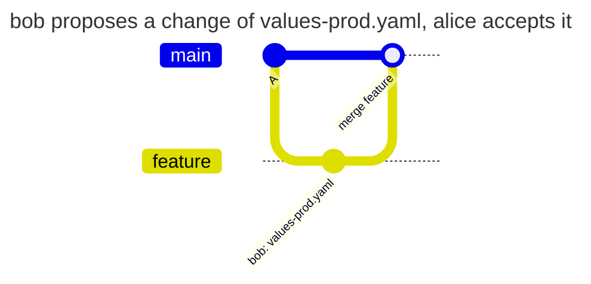

| Who | What | Result | Why |
| --- | --- | --- | --- |
| bob | pushes the change to `feature` | allowed | `feature` is not in the `match` list |
| bob | pushes the same change to `release/1` | denied | `release/1` is in the list |
| bob | merges `feature` into `main` | denied | the commit of bob enters `main`, and bob merges |
| alice | merges `feature` into `main` | allowed | alice makes the change in `main` |

The denial of bob at the merge:

```text
remote: PATHPOLICY rule "prod-values", branch main: you may not change these files
remote:   may change them: alice, release-manager
remote:   files:
remote:     helm/app/values-prod.yaml
remote:   Production values are changed in main and release branches by alice or release-manager. Propose the change in your branch and ask them to merge it.
remote:   ask one of them to make the change, or to merge it from your branch
```

### 4. Working together on a branch

The task: bob and alice work in one branch. alice may change `ci.yml`, bob may not. bob may rewrite the history of their branch (rebase, squash) without asking alice every time.

The rule: in an ordinary branch a commit changes `ci.yml` only when the content of the file after it is new, that is it differs from every version of `ci.yml` in this branch before the push and from the default branch. A rewritten commit of alice brings the content the branch already had, and that is not a change. `PATHPOLICY` itself does not fall under this rule, and in `main`, protected branches and branches of the `match` list the [usual rule](#what-counts-as-a-change) applies.

The file is the one of the [short example](#in-short), with `ci.yml` instead of `.gitlab-ci.yml`.

**A commit of alice in the branch of bob.**

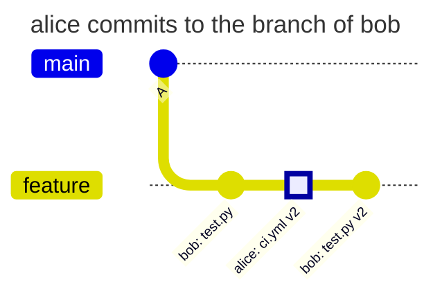

**The branch of alice merged into the branch of bob.**

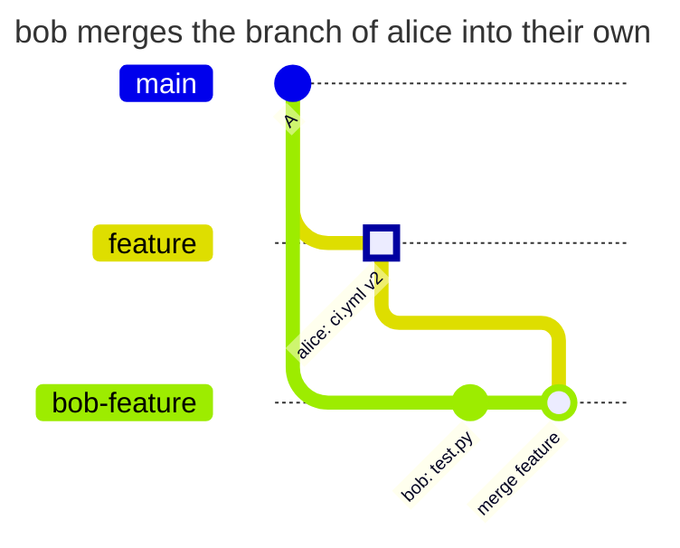

**Rebase.** Before:

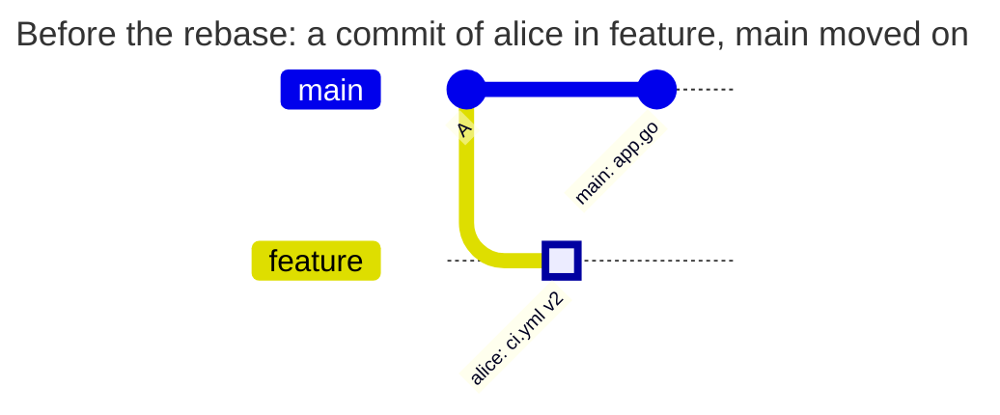

After the rebase by bob:

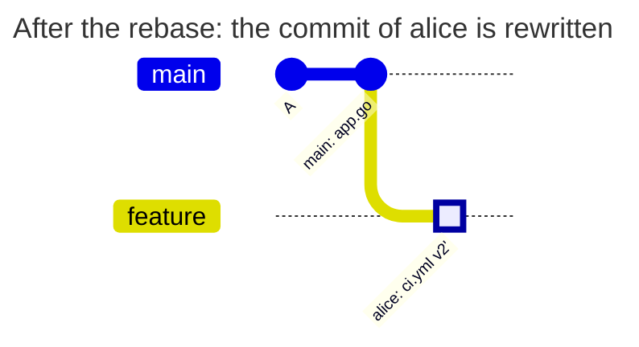

**A squash of the branch.** Before:

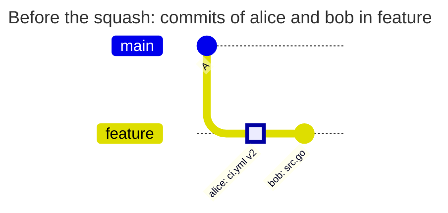

After the squash by bob:

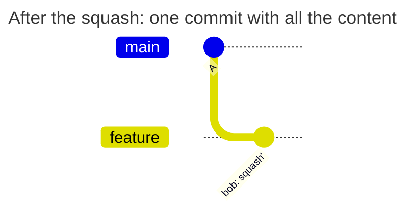

**Cherry-pick from main.**

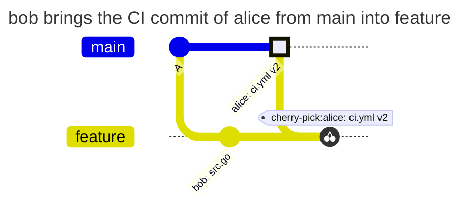

**A merge of main into feature.**

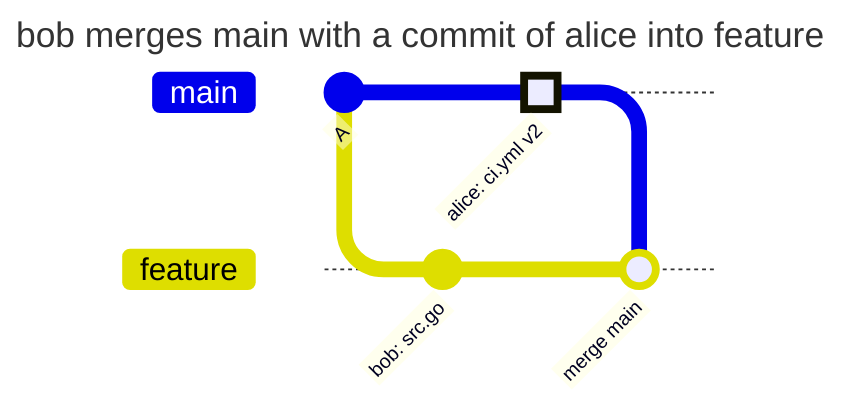

**A merge into main.**

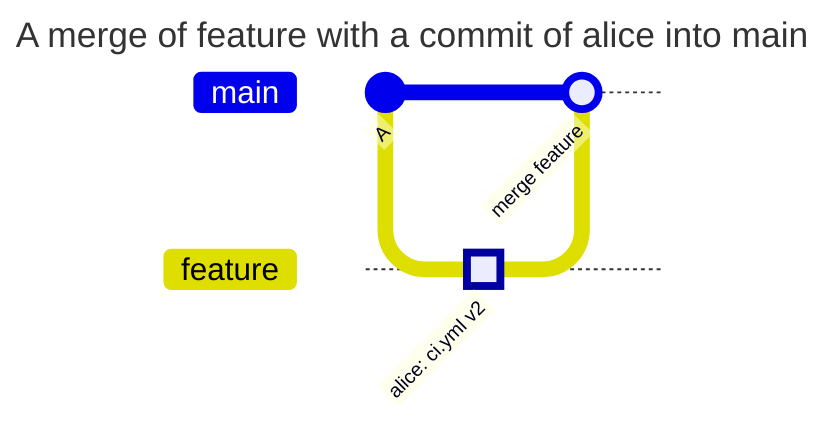

| Scenario | Result | Why |
| --- | --- | --- |
| alice pushes a commit to the branch of bob, then bob pushes their commits | allowed | alice pushes the commit, the commits of bob do not touch `ci.yml` |
| bob merges the branch of alice into their own | allowed | the merge commit takes `ci.yml` from the branch of alice unchanged |
| bob rebases a branch with one commit of alice onto a fresh main | allowed | after the rebase `ci.yml` is the one the branch had |
| bob rebases a branch with two edits of alice in a row (v2, v3) | allowed | both versions were in the branch already |
| bob squashes a branch with a commit of alice | allowed | the content of `ci.yml` in the squash commit was in the branch already |
| bob rewords or amends a commit of alice without changing the content | allowed | the content is the same |
| bob cherry-picks the CI commit of alice from main | allowed | the default branch has the same `ci.yml` |
| bob merges main into feature or rebases feature onto main | allowed | `ci.yml` comes from the default branch |
| bob pushes their own new content of `ci.yml` | denied | neither the branch nor the default branch had this content |
| a rebase with a conflict: main changed `ci.yml` too, the result is merged content | denied | the merged content is new |
| bob pushes the rewritten history to a new branch `feature-2` | denied | a new branch has no history of its own, only the default branch is compared |
| bob changes the mode of `ci.yml` (makes it executable) with the same content | denied | the file mode is part of the content |
| bob brings back v2 of alice from the history of the branch | allowed | v2 was in the branch already |
| bob rewrites a commit with a change of `PATHPOLICY` in a rebase | denied | only `admins` change `PATHPOLICY`, in any branch |
| a merge or a squash merge into main by bob | denied | in `main` the change is made by whoever merges |
| a merge or a squash merge into main by alice | allowed | alice is in `allow` |
| more than 50 000 commits enter the branch | denied with `limit_exceeded` | the hook does not check such a push and does not let it through |

What this means for a merge request:
- a squash at the merge of a merge request: the right is needed by whoever merges, because they make the change in `main`
- a rebase or a squash of the branch itself: passes while the content of the protected file in it is not new

The denial of bob for new content of `ci.yml` in an ordinary branch:

```text
remote: PATHPOLICY rule "ci", branch feature: you may not change these files
remote:   may change them: alice
remote:   files:
remote:     ci.yml
remote:   CI and deploy belong to alice.
remote:   the content of ci.yml in commit 76706632a differs both from this branch and from main; new content is pushed by one of them
```

Why the set of allowed versions does not include other branches and tags. If a version of `ci.yml` from any branch counted as known, bob would create a branch with their content, get somebody with the right to push to make a commit on it, and then bring that content into the shared branch. So only the versions of the branch itself and of the default branch are known.

### 5. Changed and reverted in one push

The task: in `main` a change of `ci.yml` reverted by the next commit of the same push is still a change.

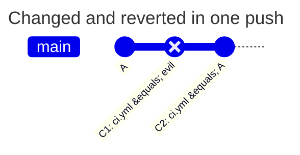

| Scenario | Result | Why |
| --- | --- | --- |
| bob pushes C1 and C2 to main | denied | C1 enters `main`, and the pipeline of C1 would run the changed `ci.yml` |
| the same to a branch of the `match` list of the rule | denied | in such a branch every commit counts too |
| C1 and C2 first in an ordinary branch, then a fast-forward of a branch of the list to C2 | denied | the commits enter the branch of the list, even though another branch holds them |
| a merge into main of a branch with C1 and C2 by bob | denied | the commit C1 enters `main` |
| the same by alice | allowed | alice is in `allow` |
| a revert of the file by a force push | denied | the content of the branch before and after the push differs |

The resulting file did not change, but every commit of the branch is a state that a pipeline, a tag or a deployment can start from. So in `main` every commit is checked, not only the difference between the ends of the push.

### 6. Who changes the other policy files

The task: PATHPOLICY stays with alice, and `COMMITPOLICY` and `TAGPOLICY` are changed by their owners. The file is [example 2](#2-agent-configuration-match-default), the rules `commit-policy` and `tag-policy`.

| Who | What | Result | Why |
| --- | --- | --- | --- |
| dev-lead | changes or deletes `COMMITPOLICY` | allowed | dev-lead is in the `allow` of the rule `commit-policy` |
| bob | changes or deletes `COMMITPOLICY` | denied | bob is not in `allow` |
| dev-lead | adds a rule for themselves to `PATHPOLICY` | denied | only `admins` change `PATHPOLICY` |

Without such a rule anyone who can push may change a policy file. The hook accepts such a version but warns about it.

### 7. A preset of the organization

The task: the platform team keeps the CI rules of all projects in the server config. A project takes them with one line `extends`, lets its own maintainer kpn change CI too and drops the rule for deploy scripts, which the project does not have.

The preset in the server config (a fragment of `examples/presets.yaml`, the key `presets.pathpolicy`):

```yaml
presets:
  pathpolicy:
    org-ci:
      rules:
        ci-config:
          match: all
          paths: [".gitlab-ci.yml", ".gitlab/ci/**"]
          allow: [platform-lead, sre-lead]
          message: The platform team changes the CI/CD configuration.
          help:
            contact: "#platform"
        deploy:
          match: all
          paths: ["scripts/deploy/**"]
          allow: [platform-lead]
          message: The deploy scripts belong to platform-lead.
```

The file of the project:

```yaml
# examples/org-ci/PATHPOLICY
# The CI rules of the organization come from the preset org-ci. This project
# lets its own maintainer kpn change the CI configuration too, and drops the
# rule for deploy scripts, which it does not have.
version: 1
extends: org-ci

admins: [platform-lead]

rules:
  ci-config:
    allow: [platform-lead, sre-lead, kpn]
  deploy: null
```

- `allow` in the file replaces the list of the preset as a whole, so platform-lead and sre-lead are listed again
- `deploy: null` removes the rule of the preset
- the other fields of `ci-config` come from the preset

`validate` shows the result of the merge:

```text
$ gitlab-repopolicy validate --config presets.yaml
PATHPOLICY: valid
  extends: org-ci
  rule ci-config: preset:org-ci, file
    allow: file
    help: preset:org-ci
    help.contact: preset:org-ci
    match: preset:org-ci
    message: preset:org-ci
    paths: preset:org-ci
```

`explain` on a Gitaly node shows the same for a given path and person:

```text
$ gitlab-repopolicy explain --project acme/platform/app --user kpn --path .gitlab-ci.yml --ref feature
acme/platform/app, PATHPOLICY of main; path .gitlab-ci.yml, ref refs/heads/feature, user kpn
  ci-config (match: all; from preset:org-ci, file): allowed; allow: platform-lead, sre-lead, kpn
    fields from: allow file; help preset:org-ci; help.contact preset:org-ci; match preset:org-ci; message preset:org-ci; paths preset:org-ci
result: kpn may change .gitlab-ci.yml on refs/heads/feature (as a person: a deploy key never may)
```

A typical mistake is to write only `[kpn]` in `allow` to "add" kpn. The list is not extended but replaced: after the merge only kpn would change CI.

### 8. Recovery when every admin is gone

The task: every one of `admins` was removed from the project, blocked or demoted to Developer. Somebody has to change PATHPOLICY to name new admins.

An **admin** is a user of `admins` who is active and has the role Maintainer or higher in the project, including one inherited from a group. When the GitLab API confirms that there are none, an Owner of the project (including an Owner of a parent group) may change PATHPOLICY. This is recovery.

| Who changes PATHPOLICY | Working admins by the PATHPOLICY of the default branch | Result |
| --- | --- | --- |
| an admin | any | allowed |
| an Owner of the project, not an admin | at least one | denied with `policy_admin_violation` |
| an Owner of the project, not an admin | none, and the API confirmed it | allowed, recovery |
| an Owner of the project, not an admin | the API did not answer | denied with `authorization_backend_failure` |
| a deploy key | any | denied with `unknown_principal` |
| everybody else | any | denied with `policy_admin_violation` |

A failure of the API never turns recovery on. An instance administrator is not a member of the project and does not get recovery: the way for them is to become an Owner (it shows in the audit of GitLab) or break-glass ([operations.en.md](operations.en.md#break-glass)).

A recovery push changes only PATHPOLICY: protected files in the same push are checked by the old rules. The Owner sees `PATHPOLICY is changed by Owner <username> because it has no working admins. This is logged.` in the output of the push, and the event `policy_recovery` is written to audit. It deserves an alert.

A typical mistake is to wait for recovery while one admin still works but is on vacation. Recovery turns on only without any working admin, so keep two or three in PATHPOLICY.

## The first PATHPOLICY and new versions

**The first PATHPOLICY** in the default branch is added by a user with the role Maintainer or higher. A malicious first file is an inconvenience, not an escalation: PATHPOLICY only narrows permissions, and an Owner can remove the membership of whoever took the file, and recovery turns on.

**A new version of any policy file** is checked by the hook at a push to any branch, not only to `main`. The author sees the error at once, not at the merge. An error is the denial `invalid_policy_update`.

| Check | PATHPOLICY | COMMITPOLICY | TAGPOLICY | BRANCHPOLICY |
| --- | --- | --- | --- | --- |
| a regular file (not a directory, not a symlink, not a submodule), within the size limit | yes | yes | yes | yes |
| `version`, schema, unknown keys, limits, `match`, the merge with presets | yes | yes | yes | yes |
| usernames added in this version exist and are active | yes | `except.users` | no | no |
| signing keys | no | no | yes | no |
| at least one working admin, otherwise `lockout_prevented` | yes | no | no | no |
| the file is not protected by a rule of PATHPOLICY | no | warning | warning | warning |

Usernames that the version of the default branch already had are not checked again. Those that disappear later are found by `settings-check` ([operations.en.md](operations.en.md#settings-check)).

**An invalid PATHPOLICY in the default branch** (it happens only around the hook, through break-glass or `mode: audit`) blocks every change of the content of branches and tags of the project, because the rules are unknown. Deletions of branches and tags, break-glass and an Owner who fixes or deletes only PATHPOLICY go through.

**Deleting a policy file** returns to the state without it. PATHPOLICY is deleted by an admin (by an Owner during recovery), the other files by whoever a rule of PATHPOLICY allows. When PATHPOLICY is deleted and the other files stay, anyone who can push may change them.

## Denials

This is the denial when bob changed `.gitlab-ci.yml` in the branch `feature` ([example 1](#1-only-the-platform-team-changes-ci)):

```text
remote: gitlab-repopolicy: push rejected by the rules of this repository (1 problem)
remote:
remote: PATHPOLICY rule "ci-config", branch feature: you may not change these files
remote:   may change them: alice, sre-lead
remote:   files:
remote:     .gitlab-ci.yml
remote:   The platform team changes the CI/CD configuration and the deploy scripts. Ask alice or sre-lead to push this change.
remote:   the content of .gitlab-ci.yml in commit 11e97b832 differs both from this branch and from main; new content is pushed by one of them
remote:   who can help with this rule: #platform
remote:
remote: rules: PATHPOLICY in main (f50c5a0)
remote: checked as: bob (SSH)
remote: GL-HOOK-ERR: gitlab-repopolicy: you may not change .gitlab-ci.yml (PATHPOLICY rule ci-config; may change: alice, sre-lead)
```

git adds `remote:` to every line from the server.

| Line | What it means |
| --- | --- |
| `push rejected by the rules of this repository (1 problem)` | the push is rejected as a whole, no branch and no tag of it changed |
| `PATHPOLICY rule "ci-config", branch feature: ...` | the policy file, the rule, the branch and what is wrong |
| `may change them:` | who may make this change |
| `files:` | which files of the push this rule protects |
| the English text | the `message` of the rule |
| `the content of ... differs ...` | in an ordinary branch: which commit brought new content. In `main` and branches of a list there is advice whom to ask instead |
| `who can help with this rule:`, `docs of this rule:` | the `help` of the rule |
| `rules: PATHPOLICY in main (f50c5a0)` | the rules come from `main`, the commit `f50c5a0`. This version decides, not the one in your branch |
| `checked as: bob (SSH)` | whom the hook checked and how the push came. If it is not you, the push was made under another name, for example from a CI job started by another user |
| `who can help:` | only in denials you cannot fix yourself: a failure of the GitLab API, a setting of the server, a broken file in `main` |
| `GL-HOOK-ERR: ...` | the summary in one line. A merge request, the Web IDE and the GitLab API show only this line |

What to do next:
- the change is really needed - ask one of `may change them` to make it
- the rule seems wrong - contact the `admins` of PATHPOLICY (`gitlab-repopolicy admins` or the file in `main`)
- a protected file was touched by accident - restore it from `main` (`git restore --source=origin/main -- .gitlab-ci.yml`, then `git commit --amend`) and push again

A change of PATHPOLICY itself by somebody who is not an admin:

```text
remote: PATHPOLICY, branch feature: only PATHPOLICY admins may change PATHPOLICY
remote:   admins: alice, sre-lead
remote:   files:
remote:     PATHPOLICY
remote:   ask one of them to make this change; this applies to every branch, including yours
```

| Code | Title in the output | When |
| --- | --- | --- |
| `protected_path_violation` | you may not change these files | a path of a rule is changed by someone not in `allow` |
| `policy_admin_violation` | only PATHPOLICY admins may change PATHPOLICY | PATHPOLICY is changed by someone who is not an admin |
| `lockout_prevented` | the changed PATHPOLICY would have no working admin | the new version has no working admin |
| `invalid_policy` | PATHPOLICY in main is broken, so no changes are accepted | PATHPOLICY in the default branch is invalid |
| `invalid_policy_update` | the changed PATHPOLICY is invalid | a new version of a policy file failed the checks |
| `authorization_backend_failure` | could not check permissions: the GitLab API did not answer | the GitLab API did not answer, the token expired or the service account does not see the project |
| `unknown_principal` | only a person may change these files | a deploy key on a protected path or in PATHPOLICY |
| `limit_exceeded` | the check did not finish within the server limits | the limit of time, of API calls or more than 50 000 commits |
| `internal_error` | internal error: the push was not checked and is rejected | an internal error, the output has an id to find in audit |

PATHPOLICY guards access. When the hook cannot get the answer it needs (the API did not answer, the file in `main` is broken, an internal error), a push that touches protected files is rejected, not let through. A push that touches no rule does not depend on the API and goes through.

## Common mistakes

| Symptom | Cause | What to do |
| --- | --- | --- |
| bob cannot push even a branch with `.gitlab-ci.yml` | a rule with `match: all` applies to every branch | this is intended for CI. The owner of the file pushes the branch with the change |
| a denial after a rebase of a branch, although `ci.yml` was not touched | the branch is in the `match` list or protected in GitLab, and there every commit counts | for CI files use `match: all`, not a list |
| bob changed the file in a branch, and the hook let it through | the rule with `match: default` or a list does not apply to this branch | this is intended. The change is checked at the merge into `main` |
| a denial for a change that was reverted right away | in `main` every commit counts | remove both commits from the history (`git rebase -i`) |
| a new PATHPOLICY is rejected with `lockout_prevented` | a typo in the name of an admin, or the admin is not a Maintainer | fix the name, check it with `validate --online --project` |
| `checked as:` shows another username | a push from a CI job runs as the user who started the pipeline | give automation a project access token and put the bot in `allow` |
| `allow: [kpn]` in a file with `extends` removed the other people of the preset | a list in the file replaces the list of the preset | list everyone who has the right in the file |

## Checking without a push

| Command | What it does |
| --- | --- |
| `gitlab-repopolicy validate -f PATHPOLICY` | the same checks as at a push, without GitLab. With `--config` also the merge with presets and the origin of the rules |
| `gitlab-repopolicy validate -f PATHPOLICY --online --config FILE --project P` | also that usernames exist and the role of the admins in the project, through the API |
| `gitlab-repopolicy explain --project P --user U --path X [--ref R]` | which rules match the path, where they come from and whether they allow the change |
| `gitlab-repopolicy admins --project P` | admins of the file, working admins and whether recovery is on |
| `gitlab-repopolicy test` | the decision of the hook for a given push without the push ([operations.en.md](operations.en.md#check-a-push-without-pushing)) |

Step by step with output - [validate.en.md](validate.en.md), all flags - [cli.en.md](cli.en.md).

An error of `validate`, with the line of the file:

```text
$ gitlab-repopolicy validate -f PATHPOLICY
PATHPOLICY: invalid
  line 6: rule ci: paths: "/ci/**": patterns are relative to the repository root, remove the leading /
```

## What PATHPOLICY does not protect

The hook sees only changes of branches and tags. The settings of a project (the path of the CI configuration, protected branches, the default branch, job-token push) change in Settings, and the hook does not see them. `settings-check` compares them ([operations.en.md](operations.en.md#settings-check)), the full list of limits is in [threat-model.en.md](threat-model.en.md).

The hook does not check projects in personal namespaces: they do not deploy and do not keep team code, and their changes reach group projects through a merge, which is checked.
