[](pathpolicy.md)
[](pathpolicy.en.md)

# PATHPOLICY

## Коротко

PATHPOLICY визначає, хто може змінювати певні файли репозиторію: CI-конфігурацію, deploy-скрипти, production-значення. Якщо захищений файл змінює людина, якої немає в правилі, GitLab відхиляє push. Права GitLab при цьому нікуди не зникають: PATHPOLICY лише звужує їх і ніколи не дає нових.

Файл лежить у корені репозиторію з ім'ям `PATHPOLICY` (без розширення, регістр важливий), вміст - YAML. Найменший робочий файл:

```yaml
version: 1
admins: [alice]
rules:
  ci:
    match: all
    paths: [".gitlab-ci.yml"]
    allow: [alice]
    message: CI belongs to alice.
```

## Швидкий старт

1. Створіть `PATHPOLICY` у гілці, перевірте його командою `gitlab-repopolicy validate` ([validate.md](validate.md)) і злийте в default branch. Першу PATHPOLICY додає Maintainer або Owner проєкту
2. З цього моменту hook читає правила з default branch. `.gitlab-ci.yml` у будь-якій гілці може змінити лише alice. Інші файли GitLab авторизує як зазвичай
3. Сам `PATHPOLICY` тепер змінюють лише `admins`. Інші файли політик (`COMMITPOLICY`, `TAGPOLICY`, `BRANCHPOLICY`) захистіть правилом PATHPOLICY, інакше їх змінить будь-хто з правом push ([приклад 6](#6-хто-змінює-інші-файли-політик))

Що побачить bob, якого немає в `allow`, коли запушить гілку зі зміненим `.gitlab-ci.yml`, - у розділі [Відмови](#відмови).

## Довідник полів

| Поле | Обов'язкове | Значення |
| --- | --- | --- |
| `version` | так | лише `1` |
| `extends` | ні | ім'я пресета серверного конфігу або список імен ([configuration.md](configuration.md#presets)) |
| `admins` | так | 1-5 username. Лише вони змінюють сам PATHPOLICY. У пресетах `admins` немає, він завжди у файлі проєкту |
| `rules` | ні | правила, до 100: ім'я правила → правило. Ім'я - `[a-z0-9-]{1,63}`, його видно у відмовах і audit |
| `rules.<ім'я>.match` | так | у яких гілках діє правило: `all`, `default` або список гілок ([match.md](match.md)) |
| `rules.<ім'я>.paths` | так | 1-50 шаблонів шляхів ([нижче](#шаблони-шляхів)) |
| `rules.<ім'я>.allow` | так | 1-50 username тих, хто може змінювати ці шляхи |
| `rules.<ім'я>.message` | так | текст для того, кому відмовили, до 1000 символів |
| `rules.<ім'я>.help` | ні | `contact` (до 200 символів) і `docs_url` (адреса `http(s)://`). Відмова за правилом друкує `who can help with this rule:` і `docs of this rule:` |

"Обов'язкове" означає обов'язкове після злиття з пресетами: у файлі правило може лише змінювати окремі поля правила з пресета ([приклад 7](#7-пресет-організації)). Будь-яке поле правила у файлі може бути `null`, тоді воно видаляється з результату злиття.

Невідомі ключі, YAML anchors і aliases - помилка. Розмір файлу - до 64 KiB.

### Шаблони шляхів

Шлях у `paths` - це шаблон відносно кореня репозиторію:
- `*` - будь-які символи в межах однієї частини шляху, `/` не перетинає
- `**` - будь-яка кількість каталогів, зокрема жодного
- `?` - один символ, `[abc]` - один символ зі списку

| Шаблон | Охоплює | Не охоплює |
| --- | --- | --- |
| `Makefile` | `Makefile` | `src/Makefile`, `makefile` |
| `*.tf` | `main.tf` | `infra/main.tf` |
| `ci/**` | `ci/a.yml`, `ci/x/y.yml` | `x/ci/a.yml` |
| `helm/**/values-prod.yaml` | `helm/values-prod.yaml`, `helm/app/values-prod.yaml` | `helm/app/values-stage.yaml` |

- шаблон завжди від кореня: `terraform/prod/**` не охоплює `x/terraform/prod/a.tf`
- заперечення (`!`) і фігурних дужок `{a,b}` немає
- збіг з урахуванням регістру, так, як шлях бачить git
- без початкового `/`, без `\`, `.`, `..` і порожніх частин, до 256 байт і не більше чотирьох `**`
- перейменування - це видалення старого шляху і додавання нового, перевіряються обидва. Зміна режиму файлу, symlink і submodule - теж зміна шляху

**Діють усі правила, що збіглися.** Якщо шлях потрапив у два правила, зміну дозволено лише тому, хто є в `allow` обох. Нове правило може тільки звузити коло людей. Шлях, з яким не збіглося жодне правило, GitLab авторизує як зазвичай: PATHPOLICY - не список дозволених файлів.

### Хто вносить зміну

У `admins` і `allow` пишуть лише username людей або ботів. Груп і ролей немає навмисно: членство в групі змінюється поза review файлу політики, і людина, яку додали в групу заради іншої задачі, мовчки отримала б право. Username порівнюються без урахування регістру.

| Як зроблено push | Хто вносить зміну |
| --- | --- |
| HTTPS, Web IDE, merge та інші дії в UI і API | користувач, від імені якого йде дія |
| SSH особистим ключем | власник ключа |
| SSH deploy key | ніхто: deploy key - не людина, на захищеному шляху відмова `unknown_principal` |
| project або group access token, service account | бот, якщо його username є в правилі |
| кнопка merge, auto-merge | той, хто натиснув merge або ввімкнув auto-merge. Автор комітів не враховується |
| push із CI з `CI_JOB_TOKEN` | користувач, який запустив pipeline |

Автор і committer коміту та підписи комітів для рішення не використовуються, їх легко підробити. Для автоматизації, якій потрібен захищений шлях, підходить project access token, username бота якого вказано в правилі.

### Що вважається зміною

| Де | Що вважається зміною захищеного файлу |
| --- | --- |
| default branch, гілки, захищені в GitLab, гілки зі списку `match` правила | кожен коміт, який потрапляє в гілку цим push, і різниця вмісту гілки до і після push. Байдуже, хто зробив коміт і чи лежить він уже в іншій гілці: зміну в гілку вносить той, хто пушить або мержить |
| інші гілки (під `match: all`) | новий вміст файлу. Коміт змінює файл, лише якщо після нього вміст (разом із режимом файлу) відрізняється від усіх версій файлу в цій гілці до push і від default branch |
| теги | не перевіряються: тег можна поставити лише на коміт, який уже лежить у гілці ([tagpolicy.md](tagpolicy.md#3-тег-поза-гілкою)), а цей коміт перевірено разом із гілкою |

Звідси два наслідки, які розібрано в прикладах:
- у `main` зміна, яку відкотили в тому ж push, усе одно зміна ([приклад 5](#5-змінив-і-відкотив-в-одному-push))
- у звичайній гілці rebase, squash і cherry-pick комітів alice не є зміною, поки вміст файлу той самий ([приклад 4](#4-спільна-робота-над-гілкою))

Сам файл `PATHPOLICY` під друге правило не потрапляє: його змінюють лише `admins` у будь-якій гілці.

Якщо в гілку одним push потрапляє понад 50 000 комітів, hook їх не перевіряє і відхиляє push з `limit_exceeded`. На практиці таких push немає.

### Де файл має ефект

Правильне `match` залежить від того, звідки GitLab читає файл:

| Файли | Де GitLab їх читає | `match` |
| --- | --- | --- |
| `.gitlab-ci.yml`, `.gitlab/ci/**`, скрипти, які викликає CI | pipeline будь-якої гілки виконує CI-конфігурацію саме цієї гілки, з runner'ами і змінними проєкту | `all` |
| конфіг агентів `.gitlab/agents/**`, `CODEOWNERS`, файли політик | лише з default branch | `default` |
| deploy-значення (`values-prod.yaml`) | з гілок, з яких іде деплой | список гілок, наприклад `[main, '/^release\//']` |

## Приклади

### 1. CI змінює лише команда платформи

Задача: `.gitlab-ci.yml` і deploy-скрипти змінюють лише alice і sre-lead, у будь-якій гілці.

```yaml
# examples/ci-config/PATHPOLICY
# The platform team, alice and sre-lead, owns the CI configuration and the
# deploy scripts in every branch and the production values in main and
# release branches. Everything else is authorized by GitLab as usual.
version: 1

admins: [alice, sre-lead]

rules:
  ci-config:
    match: all
    paths:
      - ".gitlab-ci.yml"
      - ".gitlab/ci/**"
      - "scripts/deploy/**"
    allow: [alice, sre-lead]
    message: >-
      The platform team changes the CI/CD configuration and the deploy scripts.
      Ask alice or sre-lead to push this change.
    help:
      contact: "#platform"

  prod-values:
    match: [main, '/^release\//']
    paths: ["helm/**/values-prod.yaml"]
    allow: [alice, release-manager]
    message: >-
      Production values are changed in main and release branches by alice or
      release-manager. Propose the change in your branch and ask them to merge it.
```

| Хто | Що робить | Результат | Чому |
| --- | --- | --- | --- |
| bob | змінює `README.md` | дозволено | жодне правило не стосується файлу |
| bob | пушить гілку `feature` зі зміненим `.gitlab-ci.yml` | відмова | `ci-config` діє в усіх гілках, bob немає в `allow` |
| alice | пушить ту саму гілку | дозволено | alice є в `allow` |
| bob | ставить тег на коміт цієї гілки | дозволено | теги PATHPOLICY не перевіряє, коміт уже перевірено разом із гілкою |

Чому `match: all`, а не лише `main`. Pipeline гілки виконує її власну CI-конфігурацію. Якби правило діяло лише в `main`, bob запушив би гілку зі зміненим `.gitlab-ci.yml`, і її pipeline виконав би цю зміну з runner'ами проєкту ще до review. Тому bob не може навіть запушити таку гілку і просить alice внести зміну.

Типова помилка - `match: default` для CI-файлів. Захист тоді діє лише в default branch, а pipeline гілок виконує будь-яку CI-конфігурацію.

### 2. Конфіг агентів: `match: default`

Задача: конфігурацію GitLab agent for Kubernetes (`.gitlab/agents/**`) змінює лише alice, але запропонувати зміну може будь-хто.

```yaml
# examples/delegation/PATHPOLICY
# PATHPOLICY stays with alice. The other policy files and the GitLab agent
# configuration are delegated to their owners by path rules.
version: 1

admins: [alice]

rules:
  commit-policy:
    match: all
    paths: ["COMMITPOLICY"]
    allow: [dev-lead, alice]
    message: COMMITPOLICY is changed by dev-lead or alice.

  tag-policy:
    match: all
    paths: ["TAGPOLICY"]
    allow: [release-lead, alice]
    message: TAGPOLICY is changed by release-lead or alice.

  kubernetes-agents:
    match: default
    paths: [".gitlab/agents/**"]
    allow: [alice]
    message: >-
      The agent configuration is read only from the default branch.
      Change it in your branch and ask alice to merge it.
```

| Хто | Що робить | Результат | Чому |
| --- | --- | --- | --- |
| bob | змінює `.gitlab/agents/prod/config.yaml` у `feature` | дозволено | правило діє лише в default branch |
| bob | мержить `feature` у `main` | відмова | зміну в `main` вносить bob |
| alice | мержить `feature` у `main` | дозволено | alice є в `allow` |

Тут достатньо `default`: GitLab читає конфіг агентів лише з default branch, тож зміна в гілці нічого не робить, поки її не злили.

### 3. Production-значення: пропонує будь-хто, приймає власник

Задача: `values-prod.yaml` деплоїться з `main` і release-гілок. Зміну може запропонувати будь-хто, прийняти - лише alice або release-manager. Файл - правило `prod-values` з [прикладу 1](#1-ci-змінює-лише-команда-платформи).

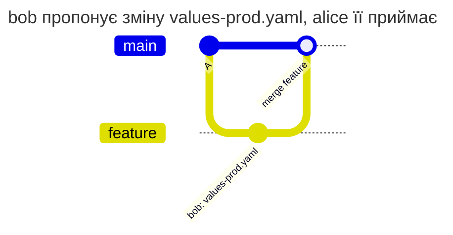

| Хто | Що робить | Результат | Чому |
| --- | --- | --- | --- |
| bob | пушить зміну в `feature` | дозволено | `feature` немає в списку `match` |
| bob | пушить ту саму зміну в `release/1` | відмова | `release/1` є в списку |
| bob | мержить `feature` у `main` | відмова | коміт bob потрапляє в `main`, а мержить bob |
| alice | мержить `feature` у `main` | дозволено | зміну в `main` вносить alice |

Відмова bob'у під час merge:

```text
remote: PATHPOLICY rule "prod-values", branch main: you may not change these files
remote:   may change them: alice, release-manager
remote:   files:
remote:     helm/app/values-prod.yaml
remote:   Production values are changed in main and release branches by alice or release-manager. Propose the change in your branch and ask them to merge it.
remote:   ask one of them to make the change, or to merge it from your branch
```

### 4. Спільна робота над гілкою

Задача: bob і alice працюють в одній гілці. alice може змінювати `ci.yml`, bob - ні. bob має право переписувати історію своєї гілки (rebase, squash), не просячи alice щоразу.

Правило: у звичайній гілці коміт змінює `ci.yml`, лише якщо після нього вміст файлу новий, тобто відрізняється від усіх версій `ci.yml` у цій гілці до push і від default branch. Переписаний коміт alice приносить той самий вміст, що вже був у гілці, і це не зміна. Сам `PATHPOLICY` під це правило не потрапляє, а в `main`, захищених гілках і гілках зі списку `match` діє [звичайне правило](#що-вважається-зміною).

Файл - як у [короткому прикладі](#коротко), з `ci.yml` замість `.gitlab-ci.yml`.

**Коміт alice у гілці bob'а.**

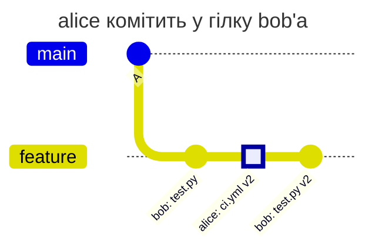

**Гілка alice, влита в гілку bob'а.**

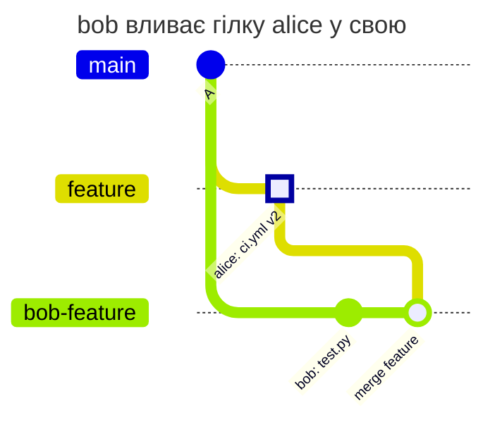

**Rebase.** До:

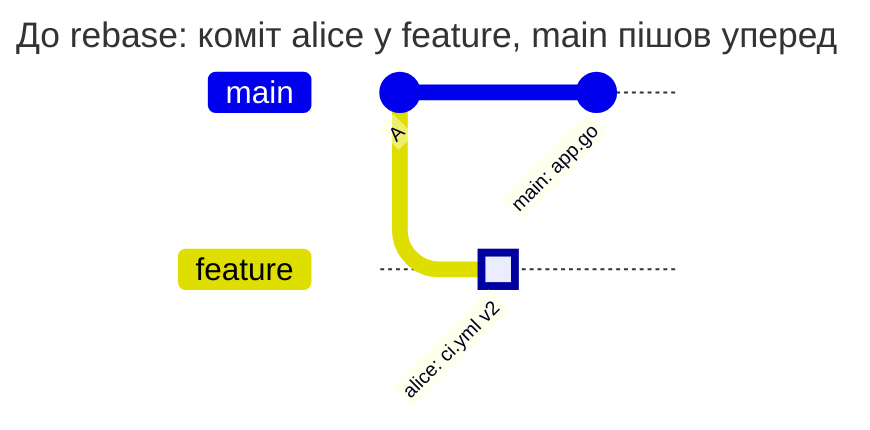

Після rebase, який зробив bob:

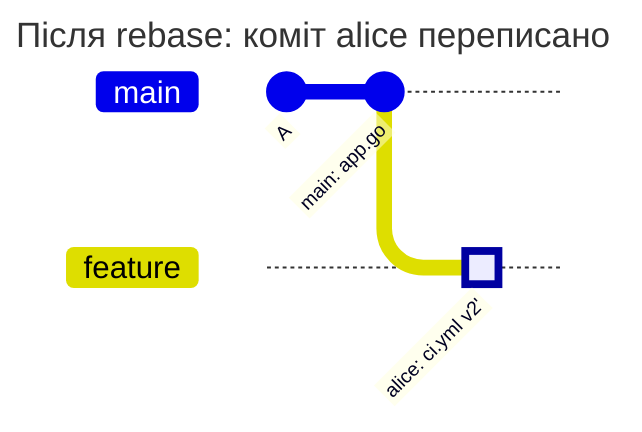

**Squash гілки.** До:

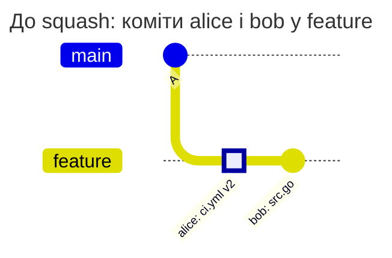

Після squash, який зробив bob:

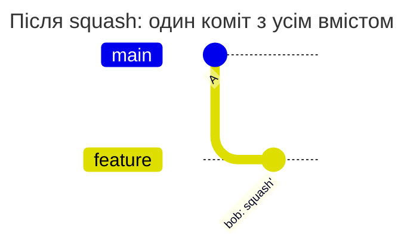

**Cherry-pick з main.**

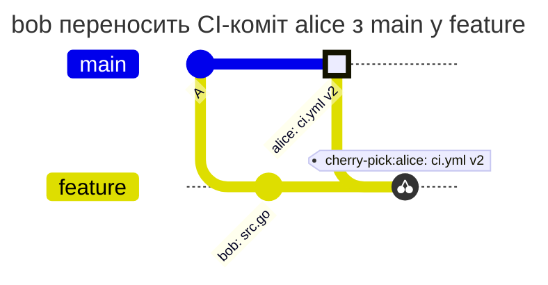

**Merge main у feature.**

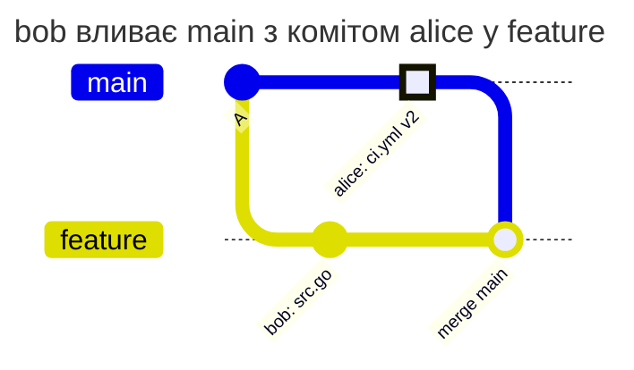

**Merge у main.**

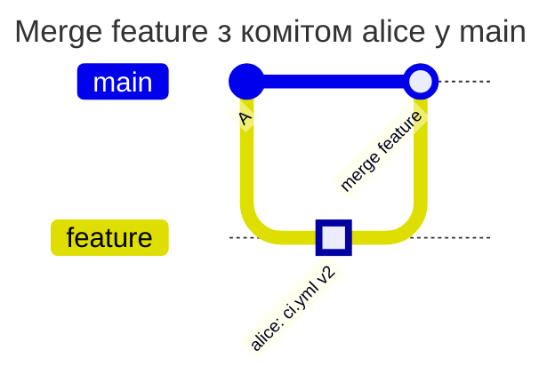

| Сценарій | Результат | Чому |
| --- | --- | --- |
| alice пушить коміт у гілку bob'а, bob далі пушить свої коміти | дозволено | коміт alice пушить alice, коміти bob'а не чіпають `ci.yml` |
| bob вливає гілку alice у свою | дозволено | merge-коміт бере `ci.yml` з гілки alice без змін |
| bob робить rebase гілки з одним комітом alice на свіжий main | дозволено | після rebase `ci.yml` такий самий, як був у гілці |
| bob робить rebase гілки з двома послідовними правками alice (v2, v3) | дозволено | обидві версії вже були в гілці |
| bob робить squash гілки з комітом alice | дозволено | вміст `ci.yml` у squash-коміті вже був у гілці |
| bob робить reword або amend коміту alice без зміни вмісту | дозволено | вміст той самий |
| bob робить cherry-pick CI-коміту alice з main | дозволено | такий самий `ci.yml` є в default branch |
| bob вливає main у feature або робить rebase feature на main | дозволено | `ci.yml` приходить з default branch |
| bob пушить свій новий вміст `ci.yml` | відмова | такого вмісту не було ні в гілці, ні в default branch |
| rebase з конфліктом: main теж змінював `ci.yml`, вийшов злитий вміст | відмова | злитий вміст новий |
| bob пушить переписану історію в нову гілку `feature-2` | відмова | у нової гілки немає своєї історії, порівнюється лише з default branch |
| bob змінює режим `ci.yml` (робить його виконуваним) при тому самому вмісті | відмова | режим файлу теж частина вмісту |
| bob повертає в гілку v2 alice з її ж історії | дозволено | v2 уже була в гілці |
| bob переписує коміт зі зміною `PATHPOLICY` під час rebase | відмова | `PATHPOLICY` змінюють лише `admins` у будь-якій гілці |
| merge або squash-merge у main, мержить bob | відмова | у `main` зміну вносить той, хто мержить |
| merge або squash-merge у main, мержить alice | дозволено | alice є в `allow` |
| у гілку потрапляє понад 50 000 комітів | відмова `limit_exceeded` | hook не перевіряє такий push і не пропускає його |

Підсумок для merge request:
- squash під час merge MR: права потрібні тому, хто мержить, бо зміну в `main` вносить він
- rebase або squash самої гілки: проходить, поки вміст захищеного файлу в ній не новий

Відмова bob'у за новий вміст `ci.yml` у звичайній гілці:

```text
remote: PATHPOLICY rule "ci", branch feature: you may not change these files
remote:   may change them: alice
remote:   files:
remote:     ci.yml
remote:   CI and deploy belong to alice.
remote:   the content of ci.yml in commit 76706632a differs both from this branch and from main; new content is pushed by one of them
```

Чому набір дозволених версій не розширено на інші гілки і теги. Якби версія `ci.yml` з будь-якої гілки вважалася відомою, bob створив би гілку зі своїм вмістом, домовився з кимось із прав push про коміт на неї, і потім переніс би цей вміст у свою гілку. Тому відомими вважаються лише версії з самої гілки і з default branch.

### 5. Змінив і відкотив в одному push

Задача: у `main` зміна `ci.yml`, яку відкотили наступним комітом того ж push, усе одно зміна.

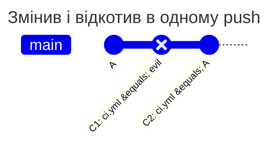

| Сценарій | Результат | Чому |
| --- | --- | --- |
| bob пушить у main C1 і C2 | відмова | C1 потрапляє в `main`, а pipeline коміту C1 виконав би змінений `ci.yml` |
| те саме в гілку зі списку `match` правила | відмова | у такій гілці теж рахується кожен коміт |
| C1 і C2 спочатку в звичайній гілці, потім fast-forward гілки зі списку на C2 | відмова | коміти потрапляють у гілку зі списку, хоч уже й лежать в іншій |
| merge у main гілки з C1 і C2, мержить bob | відмова | коміт C1 потрапляє в `main` |
| те саме, мержить alice | дозволено | alice є в `allow` |
| відкат файлу force push'ем | відмова | вміст гілки до і після push різний |

Підсумковий файл не змінився, але кожен коміт гілки - це стан, з якого можна запустити pipeline, зробити тег або деплой. Тому в `main` перевіряється кожен коміт, а не лише різниця на кінцях push.

### 6. Хто змінює інші файли політик

Задача: PATHPOLICY залишається за alice, а `COMMITPOLICY` і `TAGPOLICY` змінюють їхні власники. Файл - [приклад 2](#2-конфіг-агентів-match-default), правила `commit-policy` і `tag-policy`.

| Хто | Що робить | Результат | Чому |
| --- | --- | --- | --- |
| dev-lead | змінює або видаляє `COMMITPOLICY` | дозволено | dev-lead є в `allow` правила `commit-policy` |
| bob | змінює або видаляє `COMMITPOLICY` | відмова | bob немає в `allow` |
| dev-lead | додає собі правило в `PATHPOLICY` | відмова | `PATHPOLICY` змінюють лише `admins` |

Без такого правила файл політики може змінити будь-хто з правом push. Hook приймає таку версію, але попереджає про це.

### 7. Пресет організації

Задача: команда платформи веде правила CI для всіх проєктів у серверному конфігу. Проєкт бере їх одним рядком `extends`, дозволяє своєму maintainer kpn теж змінювати CI і прибирає правило для deploy-скриптів, яких у проєкті немає.

Пресет у серверному конфігу (уривок `examples/presets.yaml`, ключ `presets.pathpolicy`):

```yaml
presets:
  pathpolicy:
    org-ci:
      rules:
        ci-config:
          match: all
          paths: [".gitlab-ci.yml", ".gitlab/ci/**"]
          allow: [platform-lead, sre-lead]
          message: The platform team changes the CI/CD configuration.
          help:
            contact: "#platform"
        deploy:
          match: all
          paths: ["scripts/deploy/**"]
          allow: [platform-lead]
          message: The deploy scripts belong to platform-lead.
```

Файл проєкту:

```yaml
# examples/org-ci/PATHPOLICY
# The CI rules of the organization come from the preset org-ci. This project
# lets its own maintainer kpn change the CI configuration too, and drops the
# rule for deploy scripts, which it does not have.
version: 1
extends: org-ci

admins: [platform-lead]

rules:
  ci-config:
    allow: [platform-lead, sre-lead, kpn]
  deploy: null
```

- `allow` у файлі замінює список пресета цілком, тому в ньому знову перелічено platform-lead і sre-lead
- `deploy: null` видаляє правило пресета
- решта полів `ci-config` приходить з пресета

Результат злиття показує `validate`:

```text
$ gitlab-repopolicy validate --config presets.yaml
PATHPOLICY: valid
  extends: org-ci
  rule ci-config: preset:org-ci, file
    allow: file
    help: preset:org-ci
    help.contact: preset:org-ci
    match: preset:org-ci
    message: preset:org-ci
    paths: preset:org-ci
```

`explain` на ноді Gitaly показує те саме для конкретного шляху і людини:

```text
$ gitlab-repopolicy explain --project acme/platform/app --user kpn --path .gitlab-ci.yml --ref feature
acme/platform/app, PATHPOLICY of main; path .gitlab-ci.yml, ref refs/heads/feature, user kpn
  ci-config (match: all; from preset:org-ci, file): allowed; allow: platform-lead, sre-lead, kpn
    fields from: allow file; help preset:org-ci; help.contact preset:org-ci; match preset:org-ci; message preset:org-ci; paths preset:org-ci
result: kpn may change .gitlab-ci.yml on refs/heads/feature (as a person: a deploy key never may)
```

Типова помилка - написати в `allow` лише `[kpn]`, щоб "додати" kpn. Список не доповнюється, а замінюється: після злиття CI змінював би лише kpn.

### 8. Recovery, коли всі admins пішли

Задача: усіх `admins` видалили з проєкту, заблокували або понизили до Developer. Хтось має змінити PATHPOLICY, щоб призначити нових.

**Admin** - користувач з `admins`, який активний і має в проєкті роль Maintainer або вище, зокрема успадковану від групи. Коли API GitLab підтвердив, що таких немає, змінити PATHPOLICY може Owner проєкту (зокрема Owner батьківської групи). Це називається recovery.

| Хто змінює PATHPOLICY | Робочі admins за PATHPOLICY з default branch | Результат |
| --- | --- | --- |
| admin | будь-які | дозволено |
| Owner проєкту, не admin | є хоча б один | відмова `policy_admin_violation` |
| Owner проєкту, не admin | жодного, і API це підтвердив | дозволено, recovery |
| Owner проєкту, не admin | API не відповів | відмова `authorization_backend_failure` |
| deploy key | будь-які | відмова `unknown_principal` |
| усі інші | будь-які | відмова `policy_admin_violation` |

Збій API recovery ніколи не вмикає. Instance administrator не є учасником проєкту і recovery не отримує: його шлях - стати Owner'ом (це видно в аудиті GitLab) або break-glass ([operations.md](operations.md#break-glass)).

Recovery-push змінює лише PATHPOLICY: захищені файли в тому ж push перевіряються за старими правилами. Owner бачить у виводі push `PATHPOLICY is changed by Owner <username> because it has no working admins. This is logged.`, а в audit пишеться подія `policy_recovery`. На неї варто поставити алерт.

Типова помилка - чекати recovery, коли один admin ще працює, але у відпустці. Recovery вмикається лише без жодного робочого admin, тож у PATHPOLICY варто тримати двох-трьох.

## Перша PATHPOLICY і нові версії

**Першу PATHPOLICY** в default branch додає користувач з роллю Maintainer або вище. Зловмисний перший файл - незручність, а не ескалація: PATHPOLICY лише звужує права, а Owner може зняти членство того, хто захопив файл, і спрацює recovery.

**Нову версію будь-якого файлу політики** hook перевіряє під час push у будь-яку гілку, не лише в `main`. Автор бачить помилку одразу, а не під час merge. Помилка дає відмову `invalid_policy_update`.

| Перевірка | PATHPOLICY | COMMITPOLICY | TAGPOLICY | BRANCHPOLICY |
| --- | --- | --- | --- | --- |
| звичайний файл (не каталог, не symlink, не submodule), розмір у межах ліміту | так | так | так | так |
| `version`, схема, невідомі ключі, ліміти, `match`, злиття з пресетами | так | так | так | так |
| додані в цій версії username існують і активні | так | `except.users` | ні | ні |
| ключі підпису | ні | ні | так | ні |
| є хоча б один робочий admin, інакше `lockout_prevented` | так | ні | ні | ні |
| файл не захищено правилом PATHPOLICY | ні | попередження | попередження | попередження |

Username, які вже були у версії з default branch, повторно не перевіряються. Тих, хто зник пізніше, знаходить `settings-check` ([operations.md](operations.md#settings-check)).

**Невалідна PATHPOLICY у default branch** (так буває лише в обхід hook, через break-glass або `mode: audit`) блокує будь-яку зміну вмісту гілок і тегів проєкту, бо правила невідомі. Проходять видалення гілок і тегів, break-glass і Owner, який виправляє або видаляє лише PATHPOLICY.

**Видалення файлу політики** - повернення до стану без нього. PATHPOLICY видаляє admin (під час recovery Owner), інші файли - той, кому дозволяє правило PATHPOLICY. Якщо видалити PATHPOLICY і залишити інші файли, їх зможе змінювати будь-хто з правом push.

## Відмови

Так виглядає відмова, коли bob змінив `.gitlab-ci.yml` у гілці `feature` ([приклад 1](#1-ci-змінює-лише-команда-платформи)):

```text
remote: gitlab-repopolicy: push rejected by the rules of this repository (1 problem)
remote:
remote: PATHPOLICY rule "ci-config", branch feature: you may not change these files
remote:   may change them: alice, sre-lead
remote:   files:
remote:     .gitlab-ci.yml
remote:   The platform team changes the CI/CD configuration and the deploy scripts. Ask alice or sre-lead to push this change.
remote:   the content of .gitlab-ci.yml in commit 11e97b832 differs both from this branch and from main; new content is pushed by one of them
remote:   who can help with this rule: #platform
remote:
remote: rules: PATHPOLICY in main (f50c5a0)
remote: checked as: bob (SSH)
remote: GL-HOOK-ERR: gitlab-repopolicy: you may not change .gitlab-ci.yml (PATHPOLICY rule ci-config; may change: alice, sre-lead)
```

`remote:` git додає до кожного рядка від сервера.

| Рядок | Що означає |
| --- | --- |
| `push rejected by the rules of this repository (1 problem)` | push не прийнято цілком, жодна гілка і жоден тег з нього не змінилися |
| `PATHPOLICY rule "ci-config", branch feature: ...` | файл правил, правило, гілка і що не так |
| `may change them:` | хто може внести цю зміну |
| `files:` | які файли з push захищені цим правилом |
| текст англійською | `message` правила |
| `the content of ... differs ...` | у звичайній гілці: який коміт приніс новий вміст. У `main` і гілках зі списку тут порада, кого попросити |
| `who can help with this rule:`, `docs of this rule:` | `help` правила |
| `rules: PATHPOLICY in main (f50c5a0)` | правила взято з `main`, з коміту `f50c5a0`. Вирішує ця версія, а не та, що у вашій гілці |
| `checked as: bob (SSH)` | кого перевіряв hook і як прийшов push. Якщо тут не ви, push зроблено від чужого імені, наприклад з CI job, який запустив інший користувач |
| `who can help:` | є лише у відмовах, які ви не виправите самі: збій API GitLab, налаштування сервера, зламаний файл у `main` |
| `GL-HOOK-ERR: ...` | підсумок одним рядком. Merge request, Web IDE і API GitLab показують лише його |

Що робити далі:
- зміна справді потрібна - попросіть когось із `may change them` внести її
- правило здається хибним - зверніться до `admins` PATHPOLICY (`gitlab-repopolicy admins` або сам файл у `main`)
- зачепили захищений файл випадково - поверніть його з `main` (`git restore --source=origin/main -- .gitlab-ci.yml`, потім `git commit --amend`) і запуште ще раз

Зміну самого PATHPOLICY не admin'ом:

```text
remote: PATHPOLICY, branch feature: only PATHPOLICY admins may change PATHPOLICY
remote:   admins: alice, sre-lead
remote:   files:
remote:     PATHPOLICY
remote:   ask one of them to make this change; this applies to every branch, including yours
```

| Код | Заголовок у виводі | Коли |
| --- | --- | --- |
| `protected_path_violation` | you may not change these files | шлях із правила змінює той, кого немає в `allow` |
| `policy_admin_violation` | only PATHPOLICY admins may change PATHPOLICY | PATHPOLICY змінює не admin |
| `lockout_prevented` | the changed PATHPOLICY would have no working admin | у новій версії немає робочого admin |
| `invalid_policy` | PATHPOLICY in main is broken, so no changes are accepted | PATHPOLICY у default branch невалідна |
| `invalid_policy_update` | the changed PATHPOLICY is invalid | нова версія файлу політики не пройшла перевірку |
| `authorization_backend_failure` | could not check permissions: the GitLab API did not answer | API GitLab не відповів, токен прострочений або service account не бачить проєкт |
| `unknown_principal` | only a person may change these files | deploy key на захищеному шляху або в PATHPOLICY |
| `limit_exceeded` | the check did not finish within the server limits | ліміт часу, викликів API або понад 50 000 комітів |
| `internal_error` | internal error: the push was not checked and is rejected | внутрішня помилка, у виводі id для пошуку в audit |

PATHPOLICY стежить за доступом. Коли hook не може отримати потрібну відповідь (API не відповів, файл у `main` зламаний, внутрішня помилка), push, що зачепив захищені файли, відхиляється, а не пропускається. Push, який не зачепив жодного правила, від API не залежить і проходить.

## Часті помилки

| Симптом | Причина | Що зробити |
| --- | --- | --- |
| bob не може запушити навіть гілку з `.gitlab-ci.yml` | правило з `match: all` діє в усіх гілках | так задумано для CI. Гілку зі зміною пушить власник файлу |
| після rebase гілки відмова, хоча `ci.yml` не чіпали | гілка є в списку `match`, або вона захищена в GitLab, і там рахується кожен коміт | для CI-файлів беріть `match: all`, а не список |
| bob змінив файл у гілці, і hook пропустив | правило з `match: default` або списком діє не в цій гілці | так задумано. Зміна буде перевірена під час merge у `main` |
| відмова за зміну, яку тут же відкотили | у `main` рахується кожен коміт | приберіть обидва коміти з історії (`git rebase -i`) |
| нова PATHPOLICY відхилена з `lockout_prevented` | помилка в імені admin, або admin не Maintainer | виправте ім'я, перевірте командою `validate --online --project` |
| у відмові `checked as:` чужий username | push із CI job від імені того, хто запустив pipeline | дайте автоматизації project access token і впишіть бота в `allow` |
| `allow: [kpn]` у файлі з `extends` прибрав інших людей пресета | список у файлі замінює список пресета | перелічіть у файлі всіх, хто має право |

## Перевірка без push

| Команда | Що робить |
| --- | --- |
| `gitlab-repopolicy validate -f PATHPOLICY` | ті самі перевірки, що й під час push, без GitLab. З `--config` - злиття з пресетами і походження правил |
| `gitlab-repopolicy validate -f PATHPOLICY --online --config FILE --project P` | ще існування username і роль admins у проєкті через API |
| `gitlab-repopolicy explain --project P --user U --path X [--ref R]` | які правила збіглися зі шляхом, звідки вони і чи дозволяють зміну |
| `gitlab-repopolicy admins --project P` | admins із файлу, робочі admins і чи ввімкнено recovery |
| `gitlab-repopolicy test` | рішення hook для конкретного push без самого push ([operations.md](operations.md#перевірити-push-без-push)) |

Покроково з прикладами виводу - [validate.md](validate.md), усі прапорці - [cli.md](cli.md).

Приклад помилки `validate`, з рядком файлу:

```text
$ gitlab-repopolicy validate -f PATHPOLICY
PATHPOLICY: invalid
  line 6: rule ci: paths: "/ci/**": patterns are relative to the repository root, remove the leading /
```

## Чого PATHPOLICY не захищає

Hook бачить лише зміни гілок і тегів. Налаштування проєкту (шлях CI-конфігурації, protected branches, default branch, job-token push) змінюють у Settings, і hook їх не бачить. Їх звіряє `settings-check` ([operations.md](operations.md#settings-check)), повний перелік обмежень - у [threat-model.md](threat-model.md).

Проєкти в особистому namespace hook не перевіряє: вони не деплоять і не зберігають командний код, а зміни з них потрапляють у групові проєкти через merge, який перевіряється.
