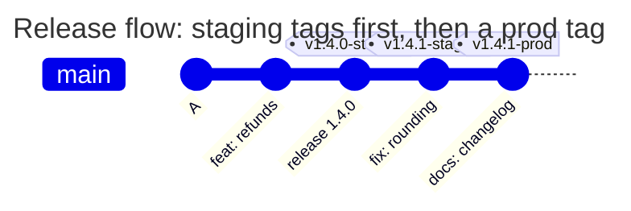
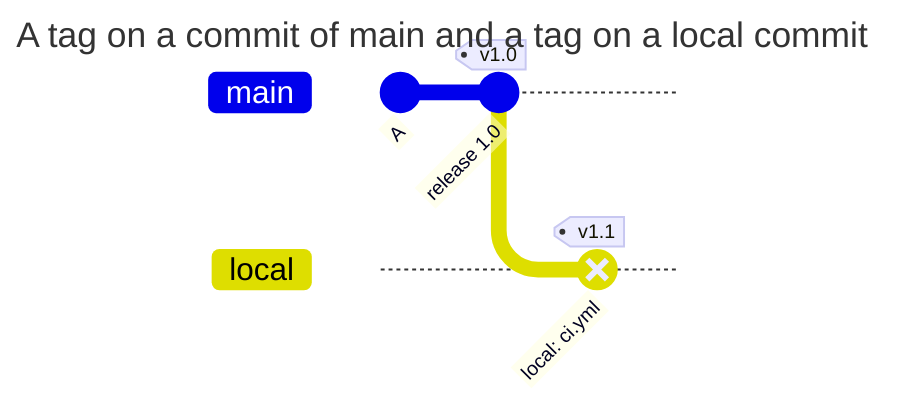

[](tagpolicy.md)
[](tagpolicy.en.md)

# TAGPOLICY

## In short

TAGPOLICY checks who signed a tag. For every kind of tag, for example releases to prod, the file names the keys that may sign such a tag. GitLab does not accept a tag without a signature or with somebody else's signature. The file is in the root of the repository under the name `TAGPOLICY`, the content is YAML. The smallest working file:

```yaml
version: 1
rules:
  prod:
    match: ['/^v\d+\.\d+\.\d+-prod$/']
    signers: [release-lead]
    message: Prod releases are signed by release-lead.
keys:
  release-lead: ssh-ed25519 AAAAC3NzaC1lZDI1NTE5AAAAIOMqqnkVzrm0SdG6UOoqKLsabgH5C9okWi0dh2l9GKJl release-lead
```

Separately from TAGPOLICY, every group project has one rule: a tag may point only to a commit that a branch holds ([example 3](#3-a-tag-outside-of-branches)).

## Quick start

1. Put the public keys of those who release into `keys`, and rules for release tags into `rules`
2. Check the file: `gitlab-repopolicy validate --tag v1.4.0-prod` shows which rules apply and who may sign the tag ([below](#checking-without-a-push))
3. Merge the file into the default branch. From then on a tag under a rule without a signature by an allowed key is rejected
4. Protect TAGPOLICY with a rule of PATHPOLICY ([pathpolicy.en.md](pathpolicy.en.md#6-who-changes-the-other-policy-files)): the history of who may release is the history of this file

## What a tag is

A tag is a permanent name for one commit, for example `v1.4.0-prod`. A branch moves with every new commit, a tag stays where it was put. That is why tags are used for releases: the pipeline of the tag `v1.4.0-prod` deploys to prod exactly the code the tag points to.

| Kind | How to create | What is inside |
| --- | --- | --- |
| lightweight | `git tag v1.4.0-prod` | only a name that points to a commit |
| annotated | `git tag -a v1.4.0-prod -m "Release 1.4.0"` | a separate object with the name, the commit, the author, the date and a text |
| signed | `git tag -s v1.4.0-prod -m "Release 1.4.0"` | an annotated tag plus a signature with an OpenPGP (GPG) or SSH key |

TAGPOLICY accepts only signed tags. How to sign and push:

```sh
# with the GPG key of user.signingkey
git tag -s v1.4.0-prod -m "Release 1.4.0"
git push origin v1.4.0-prod

# with an SSH key
git -c gpg.format=ssh -c user.signingkey=~/.ssh/id_ed25519.pub tag -s v1.4.0-staging -m "Release 1.4.0"
git push origin v1.4.0-staging
```

`git push` without the name of a tag does not send tags, so a tag is pushed separately, by name.

Three similar flags do different things:
- `git tag -s` - a signed tag. TAGPOLICY checks it
- `git commit -s` - a `Signed-off-by` line in the commit message, no cryptography ([commitpolicy.en.md](commitpolicy.en.md#what-a-commit-message-consists-of))
- `git commit -S` - a signature of the commit. TAGPOLICY does not check it

After a denial the tag is not on the server. Delete it locally, create it again with the right signature and push: `git tag -d v1.4.0-prod && git tag -s v1.4.0-prod -m "Release 1.4.0" && git push origin v1.4.0-prod`.

GitLab cannot sign the tags it creates. A tag created with the New tag button or through the Releases API gets the denial `tag_not_signed` under a rule. First create a signed tag with `git tag -s` and `git push`, then the release in GitLab for the existing tag.

## Field reference

| Field | Required | Value |
| --- | --- | --- |
| `version` | yes | `1` |
| `extends` | no | the name of a preset of the server config or a list of names ([configuration.en.md](configuration.en.md#presets)) |
| `rules` | no | rules, up to 50: rule name → rule |
| `rules.<name>.match` | yes | the names of tags ([match.en.md](match.en.md)). There is no `default` here |
| `rules.<name>.signers` | yes | 1-32 labels of keys of `keys` |
| `rules.<name>.protected` | no | `true` - a new tag under this rule must be protected by the project in GitLab (Settings > Repository > Protected tags) |
| `rules.<name>.message` | yes | text for the person who is denied, up to 1000 characters |
| `rules.<name>.help` | no | `contact` and `docs_url`, as in [PATHPOLICY](pathpolicy.en.md#field-reference) |
| `keys` | when there are rules | 1-32 entries `label: key`. Presets have no `keys`, only the file of the project |

"Required" means required after the merge with the presets. Every label of `signers` must be in `keys` of the file, this is checked after the merge too.

A key is exactly one public key per entry, private keys do not go into the file:
- OpenPGP - an armored block `-----BEGIN PGP PUBLIC KEY BLOCK-----`
- SSH - an OpenSSH public key line of the type `ssh-ed25519`, `ecdsa-sha2-nistp256`, `ecdsa-sha2-nistp384`, `ecdsa-sha2-nistp521`, `ssh-rsa`, `sk-ssh-ed25519@openssh.com` or `sk-ecdsa-sha2-nistp256@openssh.com`. No options and no certificates

A label is the name of a key inside the file (`[A-Za-z0-9_.-]`, up to 255 characters), not a GitLab user. The hook does not tie the one who signed to the one who pushes. The username of the owner of the key is a convenient label, audit reads easier then.

The file is up to 256 KiB, because armored keys are large.

### How tags are matched

| Situation | What applies |
| --- | --- |
| the tag matches no rule | the tag is not checked |
| the tag matches one rule | a key of the `signers` of the rule may sign it |
| the tag matches several rules | only a key that is in the `signers` of each of them may sign it ([example 2](#2-a-tag-under-two-rules)) |

A regex of the CI rules (`$CI_COMMIT_TAG =~ /^v\d+\.\d+\.\d+-prod$/`) goes into `match` as it is ([match.en.md](match.en.md#moving-a-regex-from-gitlab-ciyml)). A rule should cover everything the CI of this environment deploys: then a difference gives an extra check, not a deployment of an unchecked tag.

## What is checked

For every tag that a push creates or moves and whose name matches a rule:

1. The tag is annotated. A lightweight tag - denied with `tag_not_signed`
2. The name in the tag object is the name the tag is pushed under. Otherwise a signed staging tag could be pushed under the name of a prod tag. A difference - denied with `tag_object_invalid`
3. The tag points directly to a commit. A tag of another tag - denied with `tag_object_invalid`. A tag of a tree or a blob is rejected earlier, in every group project
4. There is a signature, and it is OpenPGP or SSH. No signature or an X.509 signature - denied with `tag_not_signed`
5. The signing key is in the file, and its label is in the `signers` of every matching rule. For an OpenPGP subkey the primary key counts. Otherwise denied with `tag_signer_not_allowed`
6. The signature is valid. Otherwise denied with `tag_signature_invalid`:
   - OpenPGP: the key is not expired and not revoked at the moment of the push, the signature time is not later than the push plus 5 minutes, the hash is not SHA-1, MD5 or RIPEMD-160
   - SSH: the namespace of the signature is `git`, the hash `sha256` or `sha512`, RSA only `rsa-sha2-256` or `rsa-sha2-512`. A signature with an sk key has the user presence flag
7. `protected: true` - when the tag is created, the hook asks GitLab whether the project protects this tag. No - denied with `tag_not_protected`. When the API does not answer, the tag is accepted with a warning

An SSH signature has no signature time and no key expiry, so an SSH key is valid while it is in the file.

TAGPOLICY does not govern the deletion of tags: who may create, move and delete tags is decided by the protected tags of GitLab.

## Examples

### 1. Staging and prod with different signers

The task: a staging release is made by release-lead or dev-lead, a prod release only by release-lead, and a prod tag must be protected in GitLab. The regexes come from `.gitlab-ci.yml`, where the deploy jobs have `rules: - if: $CI_COMMIT_TAG =~ /^v\d+\.\d+\.\d+-prod$/`.



```yaml
# examples/signed-releases/TAGPOLICY
# Release tags: staging is signed by release-lead or dev-lead, prod only by
# release-lead, and a prod tag must be protected in GitLab. Tags that match no
# rule, such as build-42, are not checked.
version: 1

rules:
  staging:
    match: ['/^v\d+\.\d+\.\d+-staging$/']
    signers: [release-lead, dev-lead]
    message: Staging releases are signed by release-lead or dev-lead.
  prod:
    match: ['/^v\d+\.\d+\.\d+-prod$/']
    signers: [release-lead]
    protected: true
    message: >-
      Prod releases are signed by release-lead.
      Protect v*-prod in Settings > Repository > Protected tags.

keys:
  release-lead: |
    -----BEGIN PGP PUBLIC KEY BLOCK-----
    
    mDMEas8yyBYJKwYBBAHaRw8BAQdARgQtR6FZCckYy8pf9+9snMoIb3gcbH9QVotM
    2CEt2za0H1JlbGVhc2UgTGVhZCA8bGVhZEBleGFtcGxlLmNvbT6IkwQTFgoAOxYh
    BGx5V+qHOlRnp48dB1l3WaOCcpNZBQJqzzLIAhsDBQsJCAcCAiICBhUKCQgLAgQW
    AgMBAh4HAheAAAoJEFl3WaOCcpNZf7IBAO02jJtCe9KhJlLAOTz/XX+kpgyY8mth
    6Cku2bukuF6bAP40EeqZQ1ISoo/Agcdncm5Z+KysHKFd7y49xzE0q6ObDA==
    =3XJY
    -----END PGP PUBLIC KEY BLOCK-----
  dev-lead: ssh-ed25519 AAAAC3NzaC1lZDI1NTE5AAAAIG6MuGxttDci5himWr8891GvUm9MjQljladoClrTOUiE ed25519
```

<!-- check: tag-rules examples/signed-releases/TAGPOLICY -->
| Tag | Rules | Who may sign |
| --- | --- | --- |
| `v1.4.0-staging` | `staging` | release-lead, dev-lead |
| `v1.4.0-prod` | `prod` | release-lead |
| `v1.4.0` | - | not checked |
| `build-42` | - | not checked |

The denial when dev-lead signed a prod tag:

```text
remote: TAGPOLICY rule "prod", tag v1.4.0-prod: this key may not sign these tags
remote:   signed with: key "dev-lead" from TAGPOLICY (SSH, SHA256:pttIxH9SsvfRFuR5nv5vaNqIlF5N15hu0MZMwzg6AyE)
remote:   allowed keys: release-lead (OpenPGP)
remote:   Prod releases are signed by release-lead. Protect v*-prod in Settings > Repository > Protected tags.
remote:   ask the owner of an allowed key to sign the tag, or ask the people who may change TAGPOLICY to add your key
```

### 2. A tag under two rules

The task: every release tag is signed by release-lead or dev-lead. A prod release also falls under the rule prod, signed by release-lead or sec-lead. The tag `v1.4.0-prod` matches both rules, and only a key in both lists may sign it.

```yaml
# examples/release-overlap/TAGPOLICY
# Every release tag is signed by release-lead or dev-lead; a prod release
# also matches the prod rule, signed by release-lead or sec-lead. A tag that
# matches both rules is signed only by a key that both rules list.
version: 1

rules:
  releases:
    match: ['/^v\d+\.\d+\.\d+/']
    signers: [release-lead, dev-lead]
    message: Release tags are signed by release-lead or dev-lead.
  prod:
    match: ['/^v\d+\.\d+\.\d+-prod$/']
    signers: [release-lead, sec-lead]
    message: Prod releases are also signed by release-lead or sec-lead.

keys:
  release-lead: |
    -----BEGIN PGP PUBLIC KEY BLOCK-----
    
    mDMEas8yyBYJKwYBBAHaRw8BAQdARgQtR6FZCckYy8pf9+9snMoIb3gcbH9QVotM
    2CEt2za0H1JlbGVhc2UgTGVhZCA8bGVhZEBleGFtcGxlLmNvbT6IkwQTFgoAOxYh
    BGx5V+qHOlRnp48dB1l3WaOCcpNZBQJqzzLIAhsDBQsJCAcCAiICBhUKCQgLAgQW
    AgMBAh4HAheAAAoJEFl3WaOCcpNZf7IBAO02jJtCe9KhJlLAOTz/XX+kpgyY8mth
    6Cku2bukuF6bAP40EeqZQ1ISoo/Agcdncm5Z+KysHKFd7y49xzE0q6ObDA==
    =3XJY
    -----END PGP PUBLIC KEY BLOCK-----
  dev-lead: ssh-ed25519 AAAAC3NzaC1lZDI1NTE5AAAAIG6MuGxttDci5himWr8891GvUm9MjQljladoClrTOUiE dev-lead
  sec-lead: ssh-ed25519 AAAAC3NzaC1lZDI1NTE5AAAAIOMqqnkVzrm0SdG6UOoqKLsabgH5C9okWi0dh2l9GKJl sec-lead
```

<!-- check: tag-rules examples/release-overlap/TAGPOLICY -->
| Tag | Rules | Who may sign |
| --- | --- | --- |
| `v1.4.0` | `releases` | release-lead, dev-lead |
| `v1.4.0-prod` | `releases`, `prod` | release-lead |
| `build-42` | - | not checked |

Neither dev-lead nor sec-lead may sign `v1.4.0-prod`: each of them is in only one list. A tag has one signature, so several rules for one tag only narrow the circle of signers. When the rules have no common signer, such a tag cannot be created, and `validate --tag` writes `signers: none, the matching rules have no signer in common`.

### 3. A tag outside of branches

The task: a tag is put only on a commit that a branch holds. PATHPOLICY and COMMITPOLICY checked the commit of a branch together with the branch, and a tag on a commit outside of branches would bring unchecked content: the pipeline of the tag would run the `.gitlab-ci.yml` of that commit. This rule applies to every group project, with or without policy files.



`local` is a branch that exists only on the machine of the developer.

| Scenario | Result | Why |
| --- | --- | --- |
| a push of only a tag on a commit already in main | allowed | a branch holds the commit |
| a push of only a tag on a local commit that no branch holds | denied with `tag_not_on_branch` | no branch holds the commit |
| a branch and a tag on its new commit in one push | allowed | after the push a branch holds the commit |
| a deletion of a branch and a tag on its commit in one push | denied | after the push no branch holds the commit |
| a tag on a new commit with a changed `ci.yml`, without a branch | denied with `tag_not_on_branch` | otherwise the change of `ci.yml` would bypass PATHPOLICY |
| a group project without policy files, a tag outside of branches | denied | the rule applies to every group project |
| a project in a personal namespace, a tag outside of branches | allowed | the hook does not check personal projects |

The denial:

```text
remote: gitlab-repopolicy: push rejected by the rules of this repository (1 problem)
remote:
remote: tag v1.0: the tag points to a commit that is in no branch
remote:   commit 5bdd30d35 is in no branch of the project after this push
remote:   push the branch with the commit first, or together with the tag: git push origin <branch> v1.0, or git push --follow-tags
remote:
remote: checked as: bob (SSH)
remote: GL-HOOK-ERR: gitlab-repopolicy: tag v1.0 points to commit 5bdd30d35, which is in no branch; push the branch with it: git push origin <branch> v1.0
```

How to fix:

```sh
git push origin main v1.0        # the branch and the tag in one push
git push --follow-tags origin main   # the branch and the annotated tags on its commits
```

A tag on an old commit that a branch already holds is allowed. A tag that points not to a commit but to a tree or a blob is rejected with `tag_object_invalid` in every group project.

### 4. A preset with labels of signers

The task: the rules of release tags are the same in all projects. They live in a preset of the server config, and the preset names the signers by labels. The keys behind the labels live in the file of the project.

The preset (a fragment of `examples/presets.yaml`, the key `presets.tagpolicy`):

```yaml
presets:
  tagpolicy:
    org-tags:
      rules:
        staging:
          match: ['/^v\d+\.\d+\.\d+-staging$/']
          signers: [release-lead, dev-lead]
          message: Staging releases are signed by release-lead or dev-lead.
        prod:
          match: ['/^v\d+\.\d+\.\d+-prod$/']
          signers: [release-lead]
          protected: true
          message: Prod releases are signed by release-lead. Protect v*-prod in Settings > Repository > Protected tags.
```

```yaml
# examples/org-tags/TAGPOLICY
# The tag rules of the organization come from the preset org-tags: it names
# the signers by label. The keys behind the labels live in this file, so
# replacing or revoking a key is a reviewed change of the project.
version: 1
extends: org-tags

keys:
  release-lead: ssh-ed25519 AAAAC3NzaC1lZDI1NTE5AAAAIOMqqnkVzrm0SdG6UOoqKLsabgH5C9okWi0dh2l9GKJl release-lead
  dev-lead: ssh-ed25519 AAAAC3NzaC1lZDI1NTE5AAAAIG6MuGxttDci5himWr8891GvUm9MjQljladoClrTOUiE dev-lead
```

Why keys are not in the preset. A GitLab administrator changes presets in the server config of every Gitaly node. When a person leaves, their key has to go at once, and in the project where they could release. In the file of the project that is an ordinary change with a review by the owners of the file, effective from the first push after the merge. The history of the file shows who could release in this project and when. So presets of TAGPOLICY hold only rules, and `keys` in a preset is an error.

Every label of the `signers` of the preset must be in `keys` of the file. When the project did not add a key, for example of dev-lead, the file is not accepted: `signers: "dev-lead" is not a label in keys of the file`.

### 5. `validate --tag`

`validate --tag` shows which rules apply to the name of a tag and who may sign it, with the presets:

```text
$ gitlab-repopolicy validate --config presets.yaml --tag v1.4.0-prod
TAGPOLICY: valid
  extends: org-tags
  rule prod: preset:org-tags
    match: preset:org-tags
    message: preset:org-tags
    protected: preset:org-tags
    signers: preset:org-tags
  rule staging: preset:org-tags
    match: preset:org-tags
    message: preset:org-tags
    signers: preset:org-tags
tag v1.4.0-prod: rules prod (from preset:org-tags)
  signers: release-lead (SSH)
  requires: the project protects the tag in Settings > Repository > Protected tags
  the tag must be signed by one of the signers; validate does not check signatures
```

The signature is not checked offline: that needs the tag itself. The decision of the hook for a local tag that exists comes from `gitlab-repopolicy test` ([below](#checking-without-a-push)).

## Acceptance of a new version

Besides the common checks ([pathpolicy.en.md](pathpolicy.en.md#the-first-pathpolicy-and-new-versions)):

| Situation | Result |
| --- | --- |
| a private key in the file | denied with `invalid_policy_update` and a plain statement that the key must be treated as compromised |
| more than one key in an entry, an unknown type of SSH key, an OpenPGP key without the right to sign or revoked | denied with `invalid_policy_update` |
| a label of `signers` is missing from `keys` | denied with `invalid_policy_update` |
| the same key under two labels | denied with `invalid_policy_update` |
| an expired OpenPGP key in an added or changed entry | denied with `invalid_policy_update` |
| an expired OpenPGP key in an unchanged entry | a warning: somebody else's expired key does not block an edit of the file |
| a key that no rule uses | a warning |

Replacing and revoking a key is a change of TAGPOLICY in the default branch. It takes effect from the first push after the merge. Until that merge a compromised key can sign a release.

## Denials

TAGPOLICY protects releases, so it denies on any uncertainty: a doubtful signature, a broken file or preset and an internal error are denials. The exception is `protected`: it checks settings, and a failure of the API is a warning.

| Code | Title in the output | When |
| --- | --- | --- |
| `tag_not_signed` | the tag must be signed | a lightweight tag, a tag without a signature, an X.509 signature, a tag from the UI or the Releases API |
| `tag_object_invalid` | the tag was signed as "v2.0.0-staging" but is pushed as "v2.0.0-prod" | the name in the tag object differs from the name it is pushed under |
| `tag_object_invalid` | the tag points to a tag, not a commit | a tag under a rule points to another tag, not directly to a commit |
| `tag_object_invalid` | the tag does not point to a commit | the tag points to a tree or a blob. Applies without TAGPOLICY too |
| `tag_signer_not_allowed` | this key may not sign these tags | the key is not in the file or its label is not in `signers` |
| `tag_signature_invalid` | the signature cannot be accepted | the key is expired or revoked, a weak hash, a wrong SSH namespace |
| `tag_not_protected` | the tag must be protected, but the project does not protect it | a new tag under a rule with `protected: true`, and the project does not protect it |
| `tag_not_on_branch` | the tag points to a commit that is in no branch | a tag on a commit that no branch holds after the push. Applies without TAGPOLICY too |
| `invalid_policy` | TAGPOLICY in main is broken, so no tag can be created or moved | TAGPOLICY in the default branch is invalid or its preset is gone. Branches are not affected |
| `invalid_policy_update` | the changed TAGPOLICY is invalid | a new version of the file failed the acceptance |

A lightweight tag under a rule:

```text
remote: TAGPOLICY rule "prod", tag v1.4.1-prod: the tag must be signed
remote:   it is a lightweight tag, it has no signature
remote:   allowed signing keys: release-lead (OpenPGP)
remote:   Prod releases are signed by release-lead. Protect v*-prod in Settings > Repository > Protected tags.
remote:   how to fix: git tag -d v1.4.1-prod && git tag -s v1.4.1-prod -m "v1.4.1-prod" && git push origin v1.4.1-prod
```

- `signed with` (in the denial `tag_signer_not_allowed`) - which key of the file signed the tag, its label and fingerprint
- `allowed keys`, `allowed signing keys` - the labels of the keys the rule allows to sign
- `checked as` - who pushed. This is a username in GitLab, it is not tied to the label of a key

The audit event `decision` of the module `tagpolicy` holds the tag, the rules, the label and the fingerprint of the key that signed the tag.

## Common mistakes

| Symptom | Cause | What to do |
| --- | --- | --- |
| `match: "v*": a glob is not supported; use a regex such as /^v/` | a glob instead of a regex | `match: ['/^v\d+\.\d+\.\d+$/']` ([match.en.md](match.en.md#common-mistakes)) |
| the tag `build-v2` fell under the rule of releases | a regex without `^` and `$` looks for a match anywhere | add `^` and `$` |
| `the tag points to a commit that is in no branch` | the tag was pushed without a branch | `git push origin <branch> <tag>` or `git push --follow-tags` |
| a tag from the GitLab UI is rejected | GitLab does not sign tags | `git tag -s` locally, a release for the existing tag |
| `git push --mirror` of an old repository is rejected | old unsigned tags under a rule | add TAGPOLICY after the import or use break-glass ([operations.en.md](operations.en.md#break-glass)) |
| `rule prod: signers: "release-lead" is not a label in keys of the file` | the file has no key under the label, often for a rule of a preset | add a key with this label to `keys` |

## Checking without a push

```sh
gitlab-repopolicy validate -f TAGPOLICY
gitlab-repopolicy validate -f TAGPOLICY --config presets.yaml --tag v1.4.0-prod
gitlab-repopolicy test --repo . --old 0000000000000000000000000000000000000000 \
  --new "$(git rev-parse v1.4.0-prod)" --ref refs/tags/v1.4.0-prod --user release --config release-verify.yaml
```

`validate --tag` - which rules apply and who may sign. `test` makes the same decision as the hook for a local tag, with the check of the signature. `--old` of zeros means the tag is created. `release-verify.yaml` is a copy of [config/release-verify.yaml](../config/release-verify.yaml), it enables only TAGPOLICY and has no access to the API. For a rule with `protected: true` `test` then adds the warning `could not check that the tag is protected`. Step by step - [validate.en.md](validate.en.md), all flags - [cli.en.md](cli.en.md).
