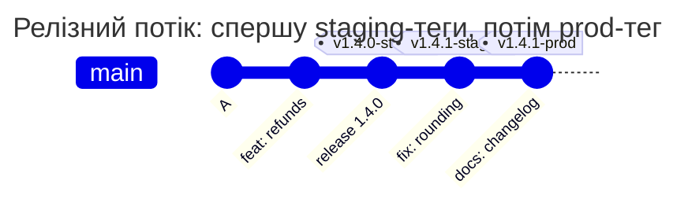
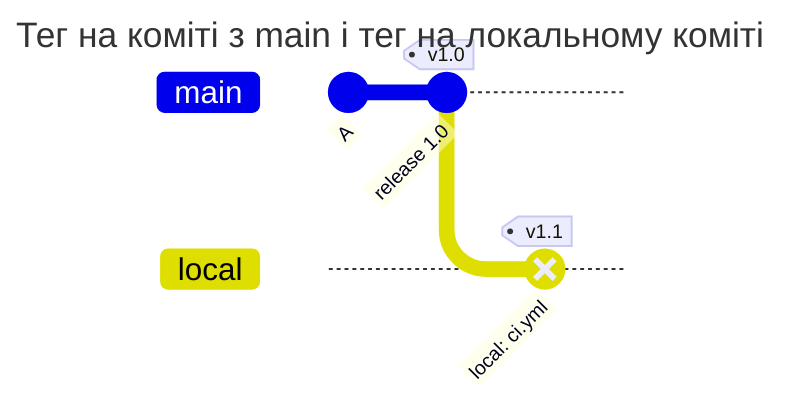

[](tagpolicy.md)
[](tagpolicy.en.md)

# TAGPOLICY

## Коротко

TAGPOLICY перевіряє, хто підписав тег. Для кожного виду тегів, наприклад релізів у prod, файл задає ключі, якими такий тег можна підписати. Тег без підпису або з чужим підписом GitLab не приймає. Файл лежить у корені репозиторію з ім'ям `TAGPOLICY`, вміст - YAML. Найменший робочий файл:

```yaml
version: 1
rules:
  prod:
    match: ['/^v\d+\.\d+\.\d+-prod$/']
    signers: [release-lead]
    message: Prod releases are signed by release-lead.
keys:
  release-lead: ssh-ed25519 AAAAC3NzaC1lZDI1NTE5AAAAIOMqqnkVzrm0SdG6UOoqKLsabgH5C9okWi0dh2l9GKJl release-lead
```

Окремо від TAGPOLICY діє правило для всіх групових проєктів: тег можна поставити лише на коміт, який лежить у гілці ([приклад 3](#3-тег-поза-гілкою)).

## Швидкий старт

1. Додайте публічні ключі тих, хто випускає релізи, у `keys`, а правила для тегів релізів - у `rules`
2. Перевірте файл: `gitlab-repopolicy validate --tag v1.4.0-prod` покаже, які правила спрацюють і хто може підписати тег ([нижче](#перевірка-без-push))
3. Злийте файл у default branch. З цього моменту тег під правилом без підпису дозволеним ключем відхиляється
4. Захистіть TAGPOLICY правилом PATHPOLICY ([pathpolicy.md](pathpolicy.md#6-хто-змінює-інші-файли-політик)): історія того, хто має право на реліз, - це історія цього файлу

## Що таке тег

Тег - постійне ім'я для одного коміту, наприклад `v1.4.0-prod`. Гілка рухається з кожним новим комітом, а тег лишається там, де його поставили. Тому теги використовують для релізів: pipeline тегу `v1.4.0-prod` деплоїть у prod саме той код, на який указує тег.

| Вид | Як створити | Що всередині |
| --- | --- | --- |
| lightweight | `git tag v1.4.0-prod` | лише ім'я, що вказує на коміт |
| annotated | `git tag -a v1.4.0-prod -m "Release 1.4.0"` | окремий об'єкт з ім'ям, комітом, автором, датою і текстом |
| підписаний | `git tag -s v1.4.0-prod -m "Release 1.4.0"` | annotated-тег плюс підпис ключем OpenPGP (GPG) або SSH |

TAGPOLICY приймає лише підписані теги. Як підписати і запушити:

```sh
# ключем GPG з user.signingkey
git tag -s v1.4.0-prod -m "Release 1.4.0"
git push origin v1.4.0-prod

# ключем SSH
git -c gpg.format=ssh -c user.signingkey=~/.ssh/id_ed25519.pub tag -s v1.4.0-staging -m "Release 1.4.0"
git push origin v1.4.0-staging
```

`git push` без імені тегу теги не відправляє, тому тег пушать окремо, за ім'ям.

Три схожі прапорці роблять різне:
- `git tag -s` - підписаний тег. Його перевіряє TAGPOLICY
- `git commit -s` - рядок `Signed-off-by` у повідомленні коміту, без криптографії ([commitpolicy.md](commitpolicy.md#з-чого-складається-повідомлення-коміту))
- `git commit -S` - підпис коміту. TAGPOLICY його не перевіряє

Після відмови тега на сервері немає. Видаліть його локально, створіть заново з правильним підписом і запуште: `git tag -d v1.4.0-prod && git tag -s v1.4.0-prod -m "Release 1.4.0" && git push origin v1.4.0-prod`.

GitLab не вміє підписувати теги, які створює сам. Тег, створений кнопкою New tag або через Releases API, під правилом отримує відмову `tag_not_signed`. Спершу створіть підписаний тег через `git tag -s` і `git push`, а потім реліз у GitLab для вже наявного тегу.

## Довідник полів

| Поле | Обов'язкове | Значення |
| --- | --- | --- |
| `version` | так | `1` |
| `extends` | ні | ім'я пресета серверного конфігу або список імен ([configuration.md](configuration.md#presets)) |
| `rules` | ні | правила, до 50: ім'я правила → правило |
| `rules.<ім'я>.match` | так | імена тегів ([match.md](match.md)). `default` тут немає |
| `rules.<ім'я>.signers` | так | 1-32 мітки ключів із `keys` |
| `rules.<ім'я>.protected` | ні | `true` - новий тег під цим правилом проєкт має захищати в GitLab (Settings > Repository > Protected tags) |
| `rules.<ім'я>.message` | так | текст для того, кому відмовили, до 1000 символів |
| `rules.<ім'я>.help` | ні | `contact` і `docs_url`, як у [PATHPOLICY](pathpolicy.md#довідник-полів) |
| `keys` | якщо є правила | 1-32 записи `мітка: ключ`. У пресетах `keys` немає, лише у файлі проєкту |

"Обов'язкове" означає обов'язкове після злиття з пресетами. Кожна мітка з `signers` має бути в `keys` файлу, це теж перевіряється після злиття.

Ключ - рівно один публічний ключ на запис, приватні ключі у файл не кладуть:
- OpenPGP - armored-блок `-----BEGIN PGP PUBLIC KEY BLOCK-----`
- SSH - рядок публічного ключа OpenSSH типу `ssh-ed25519`, `ecdsa-sha2-nistp256`, `ecdsa-sha2-nistp384`, `ecdsa-sha2-nistp521`, `ssh-rsa`, `sk-ssh-ed25519@openssh.com` або `sk-ecdsa-sha2-nistp256@openssh.com`. Без options і сертифікатів

Мітка - ім'я ключа всередині файлу (`[A-Za-z0-9_.-]`, до 255 символів), а не користувач GitLab. Hook не пов'язує того, хто підписав, з тим, хто робить push. Зручно брати username власника ключа, так легше читати audit.

Розмір файлу - до 256 KiB, бо armored-ключі великі.

### Як зіставляються теги

| Ситуація | Що діє |
| --- | --- |
| тег не збігся з жодним правилом | тег не перевіряється |
| тег збігся з одним правилом | підписати може ключ із `signers` правила |
| тег збігся з кількома правилами | підписати може лише ключ, який є в `signers` кожного з них ([приклад 2](#2-тег-під-двома-правилами)) |

Регулярний вираз з правил CI (`$CI_COMMIT_TAG =~ /^v\d+\.\d+\.\d+-prod$/`) переноситься в `match` як є ([match.md](match.md#перенесення-з-gitlab-ciyml)). Правило має покривати все, що деплоїть CI цього оточення: тоді розбіжність дає зайву перевірку, а не деплой неперевіреного тегу.

## Що перевіряється

Для кожного тегу, який push створює або переміщує і ім'я якого збіглося з правилом:

1. Тег annotated. Lightweight-тег - відмова `tag_not_signed`
2. Ім'я в об'єкті тегу збігається з ім'ям, під яким його пушать. Інакше підписаний staging-тег можна було б запушити під ім'ям prod-тегу. Розбіжність - відмова `tag_object_invalid`
3. Тег указує безпосередньо на коміт. Тег на інший тег - відмова `tag_object_invalid`. Тег на дерево чи blob відхиляється ще раніше, для всіх групових проєктів
4. Підпис є і він OpenPGP або SSH. Немає підпису або підпис X.509 - відмова `tag_not_signed`
5. Ключ підпису є у файлі, і його мітка є в `signers` кожного правила, що збіглося. Для підключа OpenPGP враховується основний ключ. Інакше відмова `tag_signer_not_allowed`
6. Підпис дійсний. Інакше відмова `tag_signature_invalid`:
   - OpenPGP: ключ не прострочений і не відкликаний на момент push, час підпису не пізніше за момент push плюс 5 хвилин, хеш не SHA-1, не MD5 і не RIPEMD-160
   - SSH: namespace підпису `git`, хеш `sha256` або `sha512`, RSA лише `rsa-sha2-256` або `rsa-sha2-512`. Підпис sk-ключем має прапорець присутності користувача
7. `protected: true` - під час створення тегу hook питає GitLab, чи захищає проєкт цей тег. Ні - відмова `tag_not_protected`. Якщо API не відповів, тег приймається з попередженням

У SSH-підписі немає часу підпису і строку дії ключа, тому SSH-ключ діє, поки лежить у файлі.

Видалення тегу TAGPOLICY не регулює: хто може створювати, переміщувати й видаляти теги, вирішують protected tags GitLab.

## Приклади

### 1. Staging і prod з різними підписантами

Задача: staging-реліз випускає release-lead або dev-lead, prod - лише release-lead, і prod-тег має бути захищеним у GitLab. Регулярні вирази взято з `.gitlab-ci.yml`, де jobs деплою мають `rules: - if: $CI_COMMIT_TAG =~ /^v\d+\.\d+\.\d+-prod$/`.



```yaml
# examples/signed-releases/TAGPOLICY
# Release tags: staging is signed by release-lead or dev-lead, prod only by
# release-lead, and a prod tag must be protected in GitLab. Tags that match no
# rule, such as build-42, are not checked.
version: 1

rules:
  staging:
    match: ['/^v\d+\.\d+\.\d+-staging$/']
    signers: [release-lead, dev-lead]
    message: Staging releases are signed by release-lead or dev-lead.
  prod:
    match: ['/^v\d+\.\d+\.\d+-prod$/']
    signers: [release-lead]
    protected: true
    message: >-
      Prod releases are signed by release-lead.
      Protect v*-prod in Settings > Repository > Protected tags.

keys:
  release-lead: |
    -----BEGIN PGP PUBLIC KEY BLOCK-----
    
    mDMEas8yyBYJKwYBBAHaRw8BAQdARgQtR6FZCckYy8pf9+9snMoIb3gcbH9QVotM
    2CEt2za0H1JlbGVhc2UgTGVhZCA8bGVhZEBleGFtcGxlLmNvbT6IkwQTFgoAOxYh
    BGx5V+qHOlRnp48dB1l3WaOCcpNZBQJqzzLIAhsDBQsJCAcCAiICBhUKCQgLAgQW
    AgMBAh4HAheAAAoJEFl3WaOCcpNZf7IBAO02jJtCe9KhJlLAOTz/XX+kpgyY8mth
    6Cku2bukuF6bAP40EeqZQ1ISoo/Agcdncm5Z+KysHKFd7y49xzE0q6ObDA==
    =3XJY
    -----END PGP PUBLIC KEY BLOCK-----
  dev-lead: ssh-ed25519 AAAAC3NzaC1lZDI1NTE5AAAAIG6MuGxttDci5himWr8891GvUm9MjQljladoClrTOUiE ed25519
```

<!-- check: tag-rules examples/signed-releases/TAGPOLICY -->
| Тег | Правила | Хто може підписати |
| --- | --- | --- |
| `v1.4.0-staging` | `staging` | release-lead, dev-lead |
| `v1.4.0-prod` | `prod` | release-lead |
| `v1.4.0` | - | не перевіряється |
| `build-42` | - | не перевіряється |

Відмова, коли dev-lead підписав prod-тег:

```text
remote: TAGPOLICY rule "prod", tag v1.4.0-prod: this key may not sign these tags
remote:   signed with: key "dev-lead" from TAGPOLICY (SSH, SHA256:pttIxH9SsvfRFuR5nv5vaNqIlF5N15hu0MZMwzg6AyE)
remote:   allowed keys: release-lead (OpenPGP)
remote:   Prod releases are signed by release-lead. Protect v*-prod in Settings > Repository > Protected tags.
remote:   ask the owner of an allowed key to sign the tag, or ask the people who may change TAGPOLICY to add your key
```

### 2. Тег під двома правилами

Задача: кожен релізний тег підписує release-lead або dev-lead. Prod-реліз має ще й правило prod, де підписують release-lead або sec-lead. Тег `v1.4.0-prod` збігається з обома правилами, і підписати його може лише ключ, який є в обох списках.

```yaml
# examples/release-overlap/TAGPOLICY
# Every release tag is signed by release-lead or dev-lead; a prod release
# also matches the prod rule, signed by release-lead or sec-lead. A tag that
# matches both rules is signed only by a key that both rules list.
version: 1

rules:
  releases:
    match: ['/^v\d+\.\d+\.\d+/']
    signers: [release-lead, dev-lead]
    message: Release tags are signed by release-lead or dev-lead.
  prod:
    match: ['/^v\d+\.\d+\.\d+-prod$/']
    signers: [release-lead, sec-lead]
    message: Prod releases are also signed by release-lead or sec-lead.

keys:
  release-lead: |
    -----BEGIN PGP PUBLIC KEY BLOCK-----
    
    mDMEas8yyBYJKwYBBAHaRw8BAQdARgQtR6FZCckYy8pf9+9snMoIb3gcbH9QVotM
    2CEt2za0H1JlbGVhc2UgTGVhZCA8bGVhZEBleGFtcGxlLmNvbT6IkwQTFgoAOxYh
    BGx5V+qHOlRnp48dB1l3WaOCcpNZBQJqzzLIAhsDBQsJCAcCAiICBhUKCQgLAgQW
    AgMBAh4HAheAAAoJEFl3WaOCcpNZf7IBAO02jJtCe9KhJlLAOTz/XX+kpgyY8mth
    6Cku2bukuF6bAP40EeqZQ1ISoo/Agcdncm5Z+KysHKFd7y49xzE0q6ObDA==
    =3XJY
    -----END PGP PUBLIC KEY BLOCK-----
  dev-lead: ssh-ed25519 AAAAC3NzaC1lZDI1NTE5AAAAIG6MuGxttDci5himWr8891GvUm9MjQljladoClrTOUiE dev-lead
  sec-lead: ssh-ed25519 AAAAC3NzaC1lZDI1NTE5AAAAIOMqqnkVzrm0SdG6UOoqKLsabgH5C9okWi0dh2l9GKJl sec-lead
```

<!-- check: tag-rules examples/release-overlap/TAGPOLICY -->
| Тег | Правила | Хто може підписати |
| --- | --- | --- |
| `v1.4.0` | `releases` | release-lead, dev-lead |
| `v1.4.0-prod` | `releases`, `prod` | release-lead |
| `build-42` | - | не перевіряється |

Ні dev-lead, ні sec-lead не можуть підписати `v1.4.0-prod`: кожен із них є лише в одному списку. Підпис у тегу один, тож кілька правил для одного тегу лише звужують коло підписантів. Якщо в правил немає спільного підписанта, такий тег неможливо створити, і `validate --tag` пише `signers: none, the matching rules have no signer in common`.

### 3. Тег поза гілкою

Задача: тег ставлять лише на коміт, який лежить у гілці. Коміт гілки перевірено PATHPOLICY і COMMITPOLICY разом з гілкою, а тег на коміт поза гілками приніс би неперевірений вміст: pipeline тегу виконав би `.gitlab-ci.yml` з цього коміту. Це правило діє для всіх групових проєктів, з файлами політик чи без них.



`local` - гілка, яка є лише на комп'ютері розробника.

| Сценарій | Результат | Чому |
| --- | --- | --- |
| push лише тегу на коміт, уже наявний у main | дозволено | коміт лежить у гілці |
| push лише тегу на локальний коміт, якого немає в жодній гілці | відмова `tag_not_on_branch` | коміт не лежить у жодній гілці |
| гілка і тег на її новий коміт одним push | дозволено | після push коміт лежить у гілці |
| видалення гілки і тег на її коміт одним push | відмова | після push коміт не лежить у жодній гілці |
| тег на новому коміті зі зміненим `ci.yml`, без гілки | відмова `tag_not_on_branch` | інакше зміна `ci.yml` обійшла б PATHPOLICY |
| груповий проєкт без файлів політик, тег поза гілками | відмова | правило діє для всіх групових проєктів |
| проєкт в особистому namespace, тег поза гілками | дозволено | особисті проєкти hook не перевіряє |

Відмова:

```text
remote: gitlab-repopolicy: push rejected by the rules of this repository (1 problem)
remote:
remote: tag v1.0: the tag points to a commit that is in no branch
remote:   commit 5bdd30d35 is in no branch of the project after this push
remote:   push the branch with the commit first, or together with the tag: git push origin <branch> v1.0, or git push --follow-tags
remote:
remote: checked as: bob (SSH)
remote: GL-HOOK-ERR: gitlab-repopolicy: tag v1.0 points to commit 5bdd30d35, which is in no branch; push the branch with it: git push origin <branch> v1.0
```

Як виправити:

```sh
git push origin main v1.0        # гілку і тег одним push
git push --follow-tags origin main   # гілку і annotated-теги на її комітах
```

Тег на старому коміті, який уже лежить у гілці, дозволений. Тег, який указує не на коміт, а на дерево чи blob, відхиляється з `tag_object_invalid` для всіх групових проєктів.

### 4. Пресет з мітками підписантів

Задача: правила релізних тегів однакові для всіх проєктів. Вони лежать у пресеті серверного конфігу, а пресет називає підписантів мітками. Ключі за мітками лежать у файлі проєкту.

Пресет (уривок `examples/presets.yaml`, ключ `presets.tagpolicy`):

```yaml
presets:
  tagpolicy:
    org-tags:
      rules:
        staging:
          match: ['/^v\d+\.\d+\.\d+-staging$/']
          signers: [release-lead, dev-lead]
          message: Staging releases are signed by release-lead or dev-lead.
        prod:
          match: ['/^v\d+\.\d+\.\d+-prod$/']
          signers: [release-lead]
          protected: true
          message: Prod releases are signed by release-lead. Protect v*-prod in Settings > Repository > Protected tags.
```

```yaml
# examples/org-tags/TAGPOLICY
# The tag rules of the organization come from the preset org-tags: it names
# the signers by label. The keys behind the labels live in this file, so
# replacing or revoking a key is a reviewed change of the project.
version: 1
extends: org-tags

keys:
  release-lead: ssh-ed25519 AAAAC3NzaC1lZDI1NTE5AAAAIOMqqnkVzrm0SdG6UOoqKLsabgH5C9okWi0dh2l9GKJl release-lead
  dev-lead: ssh-ed25519 AAAAC3NzaC1lZDI1NTE5AAAAIG6MuGxttDci5himWr8891GvUm9MjQljladoClrTOUiE dev-lead
```

Чому ключів немає в пресеті. Пресет змінює адміністратор GitLab у серверному конфігу кожної ноди Gitaly. Коли людина звільняється, її ключ треба прибрати одразу і там, де вона мала право на реліз. У файлі проєкту це звичайна зміна з review від власників файлу, яка діє з першого push після merge. Історія файлу показує, хто і коли мав право на реліз цього проєкту. Тому в пресетах TAGPOLICY лише правила, а `keys` у пресеті - помилка.

Кожна мітка з `signers` пресета має бути в `keys` файлу. Якщо проєкт не додав ключ, наприклад, dev-lead, файл не приймається: `signers: "dev-lead" is not a label in keys of the file`.

### 5. `validate --tag`

`validate --tag` показує, які правила спрацюють для імені тегу і хто може його підписати, з урахуванням пресетів:

```text
$ gitlab-repopolicy validate --config presets.yaml --tag v1.4.0-prod
TAGPOLICY: valid
  extends: org-tags
  rule prod: preset:org-tags
    match: preset:org-tags
    message: preset:org-tags
    protected: preset:org-tags
    signers: preset:org-tags
  rule staging: preset:org-tags
    match: preset:org-tags
    message: preset:org-tags
    signers: preset:org-tags
tag v1.4.0-prod: rules prod (from preset:org-tags)
  signers: release-lead (SSH)
  requires: the project protects the tag in Settings > Repository > Protected tags
  the tag must be signed by one of the signers; validate does not check signatures
```

Підпис офлайн не перевіряється: для цього потрібен сам тег. Рішення hook для вже створеного локального тегу дає `gitlab-repopolicy test` ([нижче](#перевірка-без-push)).

## Приймання нової версії

Крім загальних перевірок ([pathpolicy.md](pathpolicy.md#перша-pathpolicy-і-нові-версії)):

| Ситуація | Результат |
| --- | --- |
| приватний ключ у файлі | відмова `invalid_policy_update` з прямим текстом, що ключ треба вважати скомпрометованим |
| у записі не один ключ, невідомий тип SSH-ключа, OpenPGP-ключ без права підпису або відкликаний | відмова `invalid_policy_update` |
| мітка з `signers` відсутня в `keys` | відмова `invalid_policy_update` |
| той самий ключ під двома мітками | відмова `invalid_policy_update` |
| прострочений OpenPGP-ключ у доданому або зміненому записі | відмова `invalid_policy_update` |
| прострочений OpenPGP-ключ у незміненому записі | попередження: чужий прострочений ключ не блокує правку файлу |
| ключ, який не використовує жодне правило | попередження |

Заміна і відкликання ключа - це зміна TAGPOLICY у default branch. Вона діє з першого push після merge. Скомпрометованим ключем можна підписати реліз, доки цей merge не відбувся.

## Відмови

TAGPOLICY захищає релізи, тому за будь-якої невизначеності вона відмовляє: сумнівний підпис, зламаний файл чи пресет і внутрішня помилка дають відмову. Виняток - `protected`: це перевірка налаштувань, і збій API дає попередження.

| Код | Заголовок у виводі | Коли |
| --- | --- | --- |
| `tag_not_signed` | the tag must be signed | lightweight-тег, тег без підпису, підпис X.509, тег з UI чи Releases API |
| `tag_object_invalid` | the tag was signed as "v2.0.0-staging" but is pushed as "v2.0.0-prod" | ім'я в об'єкті тегу не збігається з ім'ям, під яким його пушать |
| `tag_object_invalid` | the tag points to a tag, not a commit | тег під правилом указує на інший тег, а не прямо на коміт |
| `tag_object_invalid` | the tag does not point to a commit | тег указує на дерево чи blob. Діє і без TAGPOLICY |
| `tag_signer_not_allowed` | this key may not sign these tags | ключа немає у файлі або його мітки немає в `signers` |
| `tag_signature_invalid` | the signature cannot be accepted | ключ прострочений чи відкликаний, слабкий хеш, неправильний namespace SSH |
| `tag_not_protected` | the tag must be protected, but the project does not protect it | новий тег під правилом з `protected: true`, а проєкт його не захищає |
| `tag_not_on_branch` | the tag points to a commit that is in no branch | тег на коміт, якого немає в жодній гілці після push. Діє і без TAGPOLICY |
| `invalid_policy` | TAGPOLICY in main is broken, so no tag can be created or moved | TAGPOLICY у default branch невалідна або її пресет зник. Гілки не зачеплені |
| `invalid_policy_update` | the changed TAGPOLICY is invalid | нова версія файлу не пройшла приймання |

Lightweight-тег під правилом:

```text
remote: TAGPOLICY rule "prod", tag v1.4.1-prod: the tag must be signed
remote:   it is a lightweight tag, it has no signature
remote:   allowed signing keys: release-lead (OpenPGP)
remote:   Prod releases are signed by release-lead. Protect v*-prod in Settings > Repository > Protected tags.
remote:   how to fix: git tag -d v1.4.1-prod && git tag -s v1.4.1-prod -m "v1.4.1-prod" && git push origin v1.4.1-prod
```

- `signed with` (у відмові `tag_signer_not_allowed`) - яким ключем з файлу підписано тег, його мітка і відбиток
- `allowed keys`, `allowed signing keys` - мітки ключів, яким правило дозволяє підписувати
- `checked as` - хто робив push. Це username у GitLab, з міткою ключа він не пов'язаний

Подія audit `decision` модуля `tagpolicy` містить тег, правила, мітку і відбиток ключа, яким підписано тег.

## Часті помилки

| Симптом | Причина | Що зробити |
| --- | --- | --- |
| `match: "v*": a glob is not supported; use a regex such as /^v/` | glob замість регулярного виразу | `match: ['/^v\d+\.\d+\.\d+$/']` ([match.md](match.md#часті-помилки)) |
| тег `build-v2` потрапив під правило релізів | вираз без `^` і `$` шукає збіг будь-де | додайте `^` і `$` |
| `the tag points to a commit that is in no branch` | тег запушили без гілки | `git push origin <гілка> <тег>` або `git push --follow-tags` |
| тег з UI GitLab відхиляється | GitLab не підписує теги | `git tag -s` локально, реліз - для наявного тегу |
| `git push --mirror` старого репозиторію відхиляється | старі непідписані теги під правилом | додавайте TAGPOLICY після імпорту або використайте break-glass ([operations.md](operations.md#break-glass)) |
| `rule prod: signers: "release-lead" is not a label in keys of the file` | у файлі немає ключа за міткою, часто для правила з пресета | додайте ключ з цією міткою в `keys` |

## Перевірка без push

```sh
gitlab-repopolicy validate -f TAGPOLICY
gitlab-repopolicy validate -f TAGPOLICY --config presets.yaml --tag v1.4.0-prod
gitlab-repopolicy test --repo . --old 0000000000000000000000000000000000000000 \
  --new "$(git rev-parse v1.4.0-prod)" --ref refs/tags/v1.4.0-prod --user release --config release-verify.yaml
```

`validate --tag` - які правила спрацюють і хто може підписати. `test` приймає те саме рішення, що й hook, для локального тегу, разом з перевіркою підпису. `--old` з нулів означає, що тег створюється. `release-verify.yaml` - копія [config/release-verify.yaml](../config/release-verify.yaml), у ній увімкнено лише TAGPOLICY і немає доступу до API. Для правила з `protected: true` `test` тоді додає попередження `could not check that the tag is protected`. Покроково - [validate.md](validate.md), усі прапорці - [cli.md](cli.md).
