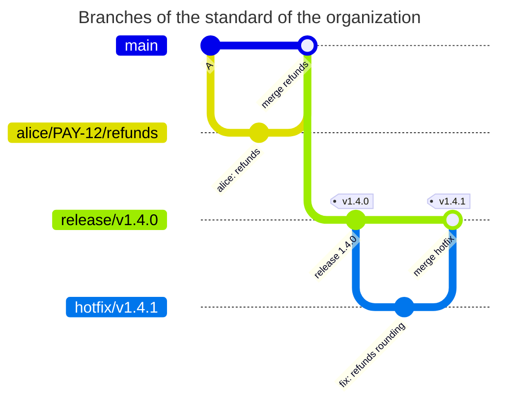

[](organization-standard.md)
[](organization-standard.en.md)

# An organization branch standard

Teams use release, hotfix, epic, demo and username-prefixed work branches. A server preset holds the shared standard, while project BRANCHPOLICY files hold local differences.

## Server preset

An administrator adds this fragment to `config.yaml` on every Gitaly node. Save it as `presets.yaml` for local checks.

```yaml
presets:
  branchpolicy:
    org-branches:
      rules:
        release:
          match: ['/^release\/v(0|[1-9][0-9]*)\.(0|[1-9][0-9]*)\.(0|[1-9][0-9]*)(-[a-z][a-z0-9]*)?$/']
          priority: 100
          protected: true
          message: Release branches look like release/v1.4.0. Protect release/* with "Allowed to push and merge Maintainers".
        release-bad:
          match: ['/^release\//']
          priority: 110
          deny: true
          message: Release branches look like release/v1.4.0.
        hotfix:
          match: ['/^hotfix\/v(0|[1-9][0-9]*)\.(0|[1-9][0-9]*)\.(0|[1-9][0-9]*)(-[a-z][a-z0-9]*)?$/']
          priority: 200
          protected: true
          message: Hotfix branches look like hotfix/v1.4.1. Protect hotfix/* with "Allowed to push and merge Maintainers".
        hotfix-bad:
          match: ['/^hotfix\//']
          priority: 210
          deny: true
          message: Hotfix branches look like hotfix/v1.4.1.
        epic:
          match: ['/^epic\/[a-z0-9][a-z0-9._-]*$/']
          priority: 300
          protected: true
          message: Epic branches look like epic/payments. Protect epic/* in Protected branches.
        epic-bad:
          match: ['/^epic\//']
          priority: 310
          deny: true
          message: Epic branches look like epic/payments.
        demo:
          match: ['/^demo\/[a-z0-9][a-z0-9._-]*$/']
          priority: 400
          protected: true
          message: Demo branches look like demo/client-a. Protect demo/* in Protected branches.
        demo-bad:
          match: ['/^demo\//']
          priority: 410
          deny: true
          message: Demo branches look like demo/client-a.
        work:
          match: ['/^[a-z0-9][a-z0-9._-]*\/(([0-9]+|[A-Z][A-Z0-9]+-[0-9]+)\/)?[a-z0-9][a-z0-9._-]*$/']
          priority: 900
          user_prefix: true
          message: Work branches are <username>/[<issue>/]<name>, for example kpn/disable_auth or kpn/PAY-12/refunds.
```

The project stores the following `BRANCHPOLICY` in its root. Run `gitlab-repopolicy validate --config presets.yaml -f BRANCHPOLICY`, then merge it into the default branch. This project additionally forbids `master`, removes demo rules and customizes its work-branch guidance.

```yaml
# examples/branch-standard/BRANCHPOLICY
# The branch standard of the organization comes from the preset org-branches
# of the server config. This project also forbids master, has no demo
# branches and names its own work branches in the message.
version: 1
extends: org-branches

rules:
  no-master:
    match: [master]
    priority: 10
    deny: true
    message: This project uses main; master must not be created.
  demo: null
  demo-bad: null
  work:
    message: Work branches are <username>/[<issue>/]<name>, for example kpn/PAY-12/refunds; PAY is the Jira project of this team.
```

`priority` orders rules from the lowest number upwards. Each new branch uses only the first matching rule. Exact rules paired with `*-bad` prevent malformed release names falling into the general work-branch class.



## Expected actions

Here `main` is the default branch; `main` and `hotfix/*` are protected, but `release/*` is not. alice and bob are active users; ghost does not exist. Global and policy modes are `enforce`; other GitLab checks allow the operations.

<!-- check: branch-push examples/branch-standard/BRANCHPOLICY main,hotfix/* -->
| New branch | Who creates it | Rule | Result | Why |
| --- | --- | --- | --- | --- |
| `hotfix/v1.4.1` | alice | `hotfix` | allowed | the name follows the standard, `hotfix/*` is protected |
| `release/v1.4.0` | alice | `release` | denied | the name follows the standard, but the project does not protect `release/*` |
| `release/foo` | alice | `release-bad` | denied | `release` did not match, the name is not `release/vX.Y.Z`. The next by `priority` is `release-bad` with `deny` |
| `alice/disable_auth` | alice | `work` | allowed | the prefix is the username of whoever pushes |
| `alice/PAY-12/refunds` | alice | `work` | allowed | the prefix and an issue key |
| `bob/fix` | alice | `work` | allowed | bob is an active GitLab user |
| `ghost/fix` | alice | `work` | denied | `ghost` is not a GitLab user |
| `fix-login` | alice | - | allowed | no rule matched, the name is not checked |

The denial for `release/v1.4.0`:

```text
remote: BRANCHPOLICY rule "release", branch release/v1.4.0: the branch must be protected, but the project does not protect it
remote:   Release branches look like release/v1.4.0. Protect release/* with "Allowed to push and merge Maintainers".
remote:   how to fix: a Maintainer protects release/v1.4.0 in Settings > Repository > Protected branches, then push again
```

Protect `release/*` and push `release/v1.4.0` again: `branch_not_protected` should disappear. `fix-login` deliberately passes without a match; add a final `match: all` with `deny` to forbid all unknown names.

Do not interpret `user_prefix` as permission to create only one's own branches: alice may create `bob/fix` if bob exists. For gradual rollout, add `mode: warn` to the file and account for global mode when testing denials.

[BRANCHPOLICY reference](../../policies/branchpolicy.en.md)
