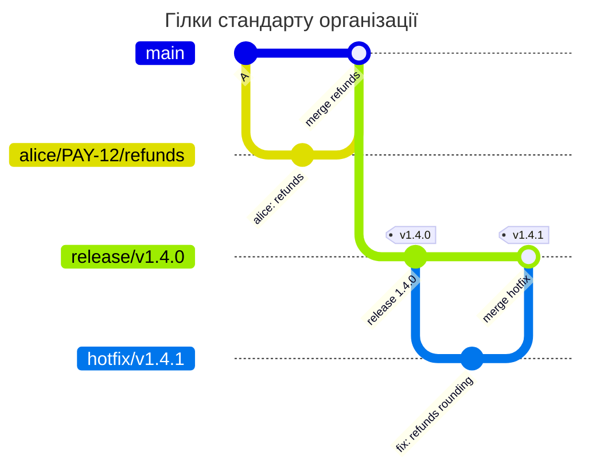

[](organization-standard.md)
[](organization-standard.en.md)

# Стандарт гілок організації

Команди використовують release-, hotfix-, epic-, demo-гілки та робочі гілки з username. Спільний стандарт зручно зберігати в серверному пресеті, а відмінності проєктів - у їхніх BRANCHPOLICY.

## Серверний пресет

Адміністратор додає цей фрагмент до `config.yaml` на всіх вузлах Gitaly. Для локальної перевірки збережіть його як `presets.yaml`.

```yaml
presets:
  branchpolicy:
    org-branches:
      rules:
        release:
          match: ['/^release\/v(0|[1-9][0-9]*)\.(0|[1-9][0-9]*)\.(0|[1-9][0-9]*)(-[a-z][a-z0-9]*)?$/']
          priority: 100
          protected: true
          message: Release branches look like release/v1.4.0. Protect release/* with "Allowed to push and merge Maintainers".
        release-bad:
          match: ['/^release\//']
          priority: 110
          deny: true
          message: Release branches look like release/v1.4.0.
        hotfix:
          match: ['/^hotfix\/v(0|[1-9][0-9]*)\.(0|[1-9][0-9]*)\.(0|[1-9][0-9]*)(-[a-z][a-z0-9]*)?$/']
          priority: 200
          protected: true
          message: Hotfix branches look like hotfix/v1.4.1. Protect hotfix/* with "Allowed to push and merge Maintainers".
        hotfix-bad:
          match: ['/^hotfix\//']
          priority: 210
          deny: true
          message: Hotfix branches look like hotfix/v1.4.1.
        epic:
          match: ['/^epic\/[a-z0-9][a-z0-9._-]*$/']
          priority: 300
          protected: true
          message: Epic branches look like epic/payments. Protect epic/* in Protected branches.
        epic-bad:
          match: ['/^epic\//']
          priority: 310
          deny: true
          message: Epic branches look like epic/payments.
        demo:
          match: ['/^demo\/[a-z0-9][a-z0-9._-]*$/']
          priority: 400
          protected: true
          message: Demo branches look like demo/client-a. Protect demo/* in Protected branches.
        demo-bad:
          match: ['/^demo\//']
          priority: 410
          deny: true
          message: Demo branches look like demo/client-a.
        work:
          match: ['/^[a-z0-9][a-z0-9._-]*\/(([0-9]+|[A-Z][A-Z0-9]+-[0-9]+)\/)?[a-z0-9][a-z0-9._-]*$/']
          priority: 900
          user_prefix: true
          message: Work branches are <username>/[<issue>/]<name>, for example kpn/disable_auth or kpn/PAY-12/refunds.
```

Проєкт зберігає в корені `BRANCHPOLICY` нижче. Перевірте `gitlab-repopolicy validate --config presets.yaml -f BRANCHPOLICY`, а потім злийте файл в основну гілку. Тут проєкт додатково забороняє `master`, прибирає demo-правила й змінює підказку робочих гілок.

```yaml
# examples/branch-standard/BRANCHPOLICY
# The branch standard of the organization comes from the preset org-branches
# of the server config. This project also forbids master, has no demo
# branches and names its own work branches in the message.
version: 1
extends: org-branches

rules:
  no-master:
    match: [master]
    priority: 10
    deny: true
    message: This project uses main; master must not be created.
  demo: null
  demo-bad: null
  work:
    message: Work branches are <username>/[<issue>/]<name>, for example kpn/PAY-12/refunds; PAY is the Jira project of this team.
```

`priority` задає порядок від меншого числа до більшого. Для кожної нової гілки діє лише перше правило зі збігом. Пари точного правила й `*-bad` не дозволяють помилково названій release-гілці перейти в загальний клас робочих гілок.



## Очікувані дії

У проєкті `main` є основною гілкою, захищені `main` і `hotfix/*`, але не `release/*`. alice і bob - активні користувачі, ghost не існує. Глобальний режим і policy - `enforce`; решта перевірок GitLab дозволяє операції.

<!-- check: branch-push examples/branch-standard/BRANCHPOLICY main,hotfix/* -->
| Нова гілка | Хто створює | Правило | Результат | Чому |
| --- | --- | --- | --- | --- |
| `hotfix/v1.4.1` | alice | `hotfix` | дозволено | ім'я за стандартом, `hotfix/*` захищено |
| `release/v1.4.0` | alice | `release` | відмова | ім'я за стандартом, але проєкт не захищає `release/*` |
| `release/foo` | alice | `release-bad` | відмова | `release` не збігся, бо ім'я не `release/vX.Y.Z`. Наступне за `priority` - `release-bad` з `deny` |
| `alice/disable_auth` | alice | `work` | дозволено | префікс - username того, хто пушить |
| `alice/PAY-12/refunds` | alice | `work` | дозволено | префікс і ключ задачі |
| `bob/fix` | alice | `work` | дозволено | bob - активний користувач GitLab |
| `ghost/fix` | alice | `work` | відмова | `ghost` - не користувач GitLab |
| `fix-login` | alice | - | дозволено | жодне правило не збіглося, ім'я не перевіряється |

Відмова для `release/v1.4.0`:

```text
remote: BRANCHPOLICY rule "release", branch release/v1.4.0: the branch must be protected, but the project does not protect it
remote:   Release branches look like release/v1.4.0. Protect release/* with "Allowed to push and merge Maintainers".
remote:   how to fix: a Maintainer protects release/v1.4.0 in Settings > Repository > Protected branches, then push again
```

Захистіть `release/*` і повторіть push `release/v1.4.0`: відмова `branch_not_protected` має зникнути. `fix-login` проходить без збігу навмисно; якщо потрібна заборона всіх невідомих імен, додайте останнє `match: all` із `deny`.

Не сприймайте `user_prefix` як право створювати лише власні гілки: alice може створити `bob/fix`, якщо bob існує. Для поетапного впровадження додайте `mode: warn` до файлу, а відмови перевіряйте з урахуванням глобального режиму.

[Довідник BRANCHPOLICY](../../policies/branchpolicy.md)
