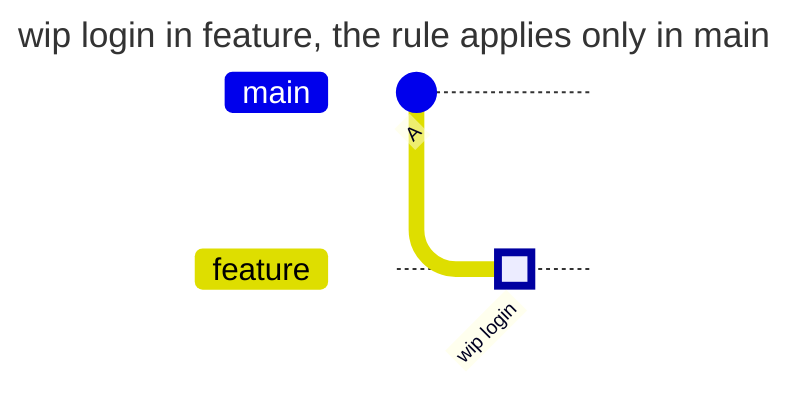
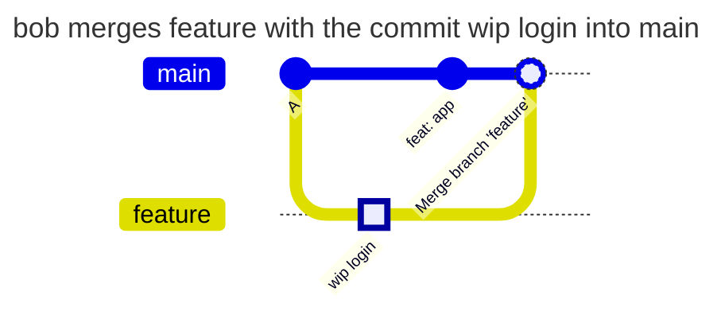

[](check-history.md)
[](check-history.en.md)

# The same actions with `new-content` and `incoming`

The team wants Conventional Commits in the history of `main` and writes anything in work branches. bob pushes the commit `wip login` to `feature` and then brings the branch into `main`. Whether the rule of `main` checks the message of this commit is decided by `check_history` of the rule. Below are the same actions of bob with both values.

## Two policies

The policies differ only in the line `check_history`. `new-content` is the default, here it is written explicitly:

```yaml
# examples/history-new-content/COMMITPOLICY
# Conventional Commits headers in main. Only commits new to the repository
# are checked: a merge of a branch that was pushed before brings its commits
# into main unchecked.
version: 1

rules:
  main:
    match: [main]
    check_history: new-content
    parser: conventional
    except:
      merge_commit: true
    checks:
      header-format:
        conventional: { level: error }
    message: Commits in main follow Conventional Commits.
```

```yaml
# examples/history-incoming/COMMITPOLICY
# Conventional Commits headers in main. Every commit that enters main is
# checked: also the commits of a merged branch, which no rule checked in that
# branch.
version: 1

rules:
  main:
    match: [main]
    check_history: incoming
    parser: conventional
    except:
      merge_commit: true
    checks:
      header-format:
        conventional: { level: error }
    message: Commits in main follow Conventional Commits.
```

- `new-content` checks only commits that no branch or tag has yet. A commit that is already in `feature` counts as checked in `main`, even if no rule checked it in `feature`
- `incoming` checks every commit the push adds to `main`, the commits of a merged branch too

The rule applies only in `main`, so in `feature` any message passes with both values. `except.merge_commit` skips the merge commit of GitLab. The global mode is `enforce`.

## Sequence of actions

bob branches `feature` from `main` and pushes the commit `wip login`. The rule of `main` does not apply here, the push goes through:



**bob merges `feature` into `main` with a merge commit:**



Only `feat: app` and the merge commit are new to the repository here. `new-content` checks `feat: app`, skips the merge commit by the exception and accepts the push: `wip login` was already in `feature`. `incoming` also checks `wip login`, which enters `main` with the merge, and denies.

**bob makes a squash merge.** One new commit enters `main` with the message bob writes during the merge, for example `feat: login`. Both values check it, and `wip login` does not enter `main` at all.

## Results

| Action of bob | `new-content` | `incoming` | Why |
| --- | --- | --- | --- |
| pushes `wip login` to `feature` | passes | passes | the rule applies only in `main` |
| pushes `wip login` straight to `main` | denied | denied | the commit is new, the header is not in the Conventional Commits format |
| merges `feature` with `wip login` into `main` with a merge commit | passes | denied | for `new-content` the commit is not new; `incoming` counts every commit that enters `main` |
| moves `main` to `feature` by a fast-forward | passes | denied | there are no new commits; for `incoming` `wip login` enters `main` |
| squash-merges `feature` into `main` with the message `feat: login` | passes | passes | one new commit with a valid header enters `main` |

The denial with `incoming` after the merge:

```text
remote: COMMITPOLICY rule "main", branch main: 1 commit message does not follow the format
remote:   required: type(scope): subject, for example feat(api): add refunds
remote:   commits:
remote:     3c41d0e2a "wip login"
remote:       - header-format conventional: expected "type(scope): subject"
remote:   Commits in main follow Conventional Commits.
remote:   how to fix: reword the commit (git commit --amend for the last one, git rebase -i for an older one), then push again
```

## Which one to choose

- `new-content` - when a rule with `match: all` applies in every branch: then every commit is checked as soon as it first appears in the repository, and a second check at the merge adds nothing
- `incoming` - when a rule applies only in some branches, such as `[main]` or `[main, '/^release\//']`. This rule did not check the commits of work branches, and without `incoming` they would enter `main` unchecked ([Conventional Commits in main and release branches](conventional-commits.en.md))

## How to check

`gitlab-repopolicy lint-commit -f COMMITPOLICY -m "wip login"` checks the message on its own, but `lint-commit` knows no branches and sees no difference between `new-content` and `incoming`. The difference shows only at a push: reproduce the table on a test project with one of the policies in `main`, and look for the denial in audit with the code `commit_format_violation`.

[COMMITPOLICY reference](../../policies/commitpolicy.en.md)
