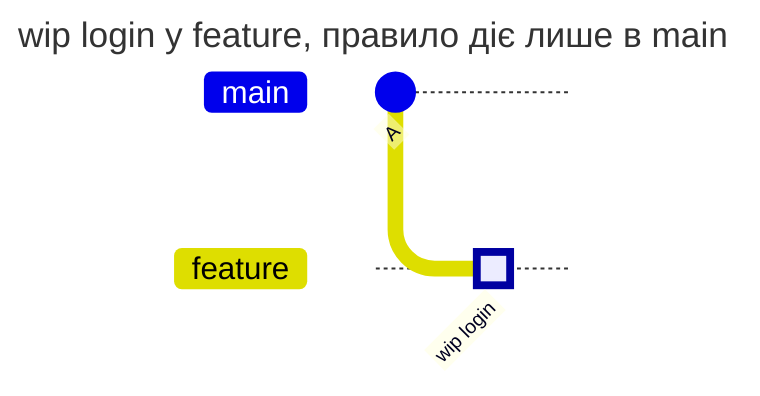
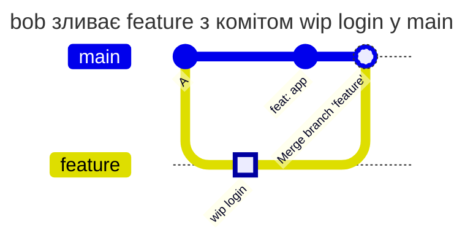

[](check-history.md)
[](check-history.en.md)

# Ті самі дії з `new-content` і `incoming`

Команда хоче Conventional Commits в історії `main`, а в робочих гілках пише як завгодно. bob надсилає у `feature` коміт `wip login`, а потім приносить гілку в `main`. Чи перевірить правило `main` повідомлення цього коміту, вирішує `check_history` правила. Нижче ті самі дії bob з обома значеннями.

## Дві політики

Політики відрізняються лише рядком `check_history`. `new-content` - значення за замовчуванням, тут воно записане явно:

```yaml
# examples/history-new-content/COMMITPOLICY
# Conventional Commits headers in main. Only commits new to the repository
# are checked: a merge of a branch that was pushed before brings its commits
# into main unchecked.
version: 1

rules:
  main:
    match: [main]
    check_history: new-content
    except:
      merge_commit: true
    checks:
      header-format:
        conventional: { level: error, value: required }
    message: Commits in main follow Conventional Commits.
```

```yaml
# examples/history-incoming/COMMITPOLICY
# Conventional Commits headers in main. Every commit that enters main is
# checked: also the commits of a merged branch, which no rule checked in that
# branch.
version: 1

rules:
  main:
    match: [main]
    check_history: incoming
    except:
      merge_commit: true
    checks:
      header-format:
        conventional: { level: error, value: required }
    message: Commits in main follow Conventional Commits.
```

- `new-content` перевіряє лише коміти, яких ще немає в жодній гілці чи тегу. Коміт, який уже лежить у `feature`, у `main` вважається перевіреним, навіть якщо в `feature` жодне правило його не перевіряло
- `incoming` перевіряє кожен коміт, який push додає в `main`, зокрема коміти злитої гілки

Правило діє лише в `main`, тож у `feature` будь-яке повідомлення проходить за обох значень. Merge-коміт GitLab пропускає `except.merge_commit`. Глобальний режим - `enforce`.

## Послідовність дій

bob відгалужує `feature` від `main` і надсилає коміт `wip login`. Правило `main` тут не діє, push проходить:



**bob зливає `feature` у `main` merge-комітом:**



Нові для репозиторію тут лише `feat: app` і merge-коміт. `new-content` перевіряє `feat: app`, merge-коміт пропускає за винятком і приймає push: `wip login` уже був у `feature`. `incoming` перевіряє ще й `wip login`, який разом із merge входить у `main`, і відмовляє.

**bob робить squash-merge.** У `main` потрапляє один новий коміт з повідомленням, яке bob пише під час merge, наприклад `feat: login`. Його перевіряють обидва значення, а `wip login` у `main` не потрапляє зовсім.

## Результати

| Дія bob | `new-content` | `incoming` | Чому |
| --- | --- | --- | --- |
| пушить `wip login` у `feature` | дозволено | дозволено | правило діє лише в `main` |
| пушить `wip login` прямо в `main` | відмова | відмова | коміт новий, header не у форматі Conventional Commits |
| зливає `feature` з `wip login` у `main` merge-комітом | дозволено | відмова | для `new-content` коміт не новий; `incoming` рахує кожен коміт, що входить у `main` |
| переносить `main` на `feature` fast-forward'ом | дозволено | відмова | нових комітів немає; для `incoming` `wip login` входить у `main` |
| робить squash-merge `feature` у `main` з повідомленням `feat: login` | дозволено | дозволено | у `main` один новий коміт з правильним header |

Відмова з `incoming` після merge:

```text
remote: COMMITPOLICY rule "main", branch main: 1 commit message does not follow the format
remote:   required: type(scope): subject, for example feat(api): add refunds
remote:   commits:
remote:     3c41d0e2a "wip login"
remote:       - header-format conventional: expected "type(scope): subject"
remote:   Commits in main follow Conventional Commits.
remote:   how to fix: reword the commit (git commit --amend for the last one, git rebase -i for an older one), then push again
```

## Що обрати

- `new-content` - коли правило з `match: all` діє в усіх гілках: тоді кожен коміт перевіряється вже тоді, коли вперше з'являється в репозиторії, і повторна перевірка під час merge нічого не додає
- `incoming` - коли правило діє лише в частині гілок, як `[main]` чи `[main, '/^release\//']`. Коміти робочих гілок це правило не перевіряло, і без `incoming` вони потрапили б у `main` неперевіреними ([Conventional Commits у main і release-гілках](conventional-commits.md))

## Як перевірити

Повідомлення окремо перевіряє `gitlab-repopolicy lint-commit -f COMMITPOLICY -m "wip login"`, але `lint-commit` не знає гілок і не бачить різниці між `new-content` і `incoming`. Різницю видно лише під час push: відтворіть таблицю на тестовому проєкті з однією з політик у `main`, а відмову шукайте в audit з кодом `commit_format_violation`.

[Довідник COMMITPOLICY](../../policies/commitpolicy.md)
