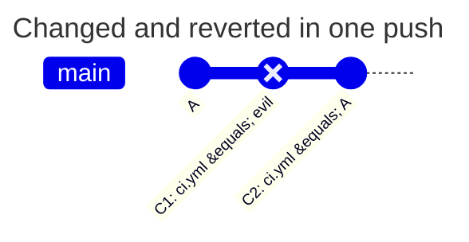

[](change-and-revert.md)
[](change-and-revert.en.md)

# Changing and reverting in one push

bob changes protected `ci.yml`, then restores its original content in the next commit. The final diff is empty, but the unwanted commit still enters `main` history. The policy must reject this push.

## Policy and initial state

This `PATHPOLICY` is already active in the root of default branch `main`. alice is an active Maintainer or Owner; bob is absent from `allow`. Results assume global `enforce` and do not override other GitLab checks. The `incoming` column of the table is for the file below, the `new-content` column for the same file without the line `check_history`.

```yaml
version: 1
admins: [alice]
rules:
  ci:
    match: all
    check_history: incoming
    paths: ["ci.yml"]
    allow: [alice]
    message: CI and deploy belong to alice.
```



| Scenario | `new-content` | `incoming` | Why |
| --- | --- | --- | --- |
| bob pushes C1 and C2 to main | denied | denied | C1 is a new commit with new content of `ci.yml`. Both values check every new commit, not only the difference at the ends of the push: the pipeline of C1 would run the changed `ci.yml` |
| C1 and C2 are first pushed to another branch, then bob moves `main` to C2 by a fast-forward | allowed | denied | for `new-content` C1 and C2 are no longer new to the repository; `incoming` counts every commit that enters `main` |
| a merge into main of a branch with C1 and C2 by bob | allowed | denied | the merge brings no new content, and the commit C1 enters `main` only for `incoming` |
| the same by alice | allowed | allowed | alice is in `allow` |
| bob rolls `main` back by a force push to a commit where `ci.yml` has the previous content | allowed | denied | there are no new commits; `incoming` also counts the difference of the content of the branch before and after the push |

The resulting file did not change, but every commit of the branch is a state that a pipeline, a tag or a deployment can start from. So a new commit with new content counts with any `check_history`, not only the difference between the ends of the push. `incoming` in addition does not let such commits come into `main` from another branch or the branch be rolled back by a force push: this way the rule guards the history of the branch itself, not only the new commits.

The force-push row assumes that the old and new endpoint states of `ci.yml` differ.

## Reproducing it

In a test project, create C1 changing `ci.yml`, then run `git revert` on that commit. Push both to `main` as bob: expect `protected_path_violation`, even when `git diff origin/main..HEAD -- ci.yml` is empty. Remove both unwanted commits from the proposed history or ask alice to make the required change. GitLab permission to push to `main` is required independently of the policy.

Do not treat an empty endpoint diff as proof that no violation occurred. History contains an intermediate state from which a pipeline can run or a tag can be created. Global `mode: audit` allows the push but records the expected denial.

[PATHPOLICY reference](../../policies/pathpolicy.en.md)
