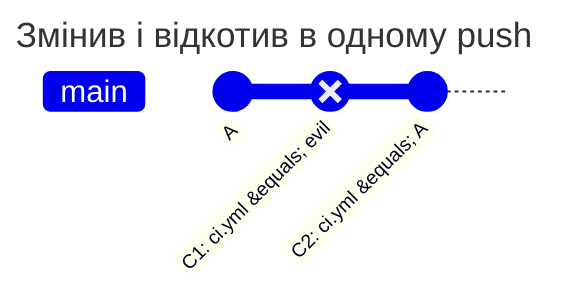

[](change-and-revert.md)
[](change-and-revert.en.md)

# Зміна та відкат в одному push

bob змінює захищений `ci.yml`, а наступним комітом повертає його початковий вміст. У підсумковому diff зміни немає, але небажаний коміт усе одно потрапляє в історію `main`. Політика має відхилити такий push.

## Політика та початковий стан

У корені основної гілки `main` вже діє цей `PATHPOLICY`. alice є активним Maintainer або Owner, bob відсутній у `allow`. Наведені результати стосуються глобального `enforce` і не скасовують інших перевірок GitLab.

```yaml
version: 1
admins: [alice]
rules:
  ci:
    match: all
    paths: ["ci.yml"]
    allow: [alice]
    message: CI and deploy belong to alice.
```



| Сценарій | Результат | Чому |
| --- | --- | --- |
| bob пушить у main C1 і C2 | відмова | C1 потрапляє в `main`, а pipeline коміту C1 виконав би змінений `ci.yml` |
| те саме в гілку зі списку `match` правила | відмова | у такій гілці теж рахується кожен коміт |
| C1 і C2 спочатку в звичайній гілці, потім fast-forward гілки зі списку на C2 | відмова | коміти потрапляють у гілку зі списку, хоч уже й лежать в іншій |
| merge у main гілки з C1 і C2, мержить bob | відмова | коміт C1 потрапляє в `main` |
| те саме, мержить alice | дозволено | alice є в `allow` |
| відкат файлу force push'ем | відмова | вміст гілки до і після push різний |

Підсумковий файл не змінився, але кожен коміт гілки - це стан, з якого можна запустити pipeline, зробити тег або деплой. Тому в `main` перевіряється кожен коміт, а не лише різниця на кінцях push.

Для рядка про гілку зі списку `match` використайте той самий файл із `match: [main, release/1]` замість `all`. Це явний список двох гілок, де кожен вхідний коміт має значення. Рядок force push передбачає, що старий і новий кінцеві стани `ci.yml` різні.

## Відтворення

На тестовому проєкті створіть коміт C1 зі зміною `ci.yml`, потім `git revert` цього коміту. Надішліть обидва від bob у `main`: очікується `protected_path_violation`, навіть якщо `git diff origin/main..HEAD -- ci.yml` порожній. Видаліть обидва небажані коміти з запропонованої історії або попросіть alice внести потрібну зміну. Дозвіл GitLab на push у `main` потрібний незалежно від policy.

Не використовуйте лише кінцевий diff як доказ відсутності порушення. Історія містить проміжний стан, з якого можна запускати pipeline або створити тег. Зміна на `mode: audit` дозволить push, але запише очікувану відмову.

[Довідник PATHPOLICY](../../policies/pathpolicy.md)
