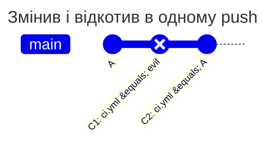

[](change-and-revert.md)
[](change-and-revert.en.md)

# Зміна та відкат в одному push

bob змінює захищений `ci.yml`, а наступним комітом повертає його початковий вміст. У підсумковому diff зміни немає, але небажаний коміт усе одно потрапляє в історію `main`. Політика має відхилити такий push.

## Політика та початковий стан

У корені основної гілки `main` вже діє цей `PATHPOLICY`. alice є активним Maintainer або Owner, bob відсутній у `allow`. Наведені результати стосуються глобального `enforce` і не скасовують інших перевірок GitLab. Колонка `incoming` таблиці відповідає файлу нижче, колонка `new-content` - тому самому файлу без рядка `check_history`.

```yaml
version: 1
admins: [alice]
rules:
  ci:
    match: all
    check_history: incoming
    paths: ["ci.yml"]
    allow: [alice]
    message: CI and deploy belong to alice.
```



| Сценарій | `new-content` | `incoming` | Чому |
| --- | --- | --- | --- |
| bob пушить у main C1 і C2 | відмова | відмова | C1 - новий коміт з новим вмістом `ci.yml`. Обидва значення перевіряють кожен новий коміт, а не лише різницю на кінцях push: pipeline коміту C1 виконав би змінений `ci.yml` |
| C1 і C2 спочатку запушено в іншу гілку, потім bob переносить `main` на C2 fast-forward'ом | дозволено | відмова | для `new-content` C1 і C2 уже не нові для репозиторію; `incoming` рахує кожен коміт, що входить у `main` |
| merge у main гілки з C1 і C2, мержить bob | дозволено | відмова | merge не приносить нового вмісту, а коміт C1 потрапляє в `main` лише для `incoming` |
| те саме, мержить alice | дозволено | дозволено | alice є в `allow` |
| bob відкочує `main` force push'ем до коміту, де `ci.yml` має попередній вміст | дозволено | відмова | нових комітів немає; `incoming` рахує ще й різницю вмісту гілки до і після push |

Підсумковий файл не змінився, але кожен коміт гілки - це стан, з якого можна запустити pipeline, зробити тег або деплой. Тому новий коміт з новим вмістом рахується за будь-якого `check_history`, а не лише різниця на кінцях push. `incoming` додатково не дає принести такі коміти в `main` з іншої гілки й відкотити гілку force push'ем: так правило охороняє історію самої гілки, а не лише нові коміти.

Рядок force push передбачає, що старий і новий кінцеві стани `ci.yml` різні.

## Відтворення

На тестовому проєкті створіть коміт C1 зі зміною `ci.yml`, потім `git revert` цього коміту. Надішліть обидва від bob у `main`: очікується `protected_path_violation`, навіть якщо `git diff origin/main..HEAD -- ci.yml` порожній. Видаліть обидва небажані коміти з запропонованої історії або попросіть alice внести потрібну зміну. Дозвіл GitLab на push у `main` потрібний незалежно від policy.

Не використовуйте лише кінцевий diff як доказ відсутності порушення. Історія містить проміжний стан, з якого можна запускати pipeline або створити тег. Зміна на `mode: audit` дозволить push, але запише очікувану відмову.

[Довідник PATHPOLICY](../../policies/pathpolicy.md)
