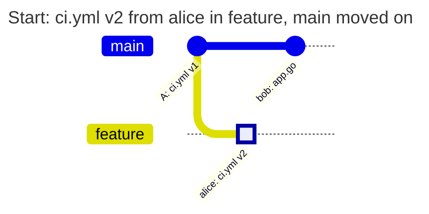
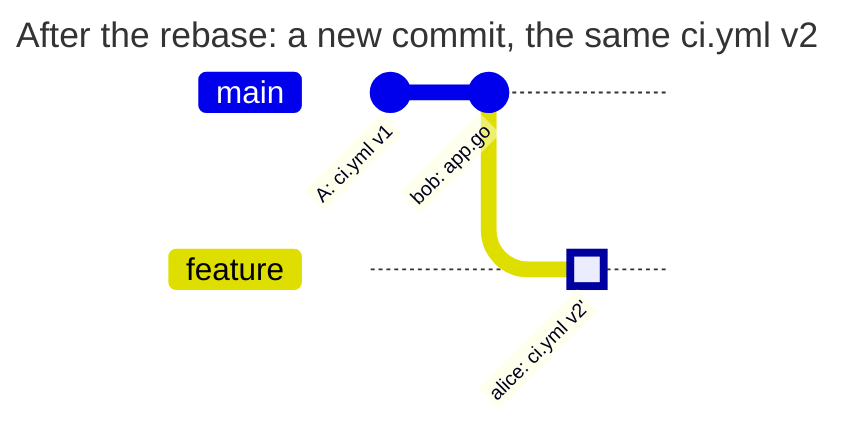
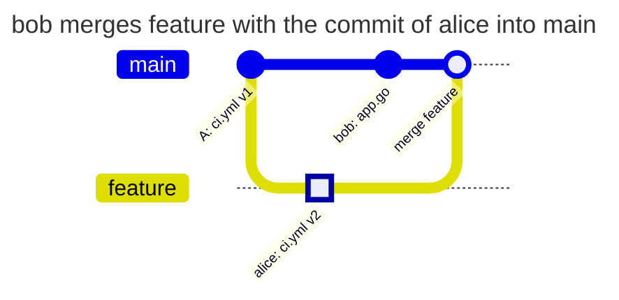
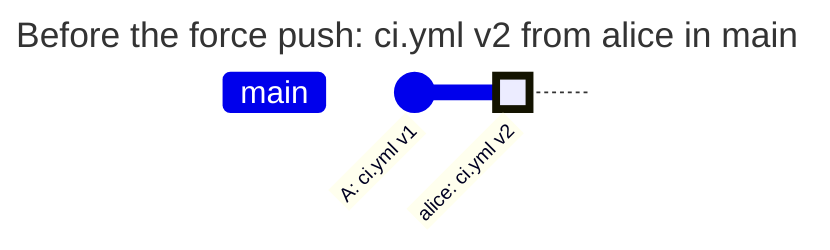

[](check-history.md)
[](check-history.en.md)

# The same actions with `new-content` and `incoming`

alice owns `ci.yml`, bob works on the code. alice has already pushed a change of `ci.yml` to `feature`, and bob goes on working with this branch: he rebases, squashes, merges into `main`. Whether to allow this or to require alice for each such step is decided by `check_history` of the rule. Below are the same actions of bob with both values.

## Two policies

The policies differ only in the line `check_history`. `new-content` is the default, here it is written explicitly:

```yaml
# examples/history-new-content/PATHPOLICY
# ci.yml belongs to alice in every branch, and only new content counts: a
# rebase, a squash or a merge of a change that alice pushed passes, a version
# of the file that no branch had is pushed by alice.
version: 1

admins: [alice]

rules:
  ci:
    match: all
    check_history: new-content
    paths: ["ci.yml"]
    allow: [alice]
    message: ci.yml is changed by alice.
```

```yaml
# examples/history-incoming/PATHPOLICY
# ci.yml belongs to alice in every branch, and every commit that enters a
# branch counts: also a rebase, a merge or a fast-forward of a change that
# alice pushed is pushed by alice.
version: 1

admins: [alice]

rules:
  ci:
    match: all
    check_history: incoming
    paths: ["ci.yml"]
    allow: [alice]
    message: ci.yml is changed by alice.
```

- `new-content` takes only new commits that no branch or tag has yet, and in them only a new state of `ci.yml`: one that neither this branch before the push nor `main` had. The state is the content and the mode of the file in git: a regular file, an executable one (`chmod +x`), a symlink or a submodule. So `chmod +x ci.yml` without a change of the text is a change too. bob may carry on the state that alice has already pushed
- `incoming` takes every commit the push adds to the branch, and the difference of the content of the branch before and after the push. Who made the commit and whether it already sits in another branch does not matter: the change into the branch is made by whoever pushes

PATHPOLICY of one of these policies applies in `main`, alice is an active Maintainer or Owner, bob is not in `allow`. The global mode is `enforce`; the permissions of GitLab and the other policies allow the pushes shown. The protection of `main` in GitLab does not change the result.

## Sequence of actions

alice branches `feature` from `main` and pushes a commit that changes `ci.yml` from v1 to v2. Both policies allow this: alice is in `allow`. Then bob pushes his change of `app.go` to `main`, the rule does not cover it:



**bob rebases `feature` onto `main`.** Git moves the commit of alice on top of the new `main` and creates a new commit with the same `ci.yml` v2:



`new-content` sees that v2 was already in `feature` and lets the push through. `incoming` counts the new commit: it changes `ci.yml` against `bob: app.go`, and bob pushes it.

**bob merges `feature` into `main`.** The merge commit takes `ci.yml` from `feature` unchanged:



`new-content` lets the merge through: the commit of alice is not new to the repository, and the merge itself brings no new content of `ci.yml`. `incoming` counts the commit of alice, which enters `main` with the merge, and denies bob.

**bob rolls `main` back with a force push.** alice pushed v2 straight to `main`, and bob moves `main` back to commit **A**:



After the push `main` points to **A** again, and `ci.yml` in `main` is v1. There are no new commits, so `new-content` checks nothing, and `main` knows v1 anyway. `incoming` counts the difference of the branch before and after the push: `ci.yml` changed from v2 to v1, and bob pushes.

## Results

| Action of bob | `new-content` | `incoming` | Why |
| --- | --- | --- | --- |
| pushes to `feature` his own version of `ci.yml` that no branch had | denied | denied | new content in a new commit, bob is not in `allow` |
| rebases `feature` onto `main` | allowed | denied | the content is the same; for `incoming` a new commit changes `ci.yml` |
| squashes `feature` together with the commit of alice | allowed | denied | the squash commit has v2, which the branch already had; for `incoming` the commit is new |
| merges `feature` into `main` with a merge commit | allowed | denied | the merge brings no new content; for `incoming` the commit of alice enters `main` |
| moves `main` to `feature` by a fast-forward | allowed | denied | there are no new commits; for `incoming` the commit of alice enters `main` |
| squash-merges `feature` into `main` | denied | denied | the squash commit is new, and v2 is new content for `main` |
| creates `feature-2` from `feature` | allowed | denied | there are no new commits; for `incoming` the new branch gets commits that `main` does not have |
| rolls `main` back with a force push over the change of alice | allowed | denied | there are no new commits; for `incoming` the content of `main` before and after the push differs |
| pushes to `main` a change of `ci.yml` and its revert in one push | denied | denied | the intermediate commit is new and brings new content |

The first and the last two rows are the same: new content from bob does not pass with any `check_history`. The difference is only in what bob does with a change of alice that was already accepted. With `new-content` he freely carries it between branches and rewrites history. With `incoming` every such step in any branch of the rule needs a person from `allow`.

The denial of bob with `incoming` after the rebase:

```text
remote: PATHPOLICY rule "ci", branch feature: you may not change these files
remote:   may change them: alice
remote:   files:
remote:     ci.yml
remote:   ci.yml is changed by alice.
remote:   this rule applies to every branch: ask one of them to push the change
```

## Which one to choose

- `new-content` - for files that people work on together in work branches: the CI configuration, build scripts. The team rebases and squashes without waiting for the owner of the file, and a new content of the file is still pushed only by the owner
- `incoming` - when it matters who brings the change into this very branch, not who wrote the content first. For example, a rule with the list `[main, '/^release\//']` for production values: there a change from a work branch, where the rule does not apply, has to be accepted by a person from `allow` ([production values](production-values.en.md))

`check_history` is set in each rule separately, so one PATHPOLICY can have both values, as in [protecting CI/CD](ci-configuration.en.md).

## How to check

Reproduce the table on a test project with one of the policies in `main`. First alice pushes `feature` with a change of `ci.yml`, then bob does the action of a table row. The expected denial has the code `protected_path_violation` in audit. Compare the same push with the other policy: only the line `check_history` changes.

Do not change `match` instead of `check_history`: `match: all` and `match: ['/./']` select the same branches and check them the same way ([match.en.md](../../policies/match.en.md#match-and-check_history-in-pathpolicy)).

[PATHPOLICY reference](../../policies/pathpolicy.en.md)
