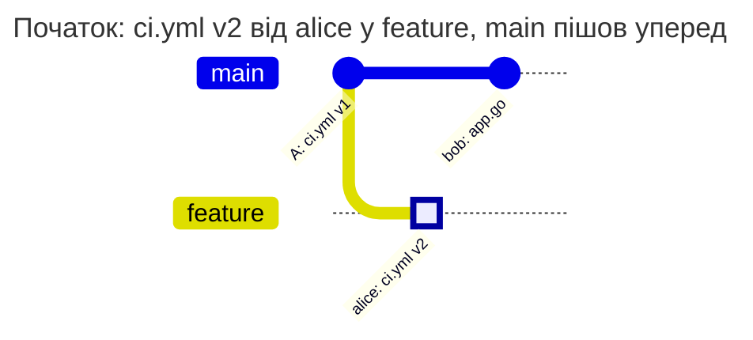
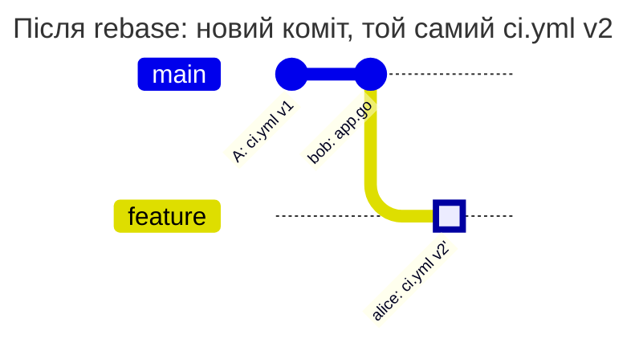
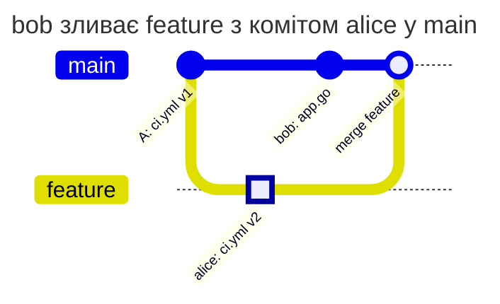
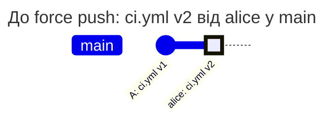

[](check-history.md)
[](check-history.en.md)

# Ті самі дії з `new-content` і `incoming`

alice відповідає за `ci.yml`, bob працює над кодом. alice вже надіслала у `feature` зміну `ci.yml`, а bob далі працює з цією гілкою: робить rebase, squash, merge у `main`. Дозволити це чи вимагати alice для кожного такого кроку, вирішує `check_history` правила. Нижче ті самі дії bob з обома значеннями.

## Дві політики

Політики відрізняються лише рядком `check_history`. `new-content` - значення за замовчуванням, тут воно записане явно:

```yaml
# examples/history-new-content/PATHPOLICY
# ci.yml belongs to alice in every branch, and only new content counts: a
# rebase, a squash or a merge of a change that alice pushed passes, a version
# of the file that no branch had is pushed by alice.
version: 1

admins: [alice]

rules:
  ci:
    match: all
    check_history: new-content
    paths: ["ci.yml"]
    allow: [alice]
    message: ci.yml is changed by alice.
```

```yaml
# examples/history-incoming/PATHPOLICY
# ci.yml belongs to alice in every branch, and every commit that enters a
# branch counts: also a rebase, a merge or a fast-forward of a change that
# alice pushed is pushed by alice.
version: 1

admins: [alice]

rules:
  ci:
    match: all
    check_history: incoming
    paths: ["ci.yml"]
    allow: [alice]
    message: ci.yml is changed by alice.
```

- `new-content` бере лише нові коміти, яких ще немає в жодній гілці чи тегу, і в них лише новий стан `ci.yml`: такий, якого не було ні в цій гілці до push, ні в `main`. Стан - це вміст і режим файлу в git: звичайний файл, виконуваний (`chmod +x`), symlink або submodule. Тому `chmod +x ci.yml` без зміни тексту - теж зміна. Стан, який alice вже надіслала, bob може переносити далі
- `incoming` бере кожен коміт, який push додає в гілку, і різницю вмісту гілки до і після push. Хто зробив коміт і чи лежить він уже в іншій гілці, неважливо: зміну в гілку вносить той, хто пушить

У `main` діє PATHPOLICY однієї з цих політик, alice є активним Maintainer або Owner, bob відсутній у `allow`. Глобальний режим - `enforce`; права GitLab та інші політики дозволяють наведені push. Захист `main` у GitLab на результат не впливає.

## Послідовність дій

alice відгалужує `feature` від `main` і надсилає коміт зі зміною `ci.yml` з v1 на v2. Обидві політики це дозволяють: alice є в `allow`. Далі bob надсилає в `main` свою зміну `app.go`, її правило не стосується:



**bob робить rebase `feature` на `main`.** Git переносить коміт alice поверх нового `main` і створює новий коміт з тим самим `ci.yml` v2:



`new-content` бачить, що v2 вже була у `feature`, і пропускає push. `incoming` рахує новий коміт: він змінює `ci.yml` відносно `bob: app.go`, а пушить його bob.

**bob зливає `feature` у `main`.** Merge-коміт бере `ci.yml` з `feature` без змін:



`new-content` пропускає merge: коміт alice не новий для репозиторію, а сам merge не приносить нового вмісту `ci.yml`. `incoming` рахує коміт alice, який разом із merge входить у `main`, і відмовляє bob.

**bob відкочує `main` force push'ем.** alice надіслала v2 прямо в `main`, а bob повертає `main` на коміт **A**:



Після push `main` знову вказує на **A**, і `ci.yml` у `main` - v1. Нових комітів немає, тому `new-content` нічого не перевіряє, а v1 і так відома `main`. `incoming` рахує різницю гілки до і після push: `ci.yml` змінився з v2 на v1, пушить bob.

## Результати

| Дія bob | `new-content` | `incoming` | Чому |
| --- | --- | --- | --- |
| пушить у `feature` свою версію `ci.yml`, якої ще ніде не було | відмова | відмова | новий вміст у новому коміті, bob немає в `allow` |
| робить rebase `feature` на `main` | дозволено | відмова | вміст той самий; для `incoming` новий коміт змінює `ci.yml` |
| робить squash `feature` разом із комітом alice | дозволено | відмова | у squash-коміті v2, яка вже була в гілці; для `incoming` коміт новий |
| зливає `feature` у `main` merge-комітом | дозволено | відмова | merge не приносить нового вмісту; для `incoming` коміт alice входить у `main` |
| переносить `main` на `feature` fast-forward'ом | дозволено | відмова | нових комітів немає; для `incoming` коміт alice входить у `main` |
| робить squash-merge `feature` у `main` | відмова | відмова | squash-коміт новий, а v2 для `main` новий вміст |
| створює `feature-2` від `feature` | дозволено | відмова | нових комітів немає; для `incoming` нова гілка отримує коміти, яких немає в `main` |
| відкочує `main` force push'ем через зміну alice | дозволено | відмова | нових комітів немає; для `incoming` вміст `main` до і після push різний |
| пушить у `main` зміну `ci.yml` і її відкат одним push | відмова | відмова | проміжний коміт новий і приносить новий вміст |

Перші й останні два рядки однакові: новий вміст від bob не проходить за будь-якого `check_history`. Різниця лише в тому, що bob робить з уже прийнятою зміною alice. З `new-content` він вільно переносить її між гілками й переписує історію. З `incoming` кожен такий крок у будь-якій гілці правила потребує людини з `allow`.

Відмова bob'у з `incoming` після rebase:

```text
remote: PATHPOLICY rule "ci", branch feature: you may not change these files
remote:   may change them: alice
remote:   files:
remote:     ci.yml
remote:   ci.yml is changed by alice.
remote:   this rule applies to every branch: ask one of them to push the change
```

## Що обрати

- `new-content` - для файлів, над якими разом працюють у робочих гілках: CI-конфігурація, скрипти збірки. Команда робить rebase і squash, не чекаючи власника файлу, а новий вміст файлу все одно пушить лише він
- `incoming` - коли важливо, хто вносить зміну саме в цю гілку, а не хто першим написав вміст. Наприклад, правило зі списком `[main, '/^release\//']` для production-значень: там зміну з робочої гілки, де правило не діє, має прийняти людина з `allow` ([prod-значення](production-values.md))

`check_history` задається в кожному правилі окремо, тож в одній PATHPOLICY можуть бути обидва значення, як у [захисті CI/CD](ci-configuration.md).

## Як перевірити

Відтворіть таблицю на тестовому проєкті з однією з політик у `main`. Спершу alice надсилає `feature` зі зміною `ci.yml`, потім bob виконує дію з рядка таблиці. Очікувана відмова має код `protected_path_violation` в audit. Порівняйте той самий push з іншою політикою: змінюється лише рядок `check_history`.

Не змінюйте `match` замість `check_history`: `match: all` і `match: ['/./']` вибирають ті самі гілки й перевіряють їх однаково ([match.md](../../policies/match.md#match-і-check_history-у-pathpolicy)).

[Довідник PATHPOLICY](../../policies/pathpolicy.md)
