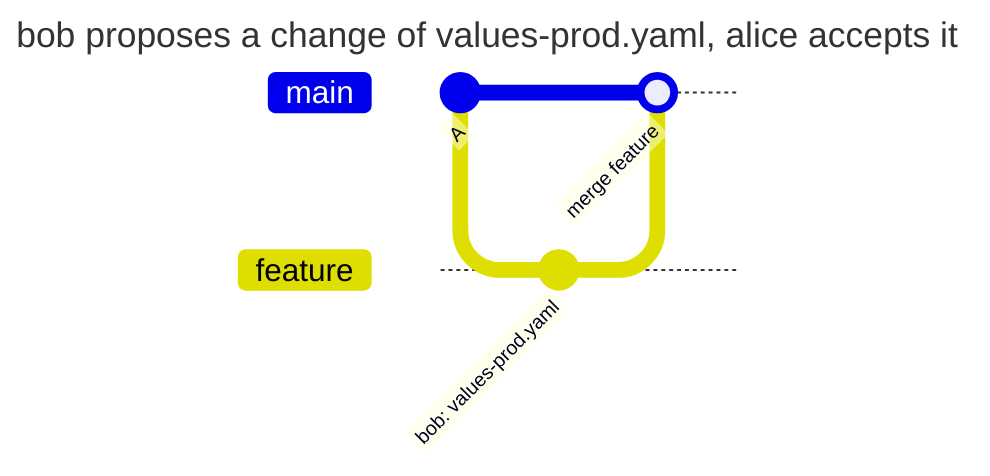

[](production-values.md)
[](production-values.en.md)

# Accepting production configuration

`helm/**/values-prod.yaml` is deployed from `main` and release branches. Anyone may prepare a change in another branch, but only alice or release-manager may introduce it into these branches.

## Configuration

Save the following as `PATHPOLICY` in the repository root. `main` is the default branch here. Initial activation needs a Maintainer or Owner; all usernames must exist and at least one `admin` must be an active Maintainer or Owner.

```yaml
# examples/ci-config/PATHPOLICY
# The platform team, alice and sre-lead, owns the CI configuration and the
# deploy scripts in every branch and the production values in main and
# release branches. Everything else is authorized by GitLab as usual.
version: 1

admins: [alice, sre-lead]

rules:
  ci-config:
    match: all
    paths:
      - ".gitlab-ci.yml"
      - ".gitlab/ci/**"
      - "scripts/deploy/**"
    allow: [alice, sre-lead]
    message: >-
      The platform team changes the CI/CD configuration and the deploy scripts.
      Ask alice or sre-lead to push this change.
    help:
      contact: "#platform"

  prod-values:
    match: [main, '/^release\//']
    paths: ["helm/**/values-prod.yaml"]
    allow: [alice, release-manager]
    message: >-
      Production values are changed in main and release branches by alice or
      release-manager. Propose the change in your branch and ask them to merge it.
```

`prod-values` names `main` explicitly and matches `release/` with a regex. `feature` does not match, so proposals are allowed. Branches in a list check incoming commits, rather than just the final file difference. The separate `ci-config` rule keeps CI under platform team control.



| Who | What | Result | Why |
| --- | --- | --- | --- |
| bob | pushes the change to `feature` | allowed | `feature` is not in the `match` list |
| bob | pushes the same change to `release/1` | denied | `release/1` is in the list |
| bob | merges `feature` into `main` | denied | the commit of bob enters `main`, and bob merges |
| alice | merges `feature` into `main` | allowed | alice makes the change in `main` |

The denial of bob at the merge:

```text
remote: PATHPOLICY rule "prod-values", branch main: you may not change these files
remote:   may change them: alice, release-manager
remote:   files:
remote:     helm/app/values-prod.yaml
remote:   Production values are changed in main and release branches by alice or release-manager. Propose the change in your branch and ask them to merge it.
remote:   ask one of them to make the change, or to merge it from your branch
```

## Checking before rollout

Run `gitlab-repopolicy validate -f PATHPOLICY`. In a test project, change only `helm/app/values-prod.yaml` and follow the table under global `enforce`. Other policies and GitLab must permit those actions. To diagnose applicability, run `explain --project P --user bob --path helm/app/values-prod.yaml --ref release/1` on a node with API access.

Do not replace the list with `all` if the team should freely propose production changes in feature branches. GitLab's glob `release/*` is different from `match`: this field needs a regex, not a glob.

[PATHPOLICY reference](../../policies/pathpolicy.en.md)
