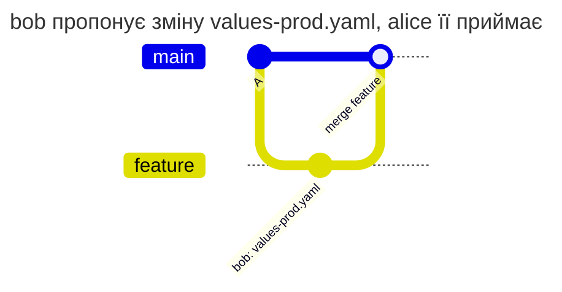

[](production-values.md)
[](production-values.en.md)

# Приймання production-конфігурації

`helm/**/values-prod.yaml` використовується для розгортання з `main` і release-гілок. Будь-хто може підготувати зміну в іншій гілці, але внести її в ці гілки може лише alice або release-manager.

## Конфігурація

Збережіть у корені репозиторію `PATHPOLICY` нижче. `main` у цьому прикладі є основною гілкою. Перша активація потребує Maintainer або Owner; усі username мають існувати, а серед `admins` має бути хоча б один активний Maintainer або Owner.

```yaml
# examples/ci-config/PATHPOLICY
# The platform team, alice and sre-lead, owns the CI configuration and the
# deploy scripts in every branch and the production values in main and
# release branches. Everything else is authorized by GitLab as usual.
version: 1

admins: [alice, sre-lead]

rules:
  ci-config:
    match: all
    paths:
      - ".gitlab-ci.yml"
      - ".gitlab/ci/**"
      - "scripts/deploy/**"
    allow: [alice, sre-lead]
    message: >-
      The platform team changes the CI/CD configuration and the deploy scripts.
      Ask alice or sre-lead to push this change.
    help:
      contact: "#platform"

  prod-values:
    match: [main, '/^release\//']
    paths: ["helm/**/values-prod.yaml"]
    allow: [alice, release-manager]
    message: >-
      Production values are changed in main and release branches by alice or
      release-manager. Propose the change in your branch and ask them to merge it.
```

`prod-values` явно називає `main` і регулярним виразом охоплює `release/`. `feature` не збігається, тому пропозиція дозволена. У гілках зі списку враховуються коміти, що входять у гілку, а не лише підсумкова різниця файлів. Окреме правило `ci-config` лишає CI під контролем команди платформи.



| Хто | Що робить | Результат | Чому |
| --- | --- | --- | --- |
| bob | пушить зміну в `feature` | дозволено | `feature` немає в списку `match` |
| bob | пушить ту саму зміну в `release/1` | відмова | `release/1` є в списку |
| bob | мержить `feature` у `main` | відмова | коміт bob потрапляє в `main`, а мержить bob |
| alice | мержить `feature` у `main` | дозволено | зміну в `main` вносить alice |

Відмова bob'у під час merge:

```text
remote: PATHPOLICY rule "prod-values", branch main: you may not change these files
remote:   may change them: alice, release-manager
remote:   files:
remote:     helm/app/values-prod.yaml
remote:   Production values are changed in main and release branches by alice or release-manager. Propose the change in your branch and ask them to merge it.
remote:   ask one of them to make the change, or to merge it from your branch
```

## Перевірка перед впровадженням

Запустіть `gitlab-repopolicy validate -f PATHPOLICY`. На тестовому проєкті перевірте зміну одного `helm/app/values-prod.yaml` за таблицею в глобальному `enforce`. Інші політики й GitLab не повинні блокувати ці дії. Для діагностики застосовності використайте `explain --project P --user bob --path helm/app/values-prod.yaml --ref release/1` на вузлі з доступом до API.

Не замінюйте список на `all`, якщо команда має вільно пропонувати production-зміни у feature-гілках. Не плутайте GitLab glob `release/*` із `match`: тут потрібен регулярний вираз, а не glob.

[Довідник PATHPOLICY](../../policies/pathpolicy.md)
