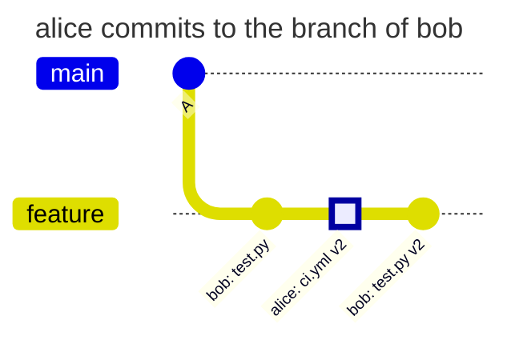
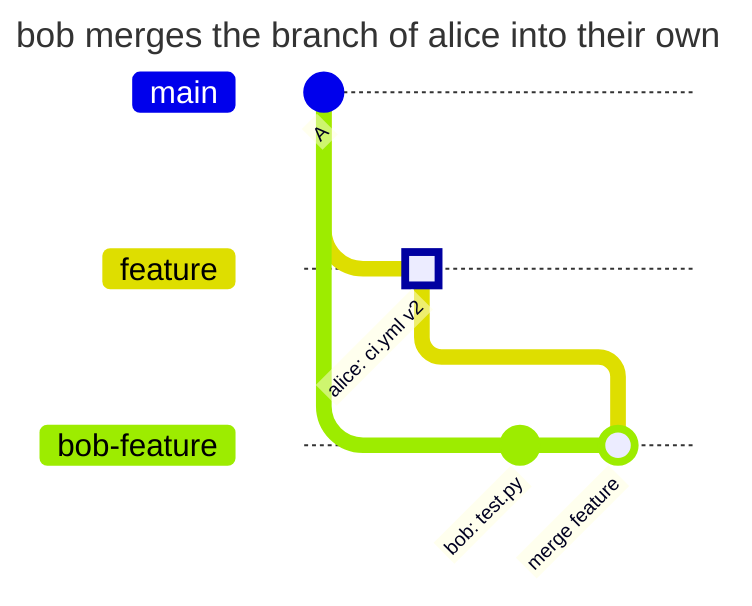
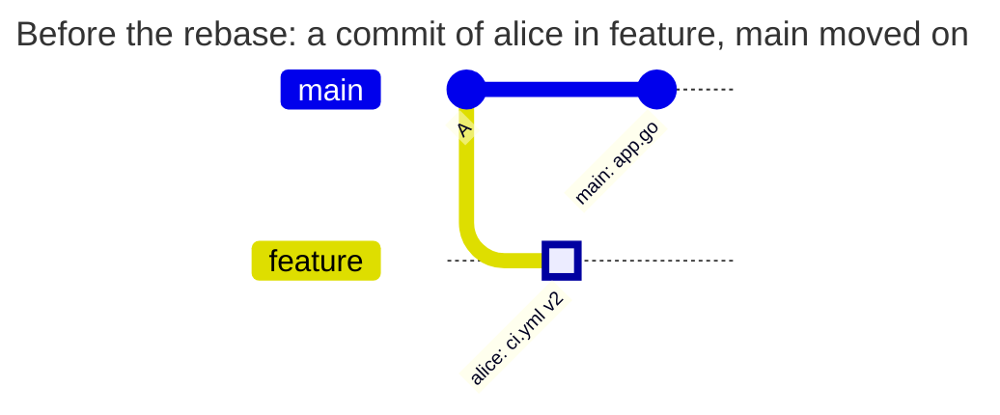
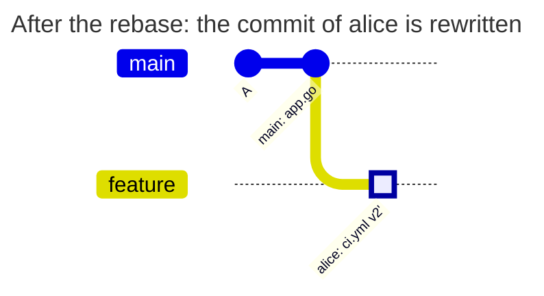
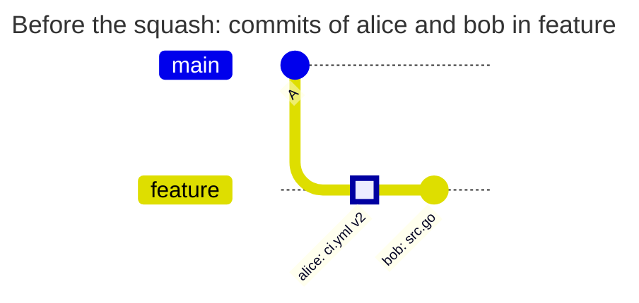
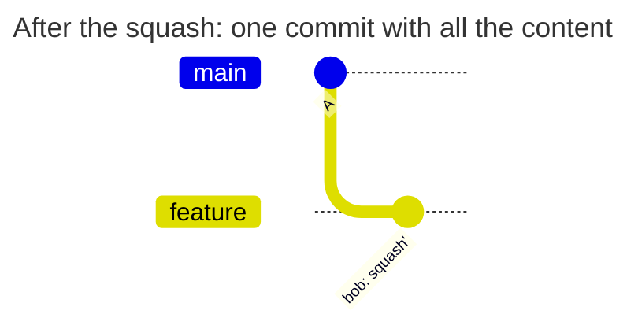
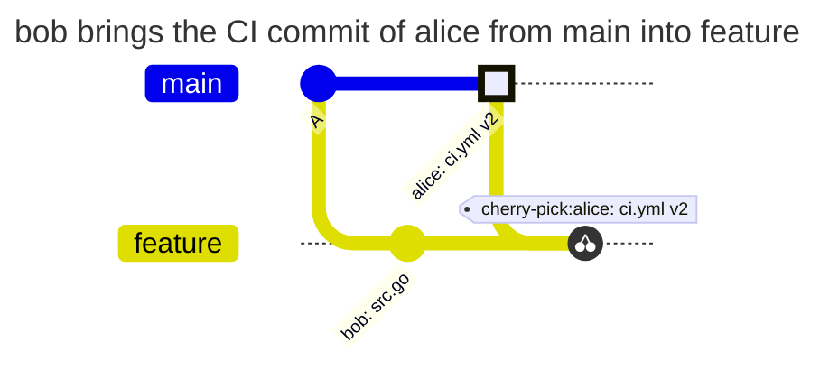
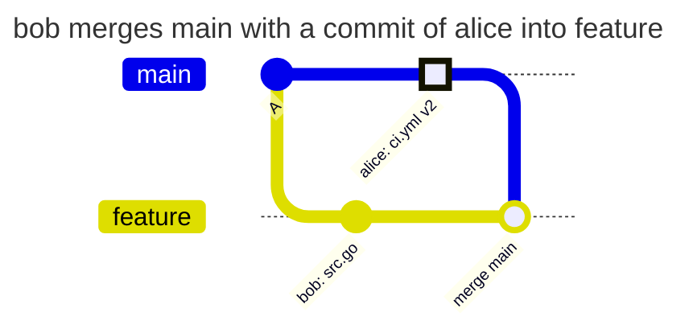
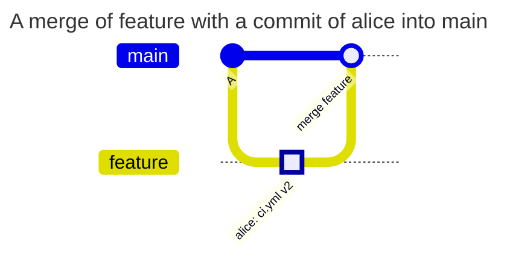

[](shared-branch.md)
[](shared-branch.en.md)

# Shared branches, rebase and squash

alice changes `ci.yml`; bob works on code in the same branch. bob needs to rewrite already accepted history without new approval for unchanged CI content, while new content of that file must be denied.

## Prerequisites

The following `PATHPOLICY` is active in the repository root of default branch `main`. alice is an active Maintainer or Owner. The rule does not set `check_history`, so `new-content` applies: only a new state of the file in new commits counts as a change. A [separate example](check-history.en.md) compares the same actions with `incoming`. Branch protection in GitLab does not affect this. Global mode is `enforce`; other policies and GitLab permissions allow the operations shown.

```yaml
version: 1
admins: [alice]
rules:
  ci:
    match: all
    paths: ["ci.yml"]
    allow: [alice]
    message: CI and deploy belong to alice.
```

For an ordinary branch, the hook compares new `ci.yml` states with versions already present in that branch's history before the push and the state in the default branch's anchor commit. The state is the content and the mode of the file in git: a regular file, an executable one (`chmod +x`), a symlink or a submodule. So `chmod +x ci.yml` without a change of the text is a change too. A new commit SHA after rebase does not by itself mean a new CI change.

## History before and after operations

**A commit of alice in the branch of bob.**



**The branch of alice merged into the branch of bob.**



**Rebase.** Before:



After the rebase by bob:



**A squash of the branch.** Before:



After the squash by bob:



**Cherry-pick from main.**



**A merge of main into feature.**



**A merge into main.**



| Scenario | Result | Why |
| --- | --- | --- |
| alice pushes a commit to the branch of bob, then bob pushes their commits | allowed | alice pushes the commit, the commits of bob do not touch `ci.yml` |
| bob merges the branch of alice into their own | allowed | the merge commit takes `ci.yml` from the branch of alice unchanged |
| bob rebases a branch with one commit of alice onto a fresh main | allowed | after the rebase `ci.yml` is the one the branch had |
| bob rebases a branch with two edits of alice in a row (v2, v3) | allowed | both versions were in the branch already |
| bob squashes a branch with a commit of alice | allowed | the content of `ci.yml` in the squash commit was in the branch already |
| bob rewords or amends a commit of alice without changing the content | allowed | the content is the same |
| bob cherry-picks the CI commit of alice from main | allowed | the default branch has the same `ci.yml` |
| bob merges main into feature or rebases feature onto main | allowed | `ci.yml` comes from the default branch |
| bob pushes their own new content of `ci.yml` | denied | neither the branch nor the default branch had this content |
| a rebase with a conflict: main changed `ci.yml` too, the result is merged content | denied | the merged content is new |
| bob pushes the rewritten history to a new branch `feature-2` | denied | a new branch has no history of its own, only the default branch is compared |
| bob changes the mode of `ci.yml` (makes it executable) with the same content | denied | the mode of the file in git is part of the state of the file |
| bob brings back v2 of alice from the history of the branch | allowed | v2 was in the branch already |
| bob rewrites a commit with a change of `PATHPOLICY` in a rebase | denied | only `admins` change `PATHPOLICY`, in any branch |
| a merge into main by bob | allowed | the commit of alice is already in the repository, and a clean merge brings no new content of `ci.yml` |
| a squash merge into main by bob | denied | the squash commit is new, and v2 of alice is new content for `main` |
| a merge or a squash merge into main by alice | allowed | alice is in `allow` |
| the same with `check_history: incoming`, a merge by bob | denied | `incoming` counts every commit that enters `main`, the commit of alice too |
| more than 50 000 commits enter the branch | denied with `limit_exceeded` | the hook does not check such a push and does not let it through |

In the diagram merging alice's branch, that branch is already on the server; a clean merge introduces no new `ci.yml` content, so with `new-content` bob can merge a change that alice accepted before. Resolving a conflict with new CI content in the merge commit requires alice. If only alice should accept CI changes into `main`, give the rule `check_history: incoming`: then, as in the row with `incoming`, a merge by bob gets a denial, but so does a rebase of the shared branch by bob ([match.en.md](../../policies/match.en.md#match-and-check_history-in-pathpolicy)).

The denial of bob for new content of `ci.yml` in an ordinary branch:

```text
remote: PATHPOLICY rule "ci", branch feature: you may not change these files
remote:   may change them: alice
remote:   files:
remote:     ci.yml
remote:   CI and deploy belong to alice.
remote:   the content of ci.yml in commit 76706632a differs both from this branch and from main; new content is pushed by one of them
```

## Verification and the limits of the exception

After `gitlab-repopolicy validate -f PATHPOLICY`, reproduce alice's CI push in a test branch, followed by bob's conflict-free rebase. It should pass. Have bob add a new line to `ci.yml`: expect `protected_path_violation`.

Do not extend this conclusion to a new `feature-2` branch: it has no history of its own, and the content is compared only with the default branch. With `check_history: incoming` there is no exception for known content in any branch. `PATHPOLICY` changes also have no such exception: they require a working admin.

[PATHPOLICY reference](../../policies/pathpolicy.en.md)
