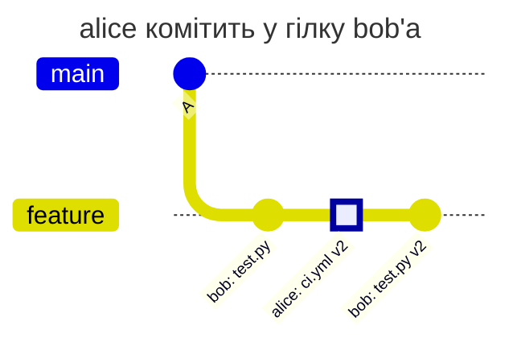
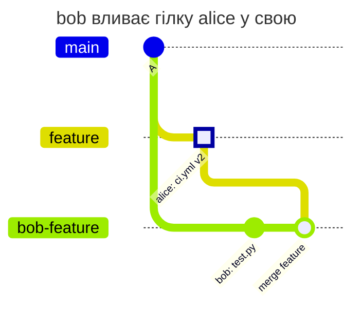
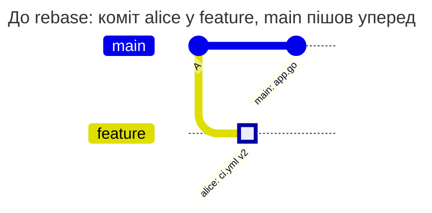
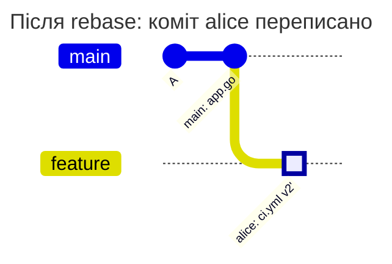
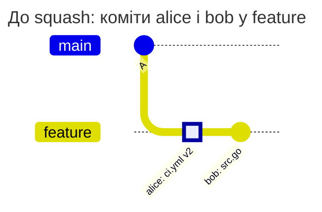
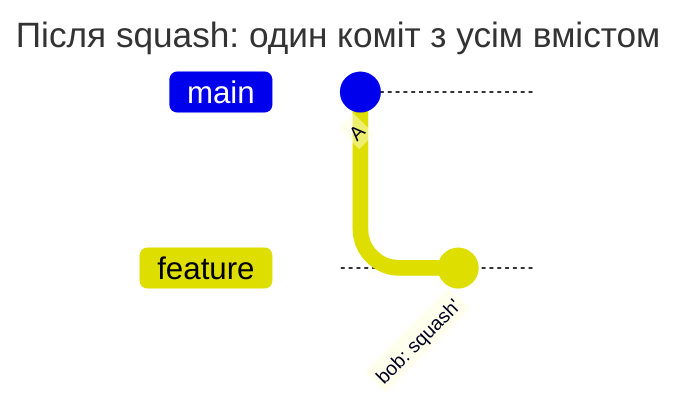
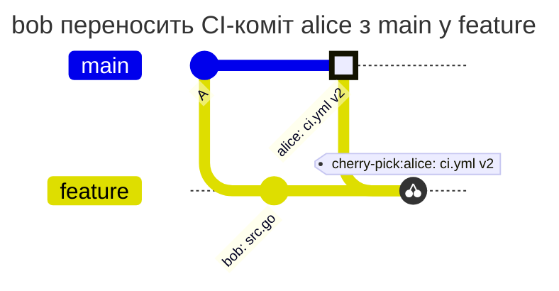
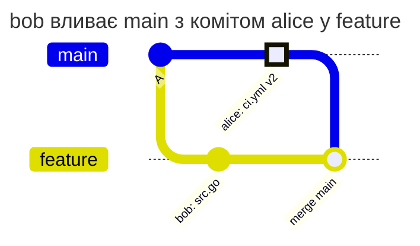
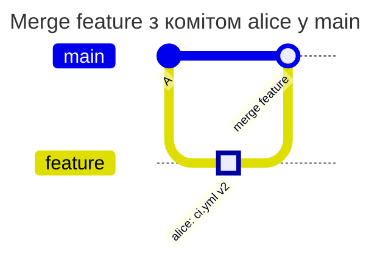

[](shared-branch.md)
[](shared-branch.en.md)

# Спільна гілка, rebase і squash

alice змінює `ci.yml`, bob працює над кодом у тій самій гілці. Потрібно дозволити bob переписувати вже прийняту історію без нового погодження незміненого CI-файлу, але відхиляти новий вміст цього файлу.

## Передумови

У корені репозиторію основної гілки `main` діє такий `PATHPOLICY`. alice є активним Maintainer або Owner. `feature` і `bob-feature` - звичайні гілки, не захищені в GitLab і не перелічені окремим списком `match`. Глобальний режим - `enforce`; решта політик і права GitLab дозволяють наведені операції.

```yaml
version: 1
admins: [alice]
rules:
  ci:
    match: all
    paths: ["ci.yml"]
    allow: [alice]
    message: CI and deploy belong to alice.
```

Для звичайної гілки hook порівнює нові стани `ci.yml` із версіями, які вже були в історії цієї гілки до push, і зі станом у коміті-якорі основної гілки. Стан включає вміст і режим файлу. Новий SHA коміту після rebase сам по собі не означає нової CI-зміни.

## Історія до й після операцій

**Коміт alice у гілці bob'а.**



**Гілка alice, влита в гілку bob'а.**



**Rebase.** До:



Після rebase, який зробив bob:



**Squash гілки.** До:



Після squash, який зробив bob:



**Cherry-pick з main.**



**Merge main у feature.**



**Merge у main.**



| Сценарій | Результат | Чому |
| --- | --- | --- |
| alice пушить коміт у гілку bob'а, bob далі пушить свої коміти | дозволено | коміт alice пушить alice, коміти bob'а не чіпають `ci.yml` |
| bob вливає гілку alice у свою | дозволено | merge-коміт бере `ci.yml` з гілки alice без змін |
| bob робить rebase гілки з одним комітом alice на свіжий main | дозволено | після rebase `ci.yml` такий самий, як був у гілці |
| bob робить rebase гілки з двома послідовними правками alice (v2, v3) | дозволено | обидві версії вже були в гілці |
| bob робить squash гілки з комітом alice | дозволено | вміст `ci.yml` у squash-коміті вже був у гілці |
| bob робить reword або amend коміту alice без зміни вмісту | дозволено | вміст той самий |
| bob робить cherry-pick CI-коміту alice з main | дозволено | такий самий `ci.yml` є в default branch |
| bob вливає main у feature або робить rebase feature на main | дозволено | `ci.yml` приходить з default branch |
| bob пушить свій новий вміст `ci.yml` | відмова | такого вмісту не було ні в гілці, ні в default branch |
| rebase з конфліктом: main теж змінював `ci.yml`, вийшов злитий вміст | відмова | злитий вміст новий |
| bob пушить переписану історію в нову гілку `feature-2` | відмова | у нової гілки немає своєї історії, порівнюється лише з default branch |
| bob змінює режим `ci.yml` (робить його виконуваним) при тому самому вмісті | відмова | режим файлу теж частина вмісту |
| bob повертає в гілку v2 alice з її ж історії | дозволено | v2 уже була в гілці |
| bob переписує коміт зі зміною `PATHPOLICY` під час rebase | відмова | `PATHPOLICY` змінюють лише `admins` у будь-якій гілці |
| merge або squash-merge у main, мержить bob | відмова | у `main` зміну вносить той, хто мержить |
| merge або squash-merge у main, мержить alice | дозволено | alice є в `allow` |
| у гілку потрапляє понад 50 000 комітів | відмова `limit_exceeded` | hook не перевіряє такий push і не пропускає його |

У діаграмі merge гілки alice вона вже є на сервері; чистий merge не додає нового вмісту `ci.yml`. Конфлікт, розв'язаний новим CI-вмістом у merge-коміті, потребує alice.

Відмова bob'у за новий вміст `ci.yml` у звичайній гілці:

```text
remote: PATHPOLICY rule "ci", branch feature: you may not change these files
remote:   may change them: alice
remote:   files:
remote:     ci.yml
remote:   CI and deploy belong to alice.
remote:   the content of ci.yml in commit 76706632a differs both from this branch and from main; new content is pushed by one of them
```

## Як перевірити й де закінчується виняток

Після `gitlab-repopolicy validate -f PATHPOLICY` відтворіть у тестовій гілці спершу push CI-зміни від alice, потім rebase без конфлікту від bob. Він має пройти. Додайте новий рядок до `ci.yml` від bob: очікується `protected_path_violation`.

Не переносіть цей висновок на нову гілку `feature-2`, на захищену гілку або на merge в `main`. У них інша база чи множина змін. Зміна `PATHPOLICY` теж не має такого винятку: потрібен робочий admin.

[Довідник PATHPOLICY](../../policies/pathpolicy.md)
