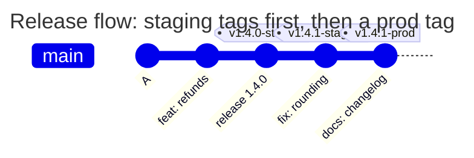

[](signed-releases.md)
[](signed-releases.en.md)

# Different signers for staging and production

release-lead or dev-lead signs staging releases; only release-lead signs production releases. The production tag must also be protected in GitLab before creation.

## Project keys and rules

Save this as `TAGPOLICY` in the repository root. The public keys below are test keys: substitute your signers' public keys for your own project. Never add private keys to the repository. Run `gitlab-repopolicy validate -f TAGPOLICY` and merge into the default branch.

```yaml
# examples/signed-releases/TAGPOLICY
# Release tags: staging is signed by release-lead or dev-lead, prod only by
# release-lead, and a prod tag must be protected in GitLab. Tags that match no
# rule, such as build-42, are not checked.
version: 1

rules:
  staging:
    match: ['/^v\d+\.\d+\.\d+-staging$/']
    signers: [release-lead, dev-lead]
    message: Staging releases are signed by release-lead or dev-lead.
  prod:
    match: ['/^v\d+\.\d+\.\d+-prod$/']
    signers: [release-lead]
    protected: true
    message: >-
      Prod releases are signed by release-lead.
      Protect v*-prod in Settings > Repository > Protected tags.

keys:
  release-lead: |
    -----BEGIN PGP PUBLIC KEY BLOCK-----
    
    mDMEas8yyBYJKwYBBAHaRw8BAQdARgQtR6FZCckYy8pf9+9snMoIb3gcbH9QVotM
    2CEt2za0H1JlbGVhc2UgTGVhZCA8bGVhZEBleGFtcGxlLmNvbT6IkwQTFgoAOxYh
    BGx5V+qHOlRnp48dB1l3WaOCcpNZBQJqzzLIAhsDBQsJCAcCAiICBhUKCQgLAgQW
    AgMBAh4HAheAAAoJEFl3WaOCcpNZf7IBAO02jJtCe9KhJlLAOTz/XX+kpgyY8mth
    6Cku2bukuF6bAP40EeqZQ1ISoo/Agcdncm5Z+KysHKFd7y49xzE0q6ObDA==
    =3XJY
    -----END PGP PUBLIC KEY BLOCK-----
  dev-lead: ssh-ed25519 AAAAC3NzaC1lZDI1NTE5AAAAIG6MuGxttDci5himWr8891GvUm9MjQljladoClrTOUiE ed25519
```

`match` should cover the names CI deploys to each environment. `signers` contains key labels, not necessarily GitLab usernames. The signer and the user pushing the tag may be different people.



<!-- check: tag-rules examples/signed-releases/TAGPOLICY -->
| Tag | Rules | Who may sign |
| --- | --- | --- |
| `v1.4.0-staging` | `staging` | release-lead, dev-lead |
| `v1.4.0-prod` | `prod` | release-lead |
| `v1.4.0` | - | not checked |
| `build-42` | - | not checked |

The denial when dev-lead signed a prod tag:

```text
remote: TAGPOLICY rule "prod", tag v1.4.0-prod: this key may not sign these tags
remote:   signed with: key "dev-lead" from TAGPOLICY (SSH, SHA256:pttIxH9SsvfRFuR5nv5vaNqIlF5N15hu0MZMwzg6AyE)
remote:   allowed keys: release-lead (OpenPGP)
remote:   Prod releases are signed by release-lead. Protect v*-prod in Settings > Repository > Protected tags.
remote:   ask the owner of an allowed key to sign the tag, or ask the people who may change TAGPOLICY to add your key
```

The table shows only rule selection by name. No match does not remove the global requirement that a branch hold the tag's commit. `prod` requires both a valid signature and tag protection; other policies and GitLab can also deny.

## Releasing and verifying

The owner of an allowed private key creates the tag with `git tag -s v1.4.0-prod -m "Release 1.4.0"` and pushes it with a branch or onto an already accepted branch commit. A Maintainer first protects `v*-prod` in Settings > Repository > Protected tags. Under global `enforce`, a production tag signed by dev-lead produces `tag_signer_not_allowed`; a lightweight tag produces `tag_not_signed`.

Do not try to create a signed tag with New tag. Push the signed tag from Git first, then create a GitLab Release for the existing tag. An API failure during `protected` checking produces a warning; it does not disable signature validation.

[TAGPOLICY reference](../../policies/tagpolicy.en.md)
