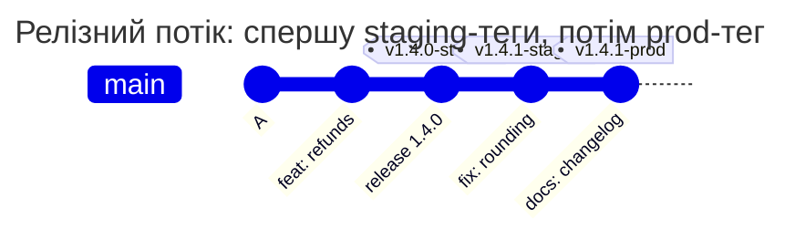

[](signed-releases.md)
[](signed-releases.en.md)

# Різні підписанти для staging і production

Staging-реліз підписує release-lead або dev-lead, production-реліз - лише release-lead. Production-тег також має бути захищений у GitLab до створення.

## Ключі й правила проєкту

Збережіть як `TAGPOLICY` у корені репозиторію. Публічні ключі нижче є тестовими: для власного проєкту підставте публічні ключі своїх підписантів. Приватні ключі до репозиторію не додають. Перевірте файл `gitlab-repopolicy validate -f TAGPOLICY` та злийте в основну гілку.

```yaml
# examples/signed-releases/TAGPOLICY
# Release tags: staging is signed by release-lead or dev-lead, prod only by
# release-lead, and a prod tag must be protected in GitLab. Tags that match no
# rule, such as build-42, are not checked.
version: 1

rules:
  staging:
    match: ['/^v\d+\.\d+\.\d+-staging$/']
    signers: [release-lead, dev-lead]
    message: Staging releases are signed by release-lead or dev-lead.
  prod:
    match: ['/^v\d+\.\d+\.\d+-prod$/']
    signers: [release-lead]
    protected: true
    message: >-
      Prod releases are signed by release-lead.
      Protect v*-prod in Settings > Repository > Protected tags.

keys:
  release-lead: |
    -----BEGIN PGP PUBLIC KEY BLOCK-----
    
    mDMEas8yyBYJKwYBBAHaRw8BAQdARgQtR6FZCckYy8pf9+9snMoIb3gcbH9QVotM
    2CEt2za0H1JlbGVhc2UgTGVhZCA8bGVhZEBleGFtcGxlLmNvbT6IkwQTFgoAOxYh
    BGx5V+qHOlRnp48dB1l3WaOCcpNZBQJqzzLIAhsDBQsJCAcCAiICBhUKCQgLAgQW
    AgMBAh4HAheAAAoJEFl3WaOCcpNZf7IBAO02jJtCe9KhJlLAOTz/XX+kpgyY8mth
    6Cku2bukuF6bAP40EeqZQ1ISoo/Agcdncm5Z+KysHKFd7y49xzE0q6ObDA==
    =3XJY
    -----END PGP PUBLIC KEY BLOCK-----
  dev-lead: ssh-ed25519 AAAAC3NzaC1lZDI1NTE5AAAAIG6MuGxttDci5himWr8891GvUm9MjQljladoClrTOUiE ed25519
```

`match` має охоплювати імена, за якими CI розгортає відповідне оточення. Список `signers` містить мітки ключів, а не обов'язково username GitLab. Підписант і користувач, який надсилає тег, можуть бути різними людьми.



<!-- check: tag-rules examples/signed-releases/TAGPOLICY -->
| Тег | Правила | Хто може підписати |
| --- | --- | --- |
| `v1.4.0-staging` | `staging` | release-lead, dev-lead |
| `v1.4.0-prod` | `prod` | release-lead |
| `v1.4.0` | - | не перевіряється |
| `build-42` | - | не перевіряється |

Відмова, коли dev-lead підписав prod-тег:

```text
remote: TAGPOLICY rule "prod", tag v1.4.0-prod: this key may not sign these tags
remote:   signed with: key "dev-lead" from TAGPOLICY (SSH, SHA256:pttIxH9SsvfRFuR5nv5vaNqIlF5N15hu0MZMwzg6AyE)
remote:   allowed keys: release-lead (OpenPGP)
remote:   Prod releases are signed by release-lead. Protect v*-prod in Settings > Repository > Protected tags.
remote:   ask the owner of an allowed key to sign the tag, or ask the people who may change TAGPOLICY to add your key
```

Таблиця показує лише вибір правил за ім'ям. Відсутність збігу не скасовує глобальної вимоги, що коміт тегу має лежати в гілці. Для `prod` потрібні і правильний підпис, і protected tag; інші політики та GitLab теж можуть відмовити.

## Як випустити й перевірити

Власник дозволеного приватного ключа створює тег через `git tag -s v1.4.0-prod -m "Release 1.4.0"` і надсилає його разом із гілкою або на вже прийнятий коміт гілки. Maintainer спершу налаштовує захист `v*-prod` у Settings > Repository > Protected tags. У глобальному `enforce` тег dev-lead для production отримує `tag_signer_not_allowed`, а lightweight-тег - `tag_not_signed`.

Не намагайтеся створити підписаний тег кнопкою New tag. Спочатку надішліть підписаний тег із Git, потім створіть GitLab Release для цього наявного тегу. Збій API перевірки `protected` дає попередження; він не вимикає перевірку підпису.

[Довідник TAGPOLICY](../../policies/tagpolicy.md)
