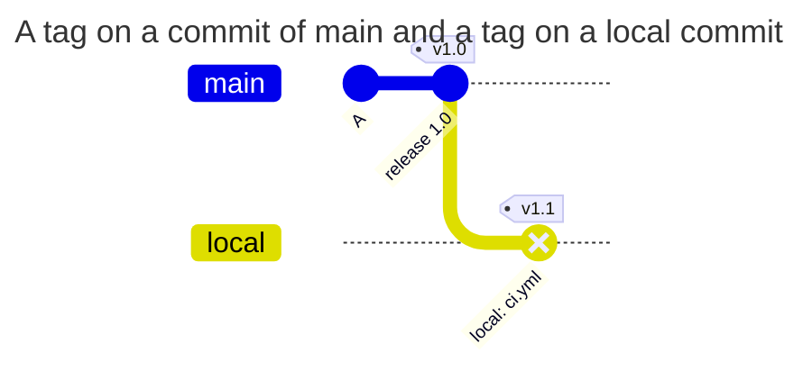

[](tag-on-branch.md)
[](tag-on-branch.en.md)

# Why a tag must point to a branch commit

A tag can trigger a pipeline. If it introduced a new commit without a branch, that commit's content could bypass path and message checks. The hook therefore checks tag commit reachability independently of TAGPOLICY.

## Initial state

Use a group test project with default branch `main` and global `enforce`. This scenario needs no policy files: it is a core check. If TAGPOLICY is present, the tag must also satisfy its signature requirements. Here `local` exists only on the developer's machine.



| Scenario | Result | Why |
| --- | --- | --- |
| a push of only a tag on a commit already in main | allowed | a branch holds the commit |
| a push of only a tag on a local commit that no branch holds | denied with `tag_not_on_branch` | no branch holds the commit |
| a branch and a tag on its new commit in one push | allowed | after the push a branch holds the commit |
| a deletion of a branch and a tag on its commit in one push | denied | after the push no branch holds the commit |
| a tag on a new commit with a changed `ci.yml`, without a branch | denied with `tag_not_on_branch` | otherwise the change of `ci.yml` would bypass PATHPOLICY |
| a group project without policy files, a tag outside of branches | denied | the rule applies to every group project |
| a project in a personal namespace, a tag outside of branches | allowed | the hook does not check personal projects |

The denial:

```text
remote: gitlab-repopolicy: push rejected by the rules of this repository (1 problem)
remote:
remote: tag v1.0: the tag points to a commit that is in no branch
remote:   commit 5bdd30d35 is in no branch of the project after this push
remote:   push the branch with the commit first, or together with the tag: git push origin <branch> v1.0, or git push --follow-tags
remote:
remote: checked as: bob (SSH)
remote: GL-HOOK-ERR: gitlab-repopolicy: tag v1.0 points to commit 5bdd30d35, which is in no branch; push the branch with it: git push origin <branch> v1.0
```

How to fix:

```sh
git push origin main v1.0        # the branch and the tag in one push
git push --follow-tags origin main   # the branch and the annotated tags on its commits
```

A tag on an old commit that a branch already holds is allowed. A tag that points not to a commit but to a tree or a blob is rejected with `tag_object_invalid` in every group project.

The branch-deletion row assumes no other branch holds the commit. The hook considers all branches after the proposed push, so a new branch and tag can arrive together. Deleting the tag itself does not need this check.

## Reproducing it

In a test project, create a local branch from `main`, add a new commit and tag it. Pushing only the tag should produce `tag_not_on_branch`; after pushing the branch, the same tag can pass this check. GitLab and other policies must permit the operation. In `audit`, the first push passes with the expected denial only in the log.

`git push --follow-tags` adds relevant annotated tags; it does not mean "send every local tag". Check which branch you are pushing. A tag pointing to a tree or blob produces `tag_object_invalid` even without policies.

[TAGPOLICY reference](../../policies/tagpolicy.en.md)
