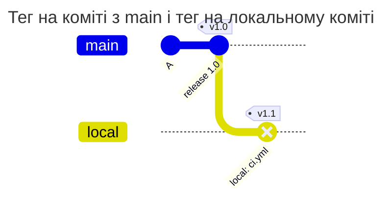

[](tag-on-branch.md)
[](tag-on-branch.en.md)

# Чому тег має вказувати на коміт гілки

Тег може запускати pipeline. Якби він приносив новий коміт без гілки, вміст цього коміту міг би обійти перевірки шляхів і повідомлень. Тому hook перевіряє досяжність коміту тегу незалежно від наявності TAGPOLICY.

## Початковий стан

Використайте груповий тестовий проєкт із основною гілкою `main` і глобальним `enforce`. Для цього сценарію policy-файлів не потрібно: це перевірка ядра. Якщо TAGPOLICY вже є, тег додатково має пройти її вимоги підпису. У прикладі `local` існує лише на комп'ютері розробника.



| Сценарій | Результат | Чому |
| --- | --- | --- |
| push лише тегу на коміт, уже наявний у main | дозволено | коміт лежить у гілці |
| push лише тегу на локальний коміт, якого немає в жодній гілці | відмова `tag_not_on_branch` | коміт не лежить у жодній гілці |
| гілка і тег на її новий коміт одним push | дозволено | після push коміт лежить у гілці |
| видалення гілки і тег на її коміт одним push | відмова | після push коміт не лежить у жодній гілці |
| тег на новому коміті зі зміненим `ci.yml`, без гілки | відмова `tag_not_on_branch` | інакше зміна `ci.yml` обійшла б PATHPOLICY |
| груповий проєкт без файлів політик, тег поза гілками | відмова | правило діє для всіх групових проєктів |
| проєкт в особистому namespace, тег поза гілками | дозволено | особисті проєкти hook не перевіряє |

Відмова:

```text
remote: gitlab-repopolicy: push rejected by the rules of this repository (1 problem)
remote:
remote: tag v1.0: the tag points to a commit that is in no branch
remote:   commit 5bdd30d35 is in no branch of the project after this push
remote:   push the branch with the commit first, or together with the tag: git push origin <branch> v1.0, or git push --follow-tags
remote:
remote: checked as: bob (SSH)
remote: GL-HOOK-ERR: gitlab-repopolicy: tag v1.0 points to commit 5bdd30d35, which is in no branch; push the branch with it: git push origin <branch> v1.0
```

Як виправити:

```sh
git push origin main v1.0        # гілку і тег одним push
git push --follow-tags origin main   # гілку і annotated-теги на її комітах
```

Тег на старому коміті, який уже лежить у гілці, дозволений. Тег, який указує не на коміт, а на дерево чи blob, відхиляється з `tag_object_invalid` для всіх групових проєктів.

Рядок із видаленням гілки передбачає, що жодна інша гілка не містить коміту. Hook рахує стан усіх гілок після запропонованого push, тому можна надіслати нову гілку й тег разом. Видалення самого тегу не потребує цієї перевірки.

## Як відтворити

На тестовому проєкті створіть локальну гілку від `main`, зробіть новий коміт і тег на ньому. Push лише тегу має дати `tag_not_on_branch`; після надсилання гілки той самий тег може пройти цю перевірку. GitLab та інші політики мають дозволяти дію. У `audit` перший push проходитиме з очікуваною відмовою лише в журналі.

`git push --follow-tags` додає до push відповідні annotated-теги, але не означає "надіслати будь-який локальний тег". Перевіряйте, яку гілку надсилаєте. Тег на дерево або blob отримає `tag_object_invalid` навіть без policy.

[Довідник TAGPOLICY](../../policies/tagpolicy.md)
