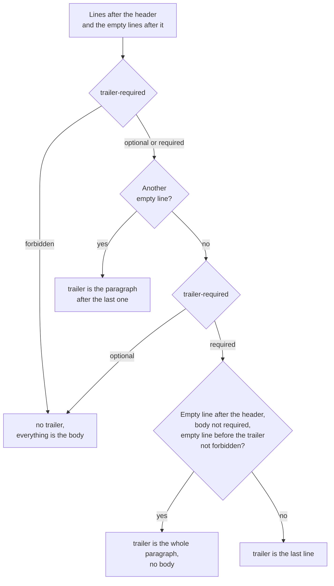

[](commitpolicy.md)
[](commitpolicy.en.md)

# COMMITPOLICY

## In short

COMMITPOLICY checks how the messages of the commits a push adds to a branch are written. When a message breaks the rules, GitLab rejects the push, and the commit has to be reworded. The file is in the root of the repository under the name `COMMITPOLICY`, the content is YAML. The smallest working file:

```yaml
version: 1
rules:
  conventional:
    match: default
    checks:
      header-format:
        conventional: {level: error, value: required}
    message: Commits in the default branch follow Conventional Commits.
```

Messages on the default branch must have a type and short description, such as `feat: add request validation`. A parenthesized scope is optional. The format of the header is required by `header-format` with `value: required`. Without this check the hook takes the header apart the same way, but does not deny for the format. This file adds no length checks or type list.

## Quick start

1. Start with `mode: warn`: violations are only shown in the output of the push and written to audit, the push goes through. This shows how many commits of the team break the rules before anyone gets a denial
2. Check the file with `gitlab-repopolicy validate` and messages with `gitlab-repopolicy lint-commit` ([below](#checking-without-a-push))
3. Merge the file into the default branch. The hook reads the rules only from there
4. When there are almost no warnings left, remove `mode: warn`, and violations of level `error` start to deny

Who may change COMMITPOLICY itself is decided by a rule of PATHPOLICY ([pathpolicy.en.md](../examples/pathpolicy/delegation.en.md)). Without such a rule anyone who can push may change the file.

## What a commit message consists of

```text
feat(api): add request validation

Validate incoming requests before processing.

Refs: #123
```

A message has a header and may contain a body and a trailer. The hook splits it into these parts by lines and empty lines ([parsing](#how-the-hook-parses-a-message)). The header is always the first line. An empty line after it is formatting that `body-leading-blank-lines` checks. Body and trailer are optional unless the policy requires them through `body-required` and `trailer-required`:

| Part | In the example | What it is |
| --- | --- | --- |
| header | `feat(api): add request validation` | the first line. `git log --oneline`, the list of commits in GitLab and the title of a merge request show it |
| body | `Validate incoming requests before processing.` | the explanation: what changed and why |
| trailer | `Refs: #123` | the last part of the message: an issue reference, `Signed-off-by` and other metadata. The hook does not set the format of the trailer lines, `pattern` checks it |

The hook always tries to parse the header in the [Conventional Commits](https://www.conventionalcommits.org/en/v1.0.0/) format:

| Part | In the example | What it is |
| --- | --- | --- |
| type | `feat` | the kind of change: `feat` - a new feature, `fix` - a fix, `docs` - documentation |
| scope | `api` | optional, in parentheses: the part of the system the change is about |
| `!` | Not used in this message | optional, before the colon: the change breaks compatibility |
| `: ` | `: ` | a colon and exactly one space |
| subject | `add request validation` | a short description of the change, not empty |

A header of another standard, such as `PAY-123 Add request validation`, is not taken apart: type, scope and `!` are unknown, and the subject is the whole line. For such a standard set `header-format` with `value: optional` and the required `pattern` ([issue keys](../examples/commitpolicy/issue-key.en.md)). Conventional Commits defines first-line structure; the policy defines type lists, length and mandatory metadata. A valid `feat: add validation` can fail an additional body or trailer requirement. [Message comparisons](../examples/commitpolicy/message-results.en.md) provide checked valid and invalid cases.

Create a message with a body, reference and DCO sign-off as follows. Each `-m` adds a separate paragraph:

```sh
git commit -s \
  -m "fix(billing): round refunds to cents" \
  -m "Refunds were computed in floating point and lost a cent on some amounts." \
  -m "Refs: #665"
```

`-s` (`--signoff`) adds `Signed-off-by: Name <email>` from `user.name` and `user.email`. When the last paragraph consists of `Key: value` lines, like `Refs: #665`, git adds the line to it, otherwise as a separate paragraph. Either way `Signed-off-by` ends up in the trailer. `-S` (capital) is something else, a cryptographic signature of the commit. COMMITPOLICY checks only the text of the message, it does not check the signature of a commit. Signatures of tags are checked by TAGPOLICY ([tagpolicy.en.md](tagpolicy.en.md)).

How to fix a commit after a denial. The hook does not update refs for this push. Fix the rejected commits in your clone; they may already be reachable through other branches or pushes:
- the last commit: `git commit --amend` (with `-s` when `Signed-off-by` is missing)
- several commits: `git rebase -i origin/main`, replace `pick` with `reword` next to the commits

If `rebase -i` rewrote commits that were already on the server, push with `--force-with-lease`.

## Field reference

| Field | Required | Value |
| --- | --- | --- |
| `version` | yes | `1` |
| `mode` | no | `enforce` (the default) or `warn`. `warn` turns every error into a warning |
| `extends` | no | the name of a preset of the server config or a list of names ([configuration.en.md](../administration/configuration.en.md#presets)) |
| `rules` | no | rules, up to 50: rule name → rule. The name is `[a-z0-9-]{1,63}` |
| `rules.<name>.match` | yes | the branches the rule applies to: `all`, `default` or a list of branches ([match.en.md](match.en.md)) |
| `rules.<name>.check_history` | no | which commits of the branch to check: `new-content` (the default) or `incoming` ([below](#which-commits-are-checked)) |
| `rules.<name>.except` | no | which commits to skip ([below](#exceptions-except)) |
| `rules.<name>.checks` | no | checks of the catalogue: type → name of the check → its fields ([below](#catalogue-of-checks-checks)) |
| `rules.<name>.message` | yes | text for the author of a commit with a violation, up to 1000 characters |
| `rules.<name>.help` | no | `contact` and `docs_url`, as in [PATHPOLICY](pathpolicy.en.md#field-reference) |

"Required" means required after the merge with the presets. Any field of a rule in the file may be `null`: this removes a rule, a check type, a single check or a field of a preset.

Every rule whose `match` matches the branch applies. An error of any of them is a denial. A branch that no rule matches is not checked.

Unknown keys, YAML anchors and aliases are an error. The file is up to 64 KiB, with up to 50 usernames in `except.users` of one rule.

### How the hook parses a message

First the hook normalizes the text:
- `\r\n` and `\r` become `\n` (the GitLab UI writes `\r\n`)
- trailing empty lines are dropped
- an empty line is a line with no characters other than spaces and tabs

Without a check, only a message that cannot be parsed at all is a violation:
- an empty header
- a NUL byte in the message or a commit larger than 1 MiB

Then the message is split into parts from the top down:

1. The header is always the first line. The hook parses it as `type(scope)!: subject`. Type is Latin letters, digits, `_` and `-`, scope and `!` are optional. When the header does not follow this format, type, scope and `!` are unknown, and the subject is the whole line
2. The empty lines right after the header separate it from the rest. `body-leading-blank-lines` looks at them, in the message as git stores it, before the hook drops trailing empty lines
3. The trailer is the paragraph after the last empty line, except the empty lines right after the header. When there is no such empty line, the trailer depends on `trailer-required`:
   - `required` - there is a trailer. When an empty line follows the header, the body is not required and an empty line before the trailer is not forbidden, the trailer is the whole paragraph after the header, and there is no body. Otherwise the trailer is the last line. When there are no lines after the header, there is no trailer
   - `optional` or no check - there is no trailer, everything after the header is the body
4. With `trailer-required: forbidden` the trailer is not looked for at all, even after an empty line: everything after the header is the body
5. The body is the lines between the header and the trailer without the empty lines around them. Empty lines inside the body are allowed

"Not required" and "not forbidden" mean that `body-required` is not `required` and `trailer-leading-blank-lines` is not `forbidden`. Each of these values comes from the checks of its type that apply to the type of the commit (the `types` field): `required` wins over `forbidden`, and without such checks `optional` applies.



A trailer of several lines exists only after an empty line or as the whole paragraph after the header. With `trailer-leading-blank-lines: forbidden` the trailer is always one last line.

In the table below the same messages go through five sets of checks. H is the header, B and T are lines of text, `_` is an empty line. The letter shows what the line is meant to be: body or trailer. The second column shows the parts for the sets with `trailer-required` r. The result columns are the values of four checks in the order of the parts of a message from the top down: `body-leading-blank-lines` / `body-required` / `trailer-leading-blank-lines` / `trailer-required`, where o is `optional`, r is `required`, f is `forbidden`. A denial cell names the checks that give it.

<!-- check: commit-structure -->
| Message | Parts with `trailer-required` r | r / r / r / r | o / r / o / r | f / r / f / r | o / o / f / r | r / o / r / o |
| --- | --- | --- | --- | --- | --- | --- |
| `H _ B _ T` | body `B`, trailer `T` | passes | passes | denied: `body-leading-blank-lines`, `trailer-leading-blank-lines` | denied: `trailer-leading-blank-lines` | passes |
| `H _ B _ B _ T` | body `B _ B`, trailer `T` | passes | passes | denied: `body-leading-blank-lines`, `trailer-leading-blank-lines` | denied: `trailer-leading-blank-lines` | passes |
| `H _ B B _ T T` | body `B B`, trailer `T T` | passes | passes | denied: `body-leading-blank-lines`, `trailer-leading-blank-lines` | denied: `trailer-leading-blank-lines` | passes |
| `H B B B T` | body `B B B`, trailer is the last line | denied: `body-leading-blank-lines`, `trailer-leading-blank-lines` | passes | passes | passes | denied: `body-leading-blank-lines` |
| `H _ B B B T` | body `B B B`, trailer is the last line | denied: `trailer-leading-blank-lines` | passes | denied: `body-leading-blank-lines` | passes | passes |
| `H _ T` | no body, trailer `T` | denied: `body-required` | denied: `body-required` | denied: `body-leading-blank-lines`, `body-required` | passes | passes |
| `H T` | no body, trailer `T` | denied: `body-leading-blank-lines`, `body-required` | denied: `body-required` | denied: `body-required` | passes | denied: `body-leading-blank-lines` |
| `H _ B` | no body, trailer `B` | denied: `body-required` | denied: `body-required` | denied: `body-leading-blank-lines`, `body-required` | passes | passes |
| `H` | neither body nor trailer | denied: `body-leading-blank-lines`, `body-required`, `trailer-required` | denied: `body-required`, `trailer-required` | denied: `body-required`, `trailer-required` | denied: `trailer-required` | denied: `body-leading-blank-lines` |

In the set r / o / r / o the trailer is optional, so the paragraph after the header without another empty line is the body: `H _ B B B T` has no trailer, and in `H _ T` the line T is the body. In the set o / o / f / r an empty line before the trailer is forbidden, so `H _ T` is the trailer `T` without a body.

The whole paragraph after the header becomes the trailer when the body is not required. This way `git commit -s` without a body gives a message where the reference and `Signed-off-by` stand in one paragraph:

```text
fix: round refunds

Refs: #665
Signed-off-by: Name <email>
```

With `trailer-required: required` both lines are the trailer, there is no body. When the body is required (`body-required: required`) or an empty line before the trailer is forbidden (`trailer-leading-blank-lines: forbidden`), the trailer is only the line `Signed-off-by: ...`, and `Refs: #665` becomes the body.

When the header is not parsed, the checks of type, scope and `!` (`type-enum`, `scope`, `scope-enum`, `breaking-bang`) and the checks with `types` do not run. The subject checks (`subject-starts-lowercase`, `subject-trailing-dot`) do not run with `header-format: required` either: the header is already wrong, and `header-format` reports it. With `optional` or without `header-format` they look at the whole first line. The other checks work the same way for any header.

### Catalogue of checks (`checks`)

`checks` is a mapping of mappings. The first-level key is a check type of the catalogue, the second-level key is a name of the check that you choose (`[a-z0-9-]{1,63}`). So one rule can have several checks of one type, for example two `pattern`, each with its own level and parameters, while the shared `match` and `except` are not repeated. The name shows in a denial next to the type: `pattern no-wip: ...`.

```yaml
checks:
  header-max-length:
    limit: {level: warn, value: 100}
  pattern:
    no-wip: {level: error, location: header, value: '!/^WIP/i'}
    issue-ref: {level: error, location: trailer, value: '/(?m)^Refs: #[0-9]+$/'}
```

Fields of a check:

- `level` is required after merging with presets: `error` reports a violation as a check error, while `warn` reports a warning
- `value` is the check's parameter: a list, string or integer from the table below. It is required after merging with presets
- `types` is an optional nonempty type list. It limits the check to commits of those types; without it in the merged rule, there is no such restriction. For a header that is not parsed the type is unknown, and a check with `types` does not run. `header-format` has no `types` field: the format of the header is checked while the type is still unknown

A check of a preset is overridden by its type and name: the file sets only the fields it changes, the rest comes from the preset. For example, `header-max-length: {limit: {level: warn}}` keeps the `value` of the preset and makes the check a warning.

The checks of whether a message has a feature - `scope`, `breaking-bang`, `subject-starts-lowercase`, `subject-trailing-dot`, `body-leading-blank-lines`, `body-required`, `trailer-leading-blank-lines` and `trailer-required` - share the same `value`:

| `value` | What it means |
| --- | --- |
| `optional` | the feature may or may not be there |
| `required` | the feature must be there |
| `forbidden` | the feature must not be there |

To lift a requirement of a preset, give the same check `value: optional`. `null` removes the check completely.

| Check | Value of the `value` field | What it checks | Fails |
| --- | --- | --- | --- |
| `header-format` | `optional`, `required` | `required` - the header follows `type(scope)!: subject`, the scope in parentheses is not empty. `optional` - any header, as without the check | `Fix timeout`, `feat(): add login` with `required` |
| `header-max-length` | An integer from 1 to 10000 | the length of the header in characters | a header of 101 characters with `100` |
| `type-enum` | A nonempty type list, such as `[feat, fix]` | the type is in the list | `bugfix: round refunds` with `[feat, fix]` |
| `scope` | `optional`, `required`, `forbidden` | a scope in parentheses after the type | `fix: round refunds` with `required` |
| `scope-enum` | A nonempty scope list, such as `[api, billing]` | the scope is in the list. A scope `a, b` or `a/b` is split into parts | `fix(ui): round refunds` with `[api, billing]` |
| `breaking-bang` | `optional`, `required`, `forbidden` | `!` after the type or the scope | `feat!: drop v1` with `forbidden` |
| `subject-starts-lowercase` | `optional`, `required`, `forbidden` | the subject starts with a lowercase letter. A digit, a sign or a character without case is not a lowercase letter | `fix: Round refunds` and `fix: 2fa for login` with `required`; `fix: round refunds` with `forbidden` |
| `subject-trailing-dot` | `optional`, `required`, `forbidden` | a full stop at the end of the subject | `fix: round refunds.` with `forbidden` |
| `body-leading-blank-lines` | `optional`, `required`, `forbidden` | an empty line right after the header, also when there is no body text | `fix: round refunds` as one line or a body right on the second line with `required` |
| `body-required` | `optional`, `required`, `forbidden` | a body between the header and the trailer | a message of only a header and `Signed-off-by` with `required` |
| `body-max-length` | An integer from 1 to 10000 | the length of the whole body in characters, line breaks included | a body of 2001 characters with `2000` |
| `trailer-leading-blank-lines` | `optional`, `required`, `forbidden` | an empty line between the body and the trailer. Without a body or without a trailer the check passes | `H _ B B B T` from the parsing table with `required` and `body-required: required` |
| `trailer-required` | `optional`, `required`, `forbidden` | a trailer, the last part of the message. The value also sets how the hook finds the trailer ([parsing](#how-the-hook-parses-a-message)). `forbidden` alone gives no violation: the trailer is not looked for then | `fix: round refunds` with `required` |
| `trailer-max-length` | An integer from 1 to 10000 | the length of the whole trailer in characters, line breaks included | a trailer of 501 characters with `500` |
| `pattern` | `/regex/`, `/regex/i`, `!/regex/` or `!/regex/i` | a regular expression in part of the message; a separate `location` field is also required | [below](#pattern) |

`body-leading-blank-lines` looks at the message as git stores it. `git commit` with the usual cleanup drops trailing empty lines, so a commit of one header is stored as `header\n`, even if the editor had an empty line after it. With `required` such a commit fails: add a body or a trailer, for example with `git commit -s`. `body-required: optional` lets you skip the body, but does not turn off `body-leading-blank-lines`.

New check types appear in new versions without a change of `version`. An unknown type in a new version of the file is an error, and in the default branch (for example after a rollback of the binary) it is skipped with a warning.

### `pattern`

`pattern` looks for a regular expression in the given part of the message:

| Field | Value |
| --- | --- |
| `location` | `header`, `body`, `trailer` or `message` (the whole message) |
| `value` | `/regex/` or `/regex/i` - must be found, `!/regex/` or `!/regex/i` - must not be found |

The regex is in RE2 syntax, as in GitLab CI and in [match](match.en.md), and is searched anywhere in the part, like `=~`. To anchor to the start or the end, write `^` and `$`. For `body`, `trailer` and `message` `^` and `$` mean the start and the end of the whole part, for lines write `(?m)`. One regex checks both the key and the value of a trailer line, for example `/(?m)^Refs: #[0-9]+$/`.

`pattern` takes the trailer from the parsing ([above](#how-the-hook-parses-a-message)), so `location: trailer` usually needs `trailer-required: required`. Without it the paragraph right after the header is the body, and the regex does not find `Refs: #12` in the message `fix: x` + an empty line + `Refs: #12`. With `trailer-required: forbidden` the trailer is empty: `/regex/` is not found and gives a violation, `!/regex/` passes.

Several requirements for the same commits are several `pattern` checks with different names in one rule ([example](../examples/commitpolicy/multiple-requirements.en.md)).

### Exceptions (`except`)

| Key | Value | What is skipped |
| --- | --- | --- |
| `merge_commit` | `true` or `false` | with `true`, the merge commit itself |
| `merged_commits` | `true` or `false` | with `true`, the commits a merge commit brings through its second parent. Only the first-parent chain is checked. Fast-forward, rebase and squash are checked as usual |
| `git_reverts` | `true` or `false` | with `true`, messages of `git revert` and the GitLab revert button: the header `Revert "..."` and the line `This reverts commit <sha>` |
| `users` | A username list, such as `[release-bot]` | pushes of these users, for example of a release bot |

If a boolean exception is absent after merging with presets, it defaults to `false`; the `users` list defaults to an empty list (`[]`). A field omitted from the project file is inherited from a preset. Explicitly set `false` to cancel an inherited boolean exception, or `users: []` to clear an inherited user list.

`except.users` applies only to a person or a bot the hook recognized. A push with a deploy key does not fall under the exception.

### Which commits are checked

`match` only selects branches. Which commits of the branch to check, `check_history` of the rule decides:

| `check_history` | Which commits |
| --- | --- |
| `new-content` (the default) | only new commits that no branch or tag has yet |
| `incoming` | every commit the push adds to the branch. For a new branch, the commits that the default branch does not have |

The protection of a branch in GitLab and the kind of `match` do not change this choice: `match: all` and a list `['/./']` that selects the same branches check them the same way. A [separate example](../examples/commitpolicy/check-history.en.md) compares the same actions with both values.

- with `new-content` a merge of `main` into a feature branch or a rebase onto a fresh `main` does not check the commits that already exist, only the merge commit and the own new commits. A merge into the default branch of a branch that was already pushed does not check its commits either: they are not new to the repository
- with `incoming` a merge request without squash brings every commit of the branch and the merge commit into the branch, and all of them are checked. A squash merge brings one commit, its message comes from the squash commit template of the project
- messages of tags are not checked
- history before COMMITPOLICY appeared is not checked. With `incoming` the exception is a merge of a branch with old commits: they enter the branch with the merge
- more than 10 000 commits entering a branch in one push are not checked: `limit_exceeded`, a denial in `enforce`, a warning in `warn`

## Examples

| Example | What it explains |
| --- | --- |
| [Conventional Commits](../examples/commitpolicy/conventional-commits.en.md) | General requirements in `main` and stricter release type lists |
| [Message results](../examples/commitpolicy/message-results.en.md) | Valid messages, denials and warnings with one configuration |
| [Header parsing](../examples/commitpolicy/header-parsing.en.md) | Spaces, scopes and body separation |
| [Issue, MR and Jira references](../examples/commitpolicy/issue-references.en.md) | At least one GitLab or Jira reference anywhere in a Conventional Commits message |
| [Issue keys](../examples/commitpolicy/issue-key.en.md) | A free-form alternative to Conventional Commits |
| [Pattern matching](../examples/commitpolicy/patterns.en.md) | Selecting `header`, `body`, `trailer` or `message` |
| [`new-content` and `incoming`](../examples/commitpolicy/check-history.en.md) | A merge and a fast-forward of a work branch into `main` with both values of `check_history` |
| [Multiple requirements](../examples/commitpolicy/multiple-requirements.en.md) | Two `pattern` checks with different names in one rule |
| [commitizen requirements](../examples/commitpolicy/commitizen.en.md) | Moving specific requirements into server checks |
| [Organization preset](../examples/commitpolicy/organization-preset.en.md) | Changing check severity and lifting an inherited requirement with `value: optional` |

## Denials

| Situation | Result |
| --- | --- |
| a violation of a check of level `error` | denied with `commit_format_violation` |
| a violation of a check of level `warn` or any violation with `mode: warn` | the push goes through, the violation is in the output of the push and in audit |
| more than 10 000 commits enter the branch | `limit_exceeded`: a denial in `enforce`, a warning in `warn` |
| COMMITPOLICY in the default branch is invalid, a preset is missing or broken | the check is skipped, a warning |
| an unknown check type in the default branch | only this type is skipped, a warning |
| the API did not answer when the hook needs to know who pushes (for `except.users`) | the rule is skipped, a warning |
| a push changes COMMITPOLICY to an invalid version | denied with `invalid_policy_update` |

COMMITPOLICY keeps the history in order, it does not guard access. So when the check cannot be made, the push goes through with a warning instead of being blocked.

A warning in the output of a push:

```text
remote: gitlab-repopolicy: push accepted with 1 warning
remote:
remote: COMMITPOLICY rule "conventional", branch main: 1 commit message does not follow the format; this is a warning, it does not block the push
remote:   required: type(scope): subject, for example feat(api): add refunds
remote:   types: feat, fix, build, chore, ci, docs, perf, refactor, revert, style, test
remote:   commits:
remote:     7680d8aca "fix: round refunds"
remote:       - pattern issue-ref: no match of /[A-Za-z0-9_.\/-]*#[0-9]+/ in the message
remote:   Commits in main and release branches follow Conventional Commits. Reword them with git rebase -i or squash the merge request.
remote:   next time: follow the format; commits that are pushed stay as they are
```

The warnings of a successful push show in the terminal as `remote:` lines. For a merge by the button, the Web IDE and other actions in the GitLab UI GitLab does not show the successful output of the hook: there warnings are visible only in audit.

## Common mistakes

| Symptom | Cause | What to do |
| --- | --- | --- |
| `rule r: unknown field "parser"` from `validate` | there is no `parser` field: the hook always tries to parse the header as Conventional Commits | remove `parser`. To require the format, add `header-format: {conventional: {level: error, value: required}}` |
| `checks.type-enum.level: expected a mapping, got a string` | the check is written without a name: `type-enum: {level: error, ...}` | add a name: `type-enum: {allowed: {level: error, ...}}` |
| `Fix timeout` passes | the rule has no `header-format` with `value: required` | add `header-format: {conventional: {level: error, value: required}}` |
| `pattern` with `location: trailer` does not see the reference | the rule has no `trailer-required: required`, and the paragraph after the header is the body, or another paragraph follows the reference | add `trailer-required` with `value: required` or move the reference into the last paragraph |
| `pattern` for `body` or `trailer` does not find a line that starts with `- ` or `Refs:` | `^` means the start of the whole part | write `/(?m)^- /` |
| a denial for `feat:` in a release branch, although it passes in `main` | both rules of example 1 apply in a release branch | this is intended. For local checks use `lint-commit --rule` |
| a merge commit of GitLab is rejected | the header `Merge branch ...` is not in the Conventional Commits format | `except.merge_commit: true` |
| `checks.header-max-length.limit.level: "off" is not one of error, warn` | there is no value `off` | to lift a requirement of a preset, give the check `value: optional` or remove it with `null` |

## Checking without a push

`gitlab-repopolicy lint-commit` checks messages with the same code as the hook.

| Command | What it checks |
| --- | --- |
| `gitlab-repopolicy lint-commit -m "feat: add x"` | one message against `COMMITPOLICY` of the current directory |
| `gitlab-repopolicy lint-commit --range origin/main..HEAD` | the commits of a range. One revision is its whole history. At most 100 000 commits |
| `-f FILE` | another COMMITPOLICY file |
| `--rule NAME` | only this rule, can be repeated. An unknown name is an error with the list of rules of the file |
| `--skip-author EMAIL` | with `--range`: skip the commits of this author, can be repeated |
| `--config FILE` | the server config with presets, when the file uses `extends`. Other keys are not read |

Without `--rule` `lint-commit` applies every rule of the file and ignores `match`: locally it is unknown which branch the commit goes to. `except.users` and `except.merge_commit` do not apply to `-m`.

```text
$ gitlab-repopolicy lint-commit -f examples/conventional-commits/COMMITPOLICY -m "Fix deploy."
message: [conventional] error: header-format conventional: expected "type(scope): subject"
message: [conventional] error: body-leading-blank-lines blank-line: an empty line must follow the header
message: [conventional] error: trailer-required dco: the message needs a trailer, the last part of the message
message: [conventional] error: pattern dco: no match of /(?m)^Signed-off-by: / in the trailer
```

The rule `release` of the example reports nothing: it has no `header-format`, and `type-enum` does not run for a header that is not parsed.

As a `commit-msg` hook of git:

```sh
#!/bin/sh
# .git/hooks/commit-msg
exec gitlab-repopolicy lint-commit --rule conventional -m "$(git stripspace --strip-comments < "$1")"
```

`git stripspace` removes the comment lines of the editor. `--rule conventional` is needed when the rules of different branches contradict each other: the rule `release` of example 1 allows only `fix`, `docs` and `chore`, and without `--rule` the hook would reject `feat:`.

In the CI of a merge request the same checks run before the merge:

```yaml
# .gitlab-ci.yml
repopolicy:
  rules:
    - if: $CI_PIPELINE_SOURCE == "merge_request_event"
  script:
    - gitlab-repopolicy validate
    - gitlab-repopolicy lint-commit --rule conventional --range "origin/$CI_MERGE_REQUEST_TARGET_BRANCH_NAME..HEAD"
```

For `origin/<target>`, the job needs the target branch history: `GIT_DEPTH: 0` or `git fetch origin "$CI_MERGE_REQUEST_TARGET_BRANCH_NAME"`. The exit code of `lint-commit` is 0 when there are no violations of level `error`, 1 when there are, and 2 for incorrect arguments. Check the policy file itself using the [validate guide](../reference/validate.en.md). The [CLI reference](../reference/cli.en.md#lint-commit) lists the linter parameters.
