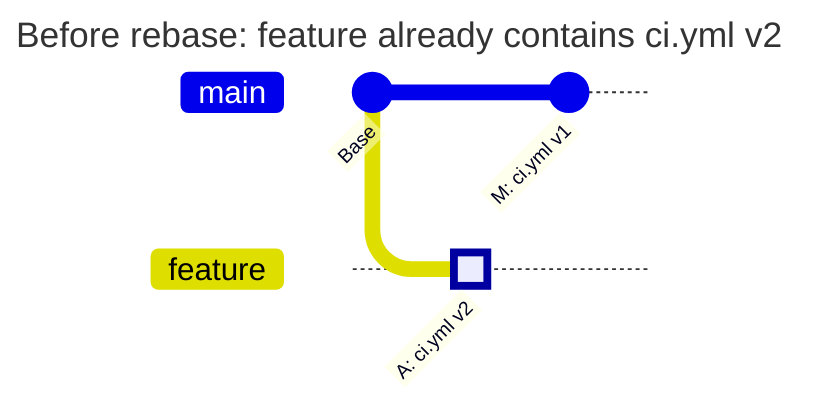
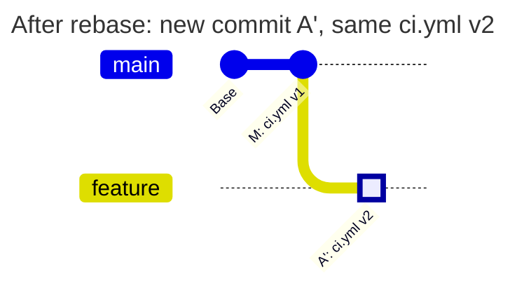
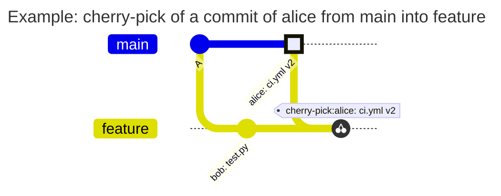

[](match.md)
[](match.en.md)

# The `match` field

`match` says which branches a rule applies to; in TAGPOLICY, which tags. Every rule of all four policy files has the field, and it is required: a rule without `match` is not accepted, there is no implicit "all branches".

```yaml
rules:
  ci-config:
    match: all                        # every branch
  agents:
    match: default                    # only the default branch of the project
  prod-values:
    match: [main, '/^release\//']     # main and the release/... branches
```

This is a fragment of PATHPOLICY, the other fields of the rules are left out.

Branches and tags are different kinds of Git reference (`ref`). A branch has a full name such as `refs/heads/main`, a tag `refs/tags/v1.0.0`; `match` uses short names `main` and `v1.0.0`. It selects where a rule applies rather than granting access by itself. Which commits to check in the selected branches is set by a separate field `check_history` in PATHPOLICY and COMMITPOLICY ([below](#match-and-check_history-in-pathpolicy)).

## Values

| Value | What it means | In which files |
| --- | --- | --- |
| `all` | every branch, in TAGPOLICY every tag | all |
| `default` | the default branch of the project (usually `main`) | PATHPOLICY, COMMITPOLICY |
| a list | the branches or tags that the elements of the list describe | all |

`default` takes the branch that is the default branch in the settings of the project, so the file does not change when `master` is renamed to `main`. In BRANCHPOLICY and TAGPOLICY `default` makes no sense: the default branch already exists, and a tag is not a branch. There it is an error.

## Elements of the list

| Element | What it means | Example |
| --- | --- | --- |
| a name | the exact name of a branch or a tag, without `refs/heads/` and `refs/tags/` | `main`, `v1.0.0` |
| `/regex/` | a regular expression in RE2 syntax (the same as in GitLab CI). Like `=~` in GitLab CI, it looks for a match anywhere in the name: write `^` and `$` yourself | `/^release\//` |
| `/regex/i` | the same, case-insensitive. There are no other flags | `/^wip\//i` |
| `!name`, `!/regex/`, `!/regex/i` | an exception | `!release/legacy` |

A list matches a name when at least one plain element matches and no exception does. A list of exceptions only means "all but": `['!main']` is every branch except `main`.

A name that itself starts with `!` can be written only as a regex: `'/^!draft$/'`.

Put regular expressions in single YAML quotes. Then `\d` and `\/` reach the hook as they are, without YAML escaping.

## Name → matches or not

| `match` | Name | Match | Why |
| --- | --- | --- | --- |
| `[main]` | `main` | yes | the exact name |
| `[main]` | `main-old` | no | an exact name matches only as a whole |
| `['/^v\d+\.\d+\.\d+$/']` | `v1.2.3` | yes | the regex describes the whole name from `^` to `$` |
| `['/^v\d+\.\d+\.\d+$/']` | `v1.2.3-rc1` | no | `-rc1` follows `3`, and `$` requires the end of the name |
| `['/v\d+/']` | `build-v2` | yes | without `^` and `$` the regex looks for a match anywhere in the name |
| `['/^wip\//i']` | `WIP/login` | yes | the flag `i` ignores case |
| `['/^wip\//']` | `WIP/login` | no | without `i` case matters |
| `['/^release\//', '!release/legacy']` | `release/v2` | yes | the regex matched, the exception did not |
| `['/^release\//', '!release/legacy']` | `release/legacy` | no | the exception matched |
| `['!main']` | `feature/login` | yes | a list of exceptions only: all but `main` |
| `['!main']` | `main` | no | the exception matched |
| `['/^!draft$/']` | `!draft` | yes | a name that starts with `!` is given as a regex |

## Moving a regex from `.gitlab-ci.yml`

A regex of `rules:if` goes into `match` unchanged:

```yaml
# .gitlab-ci.yml
deploy-prod:
  rules:
    - if: $CI_COMMIT_TAG =~ /^v\d+\.\d+\.\d+$/
```

```yaml
# TAGPOLICY, a fragment
rules:
  prod:
    match: ['/^v\d+\.\d+\.\d+$/']
```

Both match the same tags: the RE2 syntax is the same, and neither GitLab nor the hook adds `^` and `$` by itself.

GitLab CI has its own expression restrictions and unexpected substring comparison when the right side of `=~` is not a valid `/.../` expression; do not rely on that behavior ([GitLab documentation](https://docs.gitlab.com/ci/jobs/job_rules/)). The hook rejects an invalid regex as a policy error. Transfer the tested pattern itself, rather than a whole CI condition with operators and variables.

## Several rules for one branch

| | PATHPOLICY | COMMITPOLICY | BRANCHPOLICY | TAGPOLICY |
| --- | --- | --- | --- | --- |
| Several rules match | all apply: a change is allowed only when the person is in the `allow` of each | all apply: an error of any of them is a denial | the first by `priority` applies | all apply: only a key in the `signers` of each may sign the tag |
| No rule matches | the file is not protected | commits are not checked | the name is not checked | the tag is not checked |

## `match` and `check_history` in PATHPOLICY

`match` only selects branches. How changes of a protected file are checked in the selected branches is set by the rule field `check_history`, `new-content` by default. The difference shows on one rebase.

alice is responsible for `ci.yml`, while bob works on application code. bob may not change that file, but needs to update his working branch through rebase.

The following `PATHPOLICY` is already active on the default branch, `main`:

```yaml
version: 1
admins: [alice]
rules:
  ci:
    match: all
    paths: [ci.yml]
    allow: [alice]
    message: Only alice may change ci.yml.
```

The rule does not set `check_history`, so `new-content` applies. Global mode is `enforce`, and GitLab permissions and other policies allow the pushes described here.

### What happens during rebase

alice has already pushed commit **A** to `feature`, changing `ci.yml` from v1 to v2. Since then, commit **M**, which changes only `app.go`, has been added to `main`:



bob rebases: Git reapplies alice's change on top of the updated `main`, creating a new commit **A'** to replace **A**. The `ci.yml` file on `feature` remains at v2. bob pushes this rewritten history:



### Why check_history changes the result

**With `check_history: new-content`, bob's push is allowed.** The hook checks commits that no branch or tag has yet and sees that v2 was already present on this working branch before the push. Commit **A'**, with the same file state, does not require alice's permission again.

Now compare the same push with another value in the same rule:

```yaml
check_history: incoming
```

**bob's push is denied.** `incoming` checks protected-file changes in every commit entering the history of the branch, and with them the difference of the branch before and after the push. Commit **A'** is new to `feature` and changes `ci.yml` relative to its parent **M**: v1 → v2. Someone in `allow` must push such a commit. Naming alice as the commit author does not give bob that permission.

| bob's action in this example | `check_history: new-content` | `check_history: incoming` |
| --- | --- | --- |
| Rebase without editing `ci.yml`: the file remains at v2 | Allowed: v2 was already on `feature` | Denied: new commit A' changes `ci.yml` |
| A new commit changes only `app.go` | Allowed: the rule protects `ci.yml` | Allowed: the rule protects `ci.yml` |
| A new commit changes `ci.yml` to a new v3 that has never been on `feature` or `main` | Denied: bob is not in `allow` | Denied: bob is not in `allow` |
| A merge into `main` of a branch that was already pushed, with a change of `ci.yml` from alice | Allowed: the commits of the branch are not new to the repository, the merge brings no new content | Denied: the commit of alice enters `main` with the merge |

`new-content` fits CI files on working branches: it allows collaboration and rebasing already accepted changes. `incoming` is needed when every commit with a protected-file change that enters a branch of the rule must be pushed by someone in `allow`, even if that content was already present on another branch. This way a rule with the list `[main, '/^release\//']` also checks a merge request from a working branch where the rule itself does not apply ([production values](../examples/pathpolicy/production-values.en.md)).

`check_history` works the same in every branch that `match` selects: in the default branch, in branches protected in GitLab and in ordinary ones. `match: all` and `match: ['/./']` with the same `check_history` give the same result. Branch protection in GitLab decides who may push changes and does not affect `check_history`.

Squash, merge, fast-forward and rollback with both values are compared in the example [`new-content` and `incoming`](../examples/pathpolicy/check-history.en.md). Other operations on already accepted changes are covered in the [shared branch, rebase and squash scenario](../examples/pathpolicy/shared-branch.en.md).

## Common mistakes

| What is written | Error of `validate` | How to fix |
| --- | --- | --- |
| `match: ['release/*']` | `match: "release/*": a glob is not supported; use a regex such as /^release\//` | globs are not supported, write the regex `'/^release\//'` |
| `match: ['v\d+']` | `match: "v\\d+": not a branch or tag name; did you mean the regex /v\d+/?` | a regex goes between `/`: `'/v\d+/'` |
| `match: ['/v\d+/']` for release tags | no error | a regex without `^` and `$` also catches `build-v2`. Write `'/^v\d+\.\d+\.\d+$/'` |
| `match: [all]` | `match: all is a value of match, not an element of a list; write match: all` | `all` is a value of the field, not an element of a list: `match: all` |
| `match: ['!']` | `match: "!": ! must be followed by a name or a regex` | a name or a regex follows `!` |
| `match: ['!draft']` for a branch named `!draft` | no error | `!draft` is an exception for the branch `draft`. A name with `!` is given by the regex `'/^!draft$/'` |
| `match: []` | `match: the list is empty` | give at least one element or `match: all` |
| `match: ['/v(/']` | ``match: "/v(/": not a valid RE2 regex: error parsing regexp: missing closing ): `v(` `` | fix the regex |
| `match: ['/v/x']` | `match: "/v/x": flag "x" is not supported; the only flag is i` | the only flag is `i` |
| `match: default` in BRANCHPOLICY | `match: default is not allowed here; use all or a list of names` | BRANCHPOLICY and TAGPOLICY have no `default`, name the branch |

Before each error `validate` prints the line and the rule: `line 4: rule r: match: ...`.

## History diagrams

The documents of the modules show scenarios with a history of commits as diagrams. The notation is the same in all documents:
- a highlighted commit (`HIGHLIGHT`) - a change of a protected file by a person who may make it
- a commit with the other mark (`REVERSE`) - the commit the push is denied for
- ordinary commits have no mark
- `tag:` - a tag on a commit, `cherry-pick` - a commit brought over from another branch

In the diagrams and tables alice may change the protected file, bob may not. A rebase and a squash are shown as two diagrams, before and after. A rewritten commit is marked with a prime: `alice: ci.yml v2'`.


