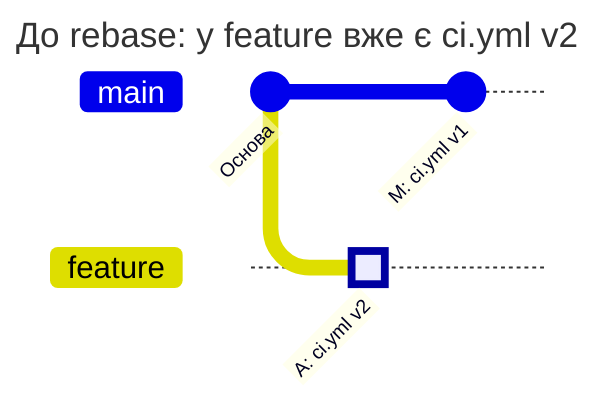
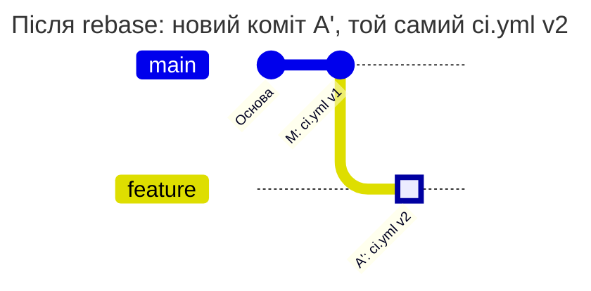
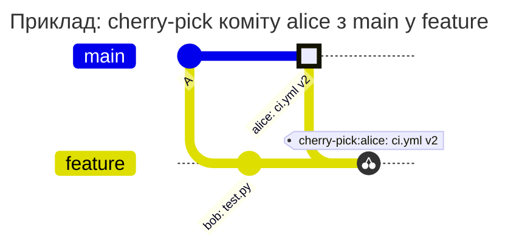

[](match.md)
[](match.en.md)

# Поле `match`

`match` каже, до яких гілок застосовується правило. У TAGPOLICY - до яких тегів. Поле є в кожному правилі всіх чотирьох файлів політик і обов'язкове: правило без `match` не приймається, неявного "усі гілки" немає.

```yaml
rules:
  ci-config:
    match: all                        # усі гілки
  agents:
    match: default                    # лише default branch проєкту
  prod-values:
    match: [main, '/^release\//']     # main і гілки release/...
```

Це фрагмент PATHPOLICY, інші поля правил тут пропущено.

Гілка й тег є різними видами Git-посилань (`ref`). Гілка має повне ім'я `refs/heads/main`, тег - `refs/tags/v1.0.0`, але в `match` пишуть короткі імена `main` та `v1.0.0`. Вибір `match` визначає застосовність правила, а не право доступу сам по собі. Які коміти перевіряти у вибраних гілках, задає окреме поле `check_history` у PATHPOLICY і COMMITPOLICY ([нижче](#match-і-check_history-у-pathpolicy)).

## Значення

| Значення | Що означає | У яких файлах |
| --- | --- | --- |
| `all` | усі гілки, у TAGPOLICY усі теги | усі |
| `default` | default branch проєкту (зазвичай `main`) | PATHPOLICY, COMMITPOLICY |
| список | гілки або теги, які описують елементи списку | усі |

`default` бере ту гілку, яка є default branch у налаштуваннях проєкту, тож після перейменування `master` на `main` файл міняти не треба. У BRANCHPOLICY і TAGPOLICY `default` не має сенсу: default branch уже існує, а тег не є гілкою. Там це помилка.

## Елементи списку

| Елемент | Що означає | Приклад |
| --- | --- | --- |
| ім'я | точне ім'я гілки або тегу, без `refs/heads/` і `refs/tags/` | `main`, `v1.0.0` |
| `/вираз/` | регулярний вираз у синтаксисі RE2 (той самий, що в GitLab CI). Як і `=~` у GitLab CI, вираз шукає збіг будь-де в імені, `^` і `$` треба писати самому | `/^release\//` |
| `/вираз/i` | те саме без урахування регістру. Інших прапорців немає | `/^wip\//i` |
| `!ім'я`, `!/вираз/`, `!/вираз/i` | виняток | `!release/legacy` |

Список збігається з ім'ям, якщо збігся хоча б один звичайний елемент і жоден виняток. Список лише з винятків означає "усі, крім": `['!main']` - усі гілки, крім `main`.

Ім'я, яке саме починається з `!`, можна задати лише регулярним виразом: `'/^!draft$/'`.

Регулярні вирази беріть в одинарні лапки YAML. Тоді `\d` і `\/` доходять до hook як є, без екранування YAML.

## Ім'я → збігається чи ні

| `match` | Ім'я | Збіг | Чому |
| --- | --- | --- | --- |
| `[main]` | `main` | так | точне ім'я |
| `[main]` | `main-old` | ні | точне ім'я збігається лише повністю |
| `['/^v\d+\.\d+\.\d+$/']` | `v1.2.3` | так | вираз описує все ім'я від `^` до `$` |
| `['/^v\d+\.\d+\.\d+$/']` | `v1.2.3-rc1` | ні | після `3` іде `-rc1`, а `$` вимагає кінця імені |
| `['/v\d+/']` | `build-v2` | так | без `^` і `$` вираз шукає збіг будь-де в імені |
| `['/^wip\//i']` | `WIP/login` | так | прапорець `i` не зважає на регістр |
| `['/^wip\//']` | `WIP/login` | ні | без `i` регістр важливий |
| `['/^release\//', '!release/legacy']` | `release/v2` | так | збігся вираз, виняток не збігся |
| `['/^release\//', '!release/legacy']` | `release/legacy` | ні | збігся виняток |
| `['!main']` | `feature/login` | так | список лише з винятків: усі, крім `main` |
| `['!main']` | `main` | ні | збігся виняток |
| `['/^!draft$/']` | `!draft` | так | ім'я з `!` на початку задано виразом |

## Перенесення з `.gitlab-ci.yml`

Регулярний вираз з `rules:if` переноситься в `match` без змін:

```yaml
# .gitlab-ci.yml
deploy-prod:
  rules:
    - if: $CI_COMMIT_TAG =~ /^v\d+\.\d+\.\d+$/
```

```yaml
# TAGPOLICY, фрагмент
rules:
  prod:
    match: ['/^v\d+\.\d+\.\d+$/']
```

Обидва вирази збігаються з тими самими тегами: синтаксис RE2 той самий, і ні GitLab, ні hook не додають `^` і `$` самі.

GitLab CI має власні обмеження виразів і нетипове порівняння підрядків, коли права частина `=~` не є коректним виразом у `/.../`; не покладайтеся на таку поведінку ([документація GitLab](https://docs.gitlab.com/ci/jobs/job_rules/)). Hook відхиляє невалідний регулярний вираз як помилку policy. Переносити варто сам перевірений шаблон, а не всю умову CI з операторами й змінними.

## Кілька правил на одну гілку

| | PATHPOLICY | COMMITPOLICY | BRANCHPOLICY | TAGPOLICY |
| --- | --- | --- | --- | --- |
| Збіглося кілька правил | діють усі: зміну дозволено, лише якщо людина є в `allow` кожного | діють усі: помилка будь-якого означає відмову | діє перше за `priority` | діють усі: підписати тег може лише ключ, який є в `signers` кожного |
| Не збіглося жодне | файл не захищено | коміти не перевіряються | ім'я не перевіряється | тег не перевіряється |

## `match` і `check_history` у PATHPOLICY

`match` лише вибирає гілки. Як перевіряти зміни захищеного файлу у вибраних гілках, задає поле правила `check_history`, за замовчуванням `new-content`. Різницю видно на одному rebase.

alice відповідає за `ci.yml`, а bob працює над кодом. bob не має права змінювати цей файл, але йому потрібно оновлювати свою робочу гілку через rebase.

В основній гілці `main` уже діє такий `PATHPOLICY`:

```yaml
version: 1
admins: [alice]
rules:
  ci:
    match: all
    paths: [ci.yml]
    allow: [alice]
    message: Only alice may change ci.yml.
```

Правило не задає `check_history`, тож діє `new-content`. Глобальний режим - `enforce`, а права GitLab та інші політики дозволяють наведені push.

### Що відбувається під час rebase

alice вже надіслала у `feature` коміт **A**, який змінює `ci.yml` із v1 на v2. Після цього в `main` з'явився коміт **M**, який змінює лише `app.go`:



bob робить rebase: Git переносить зміну alice поверх нового `main` і створює замість **A** новий коміт **A'**. Сам `ci.yml` у `feature` залишається v2. bob надсилає цю переписану історію:



### Чому результат залежить від check_history

**З `check_history: new-content` push bob дозволено.** Hook перевіряє коміти, яких ще немає в жодній гілці чи тегу, і бачить, що v2 вже була в цій робочій гілці до push. Коміт **A'** із тим самим станом файлу не вимагає повторного дозволу alice.

Тепер порівняймо той самий push з іншим значенням у тому самому правилі:

```yaml
check_history: incoming
```

**Push bob відхилено.** `incoming` перевіряє зміни захищеного файлу в кожному коміті, який додається до історії гілки, і разом з ними підсумкову різницю гілки до і після push. Коміт **A'** новий для `feature` і змінює `ci.yml` відносно свого батьківського коміту **M**: v1 → v2. Такий коміт має надсилати користувач із `allow`. Зазначене в коміті авторство alice не надає цього права bob.

| Дія bob у цьому прикладі | `check_history: new-content` | `check_history: incoming` |
| --- | --- | --- |
| Rebase без зміни `ci.yml`: файл залишається v2 | Дозволено: v2 вже була у `feature` | Відмова: новий коміт A' змінює `ci.yml` |
| Новий коміт змінює лише `app.go` | Дозволено: правило захищає `ci.yml` | Дозволено: правило захищає `ci.yml` |
| Новий коміт змінює `ci.yml` на нову v3, якої ще не було ні у `feature`, ні в `main` | Відмова: bob немає в `allow` | Відмова: bob немає в `allow` |
| Merge у `main` гілки, яку вже запушено, зі зміною `ci.yml` від alice | Дозволено: коміти гілки не нові для репозиторію, merge не приносить нового вмісту | Відмова: коміт alice входить у `main` разом із merge |

`new-content` підходить для CI-файлів у робочих гілках: він дозволяє спільну роботу та rebase вже прийнятих змін. `incoming` потрібен, коли кожен коміт зі зміною захищеного файлу, що входить у гілку правила, має надіслати людина з `allow`, навіть якщо такий вміст уже був в іншій гілці. Так правило зі списком `[main, '/^release\//']` перевіряє і merge request із робочої гілки, де саме правило не діє ([prod-значення](../examples/pathpolicy/production-values.md)).

`check_history` діє однаково в усіх гілках, які вибирає `match`: у default branch, у гілках, захищених у GitLab, і в звичайних. `match: all` і `match: ['/./']` з однаковим `check_history` дають той самий результат. Захист гілки в GitLab визначає, хто може надсилати зміни, і на `check_history` не впливає.

Squash, merge, fast-forward і відкат з обома значеннями порівнює приклад [`new-content` і `incoming`](../examples/pathpolicy/check-history.md). Інші операції з уже прийнятими змінами розібрано у сценарії [спільної гілки, rebase і squash](../examples/pathpolicy/shared-branch.md).

## Часті помилки

| Що написано | Помилка `validate` | Як виправити |
| --- | --- | --- |
| `match: ['release/*']` | `match: "release/*": a glob is not supported; use a regex such as /^release\//` | glob не підтримується, пишіть вираз `'/^release\//'` |
| `match: ['v\d+']` | `match: "v\\d+": not a branch or tag name; did you mean the regex /v\d+/?` | вираз пишеться між `/`: `'/v\d+/'` |
| `match: ['/v\d+/']` для релізних тегів | помилки немає | вираз без `^` і `$` ловить і `build-v2`. Пишіть `'/^v\d+\.\d+\.\d+$/'` |
| `match: [all]` | `match: all is a value of match, not an element of a list; write match: all` | `all` - це значення поля, а не елемент списку: `match: all` |
| `match: ['!']` | `match: "!": ! must be followed by a name or a regex` | після `!` має йти ім'я або вираз |
| `match: ['!draft']`, коли гілка зветься `!draft` | помилки немає | `!draft` - це виняток для гілки `draft`. Ім'я з `!` задається виразом `'/^!draft$/'` |
| `match: []` | `match: the list is empty` | вкажіть хоча б один елемент або `match: all` |
| `match: ['/v(/']` | ``match: "/v(/": not a valid RE2 regex: error parsing regexp: missing closing ): `v(` `` | виправте вираз |
| `match: ['/v/x']` | `match: "/v/x": flag "x" is not supported; the only flag is i` | єдиний прапорець - `i` |
| `match: default` у BRANCHPOLICY | `match: default is not allowed here; use all or a list of names` | у BRANCHPOLICY і TAGPOLICY `default` немає, вкажіть ім'я гілки |

Перед кожною помилкою `validate` друкує номер рядка і правило: `line 4: rule r: match: ...`.

## Діаграми історії

У документах модулів сценарії з історією комітів показано діаграмами. Позначення однакові в усій документації:
- кольоровий коміт (`HIGHLIGHT`) - зміна захищеного файлу від людини, якій це дозволено
- коміт з іншою позначкою (`REVERSE`) - коміт, через який push відхиляється
- звичайні коміти без позначки
- `tag:` - тег на коміті, `cherry-pick` - коміт, перенесений з іншої гілки

alice в діаграмах і таблицях може змінювати захищений файл, bob - ні. Rebase і squash показано двома діаграмами, до і після. Переписаний коміт позначено штрихом: `alice: ci.yml v2'`.


