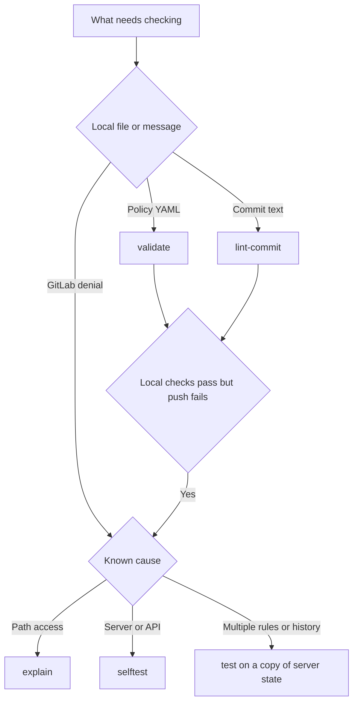

[](cli.md)
[](cli.en.md)

# CLI reference

Developers can run local checks without a server token; diagnosing active policies and installation requires configuration and API access.

## Which command to use

| Task | Command | Meaning of the result |
| --- | --- | --- |
| Validate policy YAML and content | `validate` | file valid under performed checks, not a permitted push |
| Check a message or commit range | `lint-commit` | selected message rules satisfied |
| Find who may change a particular file | `explain` | active path rules allow or deny a path for a user |
| Reproduce a hook decision for a ref update | `test` | decision for the supplied repository state, user and configuration |
| Check server files, token and API access | `selftest` | installation usable under the performed checks |
| Find project settings drift | `settings-check` | settings meet expectations or need repair |
| Find groups missing service account access | `coverage` | group coverage checked with an administrator token |
| Find working admins and recovery status | `admins` | confirmed PATHPOLICY and role data |
| Connect or remove the Gitaly wrapper | `install-hook`, `uninstall-hook` | local installation files changed |
| Rotate a token or temporarily bypass a project's checks | `token rotate`, `breakglass` | administrative action; read its effects below before running |

### From a symptom to a check

If local checks pass but a push fails, investigate active policies, actual refs or server setup. The diagram helps choose the next step.



`validate` checks a file rather than a change. A valid PATHPOLICY can deliberately forbid your push. `lint-commit` checks text; without `--rule`, it can apply a release-branch rule to a message intended for main.

Use `explain` to ask whether bob may change .gitlab-ci.yml in feature. It does not analyze intermediate commits, tag signatures or all modules together. A full decision needs `test` with Git objects and refs reproducing the server state before the push.

`selftest` checks installation and API access but neither makes a control push nor discovers all groups invisible to the service account. Use a test project for the former and `coverage` for the latter.

## General

```text
gitlab-repopolicy <command> [flags]
```

Without arguments the command prints the list of commands. `gitlab-repopolicy <command> -h` prints the flags of a command. Flags take one or two dashes: `-f` and `--f` are the same.

| Exit code | What it means |
| --- | --- |
| `0` | the command completed its task; meaning depends on the command and mode |
| `1` | the result of the check is negative (an invalid file, a denial, drift) or an error of the run |
| `2` | wrong arguments of the command |

For `validate --branch` and `--tag`, exit 0 means a successful query against a valid file, even for `denied` or no common signer. `not checked` also does not always change the exit code. `test` applies global mode: under `audit` it can return 0 for a change that `enforce` would deny. Check the command's purpose and active configuration before using its exit code in CI.

`--config` sets the server configuration path. It defaults to `/etc/gitlab-repopolicy/config.yaml` for every command except `validate` and `lint-commit`: they work without a server and read configuration only from an explicit path. The [configuration reference](../administration/configuration.en.md) explains the settings and their effect on checks.

In the Default column, "none" means the command does not supply a value for that flag automatically. If a flag is required in the chosen scenario, provide it explicitly. Boolean flags show a concrete `true` or `false` default.

## Commands

| Command | What it does | Run as | API and token | Server config | Section |
| --- | --- | --- | --- | --- | --- |
| `validate` | checks policy files | anyone | only with `--online` | only for presets and `--online` | [validate](#validate) |
| `lint-commit` | checks commit messages | anyone | no | only for presets | [lint-commit](#lint-commit) |
| `explain` | which rules of PATHPOLICY apply to a path | git or root | yes | yes | [explain](#explain) |
| `admins` | admins of PATHPOLICY and recovery | git or root | yes | yes | [admins](#admins) |
| `test` | the decision of the hook without a push | git or root | when the rules need it | yes | [test](#test) |
| `selftest` | checks the installation | root and git | yes | yes | [selftest](#selftest) |
| `settings-check` | compares the settings of projects | git or root | yes | yes | [settings-check](#settings-check) |
| `coverage` | groups without the service account | root | a token of an administrator | yes | [coverage](#coverage) |
| `install-hook` | connects the hook to Gitaly | root | no | yes | [install-hook](#install-hook) |
| `uninstall-hook` | disconnects the hook | root | no | no | [uninstall-hook](#uninstall-hook) |
| `token rotate` | rotates the token of the service account | root | yes | yes | [token rotate](#token-rotate) |
| `breakglass grant`, `revoke`, `list` | the emergency bypass for a project | root | only for `--project` | yes | [breakglass](#breakglass-grant) |
| `hook pre-receive` | the hook itself | Gitaly | yes | yes | [hook pre-receive](#hook-pre-receive) |
| `version` | the version | anyone | no | no | [version](#version) |

## Checking policy files

### `validate`

```text
gitlab-repopolicy validate [-f FILE [--module NAME]] [--config FILE] [--online [--project P]] [--branch NAME] [--tag NAME]
```

| Flag | Required | Default | What it does |
| --- | --- | --- | --- |
| `-f FILE` | no | every policy file of the current directory | the file to check |
| `--module NAME` | for `-f` with another name | by the name of the file | the module of the file: `pathpolicy`, `commitpolicy`, `tagpolicy`, `branchpolicy` |
| `--config FILE` | for `extends` and `--online` | none | the server config: presets, with `--online` also `gitlab_url` and `token_file` |
| `--online` | no | `false` | with `true`, checks through the GitLab API that usernames exist and are active; with `false`, validation is offline |
| `--project P` | no | none | with `--online`: the ID or the path of a project, to check the role of the admins |
| `--branch NAME` | no | none | the rule of BRANCHPOLICY for a new branch with this name and the result |
| `--tag NAME` | no | none | the rules of TAGPOLICY for a tag with this name and the signers |

- `--online` without `--config` - exit code 2
- `--branch` needs a BRANCHPOLICY file, `--tag` a TAGPOLICY file: through `-f` or in the current directory. None - exit code 2
- exit code 0 for any answer of `--branch` and `--tag`: it is a query, not a check

Output to stdout: `<file>: valid` or `invalid`, then `error:`, `warning:`, `not checked:` lines, the origin of the rules for a file with `extends`, the answer of `--branch` and `--tag`. Usage errors go to stderr.

```text
$ gitlab-repopolicy validate
PATHPOLICY: valid
COMMITPOLICY: valid
TAGPOLICY: valid
BRANCHPOLICY: valid
```

The [validate guide](validate.en.md) covers local checks, presets and CI.

### `lint-commit`

```text
gitlab-repopolicy lint-commit (-m MSG | --range A..B [--skip-author EMAIL]...) [-f FILE] [--rule NAME]... [--config FILE]
```

| Flag | Required | Default | What it does |
| --- | --- | --- | --- |
| `-m MSG` | `-m` or `--range` | none | a commit message |
| `--range A..B` | `-m` or `--range` | none | the commits of a range. One revision is its whole history. Up to 100 000 commits |
| `--skip-author EMAIL` | no | none | with `--range`: skip the commits of this author, can be repeated |
| `-f FILE` | no | `COMMITPOLICY` | the COMMITPOLICY file |
| `--rule NAME` | no | every rule | only this rule, can be repeated |
| `--config FILE` | for `extends` | none | the server config with presets. Other keys are not read |

- exactly one of `-m` and `--range`, otherwise exit code 2
- `--skip-author` without `--range` - exit code 2
- an unknown name in `--rule` - exit code 1 with the list of rules of the file

Exit code 0 - no violations of level `error`, 1 - there are. Violations go to stdout, one line each: `<commit>: [<rule>] error|warning: <check type> <check name>: <what is wrong>`.

```text
$ gitlab-repopolicy lint-commit -f examples/conventional-commits/COMMITPOLICY -m "Fix deploy."
message: [conventional] error: header-format conventional: expected "type(scope): subject"
message: [conventional] error: body-leading-blank-lines blank-line: an empty line must follow the header
message: [conventional] error: trailer-required dco: the message needs a trailer, the last part of the message
message: [conventional] error: pattern dco: no match of /(?m)^Signed-off-by: / in the trailer
```

To check messages before committing or in CI, use the [lint-commit examples](../policies/commitpolicy.en.md#checking-without-a-push).

## Diagnostics

### `explain`

```text
gitlab-repopolicy explain --project P --user U --path X [--ref R] [--config FILE]
```

| Flag | Required | Default | What it does |
| --- | --- | --- | --- |
| `--project P` | yes | none | the ID or the full path of the project |
| `--user U` | yes | none | a username |
| `--path X` | yes | none | a path in the repository |
| `--ref R` | no | the default branch | the name of a branch or a full ref |
| `--config FILE` | no | `/etc/gitlab-repopolicy/config.yaml` | the server config |

Reads PATHPOLICY of the default branch of the project through the API. Exit code 0 - the change is allowed or no rule matches, 1 - denied or an error (in stderr), 2 - `--project`, `--user` or `--path` is not given.

```text
$ gitlab-repopolicy explain --project acme/platform/app --user bob --path .gitlab-ci.yml --ref feature
acme/platform/app, PATHPOLICY of main; path .gitlab-ci.yml, ref refs/heads/feature, user bob
  ci-config (match: all; from preset:org-ci, file): NOT allowed; allow: platform-lead, sre-lead, kpn
    fields from: allow file; help preset:org-ci; help.contact preset:org-ci; match preset:org-ci; message preset:org-ci; paths preset:org-ci
result: bob may not change .gitlab-ci.yml on refs/heads/feature: every applying rule must allow the user
```

[Checking PATHPOLICY without a push](../policies/pathpolicy.en.md#checking-without-a-push) helps explain which rules apply. If the problem is lost admin access, check the [recovery conditions](../administration/operations.en.md#recovery).

### `admins`

```text
gitlab-repopolicy admins --project P [--config FILE]
```

| Flag | Required | Default | What it does |
| --- | --- | --- | --- |
| `--project P` | yes | none | the ID or the full path of the project |
| `--config FILE` | no | `/etc/gitlab-repopolicy/config.yaml` | the server config |

Shows the admins of PATHPOLICY of the default branch, the working admins and whether recovery is on. A failure of the API is exit code 1, not "0 admins".

```text
$ sudo gitlab-repopolicy admins --project acme/app
  alice                          missing: access level 30, Maintainer (40) is required
acme/app: configured 1, effective 0, missing 1
recovery active: an Owner of the project may change PATHPOLICY
```

When no effective admins remain, follow the [recovery procedure](../administration/operations.en.md#recovery) to restore control of PATHPOLICY.

### `test`

```text
gitlab-repopolicy test --repo DIR --old A --new B --ref R --user U [--gl-id ID] [--protocol P] [--project P] [--project-id N] [--config FILE]
```

| Flag | Required | Default | What it does |
| --- | --- | --- | --- |
| `--repo DIR` | yes | none | a repository with the objects of the update, best a mirror copy |
| `--old A` | yes | none | the old value of the ref, zeros for a creation |
| `--new B` | yes | none | the new value of the ref, zeros for a deletion |
| `--ref R` | yes | none | the full name of the ref, for example `refs/tags/v1.0.0` |
| `--user U` | yes | none | the username of whoever pushes |
| `--gl-id ID` | without the API | looked up by `--user` | `GL_ID`: `user-<id>` or `key-<id>` |
| `--protocol P` | no | `ssh` | `ssh`, `http` or `web` |
| `--project P` | no | `local/test/repository` | the path of the project |
| `--project-id N` | no | `1` | the ID of the project |
| `--config FILE` | no | `/etc/gitlab-repopolicy/config.yaml` | the server config |

Exit code 0 means the core permits the change under the supplied conditions and current mode; in `audit`, this can happen despite violations. A summary is printed to stdout, for example `allowed: the rules allow the change, 3 new commits`. Code 1 means a denial with the text intended for the user, or an execution error. To reproduce server state, prepare refs and Git objects using the [push-checking guide](../administration/operations.en.md#check-a-push-without-pushing).

### `selftest`

```text
gitlab-repopolicy selftest [--config FILE]
```

| Flag | Required | Default | What it does |
| --- | --- | --- | --- |
| `--config FILE` | no | `/etc/gitlab-repopolicy/config.yaml` | the server config |

Checks the config, presets, modules, the audit log, break-glass, the token, the service account and access to the API. One line per check: `ok`, `info`, `warn` or `FAIL`. Any `FAIL` is exit code 1. Run it as root and as git.

```text
$ sudo -u git gitlab-repopolicy selftest
info version     gitlab-repopolicy 1.0.0
ok   config      /etc/gitlab-repopolicy/config.yaml, mode enforce
ok   modules     enabled: pathpolicy, commitpolicy, tagpolicy, branchpolicy
ok   audit       /var/log/gitlab-repopolicy/audit.log does not exist yet; the directory belongs to 998:998
ok   breakglass  /etc/gitlab-repopolicy/breakglass, no active grants
ok   api         http+unix://%2Fvar%2Fopt%2Fgitlab%2Fgitlab-workhorse%2Fsockets%2Fsocket reachable as gitlab-repopolicy (id 2)
ok   account     gitlab-repopolicy is a service account
ok   groups      Maintainer of 3 groups; gitlab-repopolicy coverage checks every top-level group
ok   token       scopes read_api, self_rotate, expires on 2027-10-13
info git         git version 2.55.0-rc1.g02bb39c in PATH of selftest; the hook uses the git of Gitaly
```

After `selftest` succeeds, perform a [control push](../administration/install.en.md#6-check) to verify that Gitaly invokes the hook.

### `settings-check`

```text
gitlab-repopolicy settings-check [--config FILE] [--timeout D]
```

| Flag | Required | Default | What it does |
| --- | --- | --- | --- |
| `--config FILE` | no | `/etc/gitlab-repopolicy/config.yaml` | the server config |
| `--timeout D` | no | `1h0m0s` | the deadline of the whole check |

Compares the settings of projects with policy files against the server config and against BRANCHPOLICY. A drift is a line `<project>: <check>: <what is wrong>` and exit code 1. Without drift - `N projects with policy files checked, no drift`, exit code 0.

```text
$ sudo -u git gitlab-repopolicy settings-check
acme/app: protected_tags: not protected: v*
```

The [settings-check operations guide](../administration/operations.en.md#settings-check) explains its checks and scheduled execution.

### `coverage`

```text
gitlab-repopolicy coverage --token-file ADMIN_TOKEN [--config FILE] [--timeout D]
```

| Flag | Required | Default | What it does |
| --- | --- | --- | --- |
| `--token-file ADMIN_TOKEN` | yes | none | a file with a token of an administrator, scope `read_api` |
| `--config FILE` | no | `/etc/gitlab-repopolicy/config.yaml` | the server config: `gitlab_url` and the token of the service account |
| `--timeout D` | no | `10m0s` | the deadline of the whole check |

Finds top-level groups where the service account lacks the Maintainer role: required access checks for their projects may fail. Code 1 means such groups exist. Add the account to those groups using the [service-account setup guide](../administration/install.en.md#3-service-account-and-token).

## Installation and operation

### `install-hook`

```text
gitlab-repopolicy install-hook --hooks-dir DIR [--user git] [--binary PATH] [--config FILE]
```

| Flag | Required | Default | What it does |
| --- | --- | --- | --- |
| `--hooks-dir DIR` | yes | none | `custom_hooks_dir` of Gitaly |
| `--user U` | no | `git` | the user Gitaly runs hooks as |
| `--binary PATH` | no | `/usr/bin/gitlab-repopolicy` | the binary the wrapper runs |
| `--config FILE` | no | `/etc/gitlab-repopolicy/config.yaml` | the server config the wrapper passes |

Creates the wrapper `pre-receive.d/50-gitlab-repopolicy` and sets ownership of the configuration, token and log directory. Before running it, prepare `custom_hooks_dir` using the [hook installation guide](../administration/install.en.md#5-connect-the-hook).

### `uninstall-hook`

```text
gitlab-repopolicy uninstall-hook --hooks-dir DIR
```

| Flag | Required | Default | What it does |
| --- | --- | --- | --- |
| `--hooks-dir DIR` | yes | none | `custom_hooks_dir` of Gitaly |

Removes the wrapper and stops invoking gitlab-repopolicy from this hooks directory. To remove the package and revoke its token, follow the [removal guide](../administration/install.en.md#turn-off-and-remove).

### `token rotate`

```text
gitlab-repopolicy token rotate [--before 30d] [--config FILE]
```

| Flag | Required | Default | What it does |
| --- | --- | --- | --- |
| `--before D` | no | `30d` | rotate when the token expires within this time |
| `--config FILE` | no | `/etc/gitlab-repopolicy/config.yaml` | the server config |

When the token expires later than `--before`, it does nothing. Otherwise it rotates the token with `expires_at` = today + `token_lifetime` and writes the new one atomically. Use the [token rotation guide](../administration/operations.en.md#token-rotation) to schedule rotation and handle multiple nodes.

### `breakglass grant`

```text
gitlab-repopolicy breakglass grant (--project P | --project-id N) --ttl D --reason TEXT [--config FILE]
```

| Flag | Required | Default | What it does |
| --- | --- | --- | --- |
| `--project P` | `--project` or `--project-id` | none | the full path of the project, the ID is looked up through the API |
| `--project-id N` | `--project` or `--project-id` | none | the ID of the project, when GitLab does not answer |
| `--ttl D` | yes | none | how long the grant lasts, at most 24h |
| `--reason TEXT` | yes | none | why, for example the number of the incident |
| `--config FILE` | no | `/etc/gitlab-repopolicy/config.yaml` | the server config |

While the grant lasts, the hook skips project checks, including global restrictions and policy acceptance. GitLab permissions still apply. Before granting access, read the [break-glass procedure](../administration/operations.en.md#break-glass), including its permission and logging requirements.

### `breakglass revoke`

```text
gitlab-repopolicy breakglass revoke (--project P | --project-id N) [--config FILE]
```

| Flag | Required | Default | What it does |
| --- | --- | --- | --- |
| `--project P` | `--project` or `--project-id` | none | the full path of the project |
| `--project-id N` | `--project` or `--project-id` | none | the ID of the project |
| `--config FILE` | no | `/etc/gitlab-repopolicy/config.yaml` | the server config |

### `breakglass list`

```text
gitlab-repopolicy breakglass list [--config FILE]
```

| Flag | Required | Default | What it does |
| --- | --- | --- | --- |
| `--config FILE` | no | `/etc/gitlab-repopolicy/config.yaml` | the server config |

Lists the valid grants.

## Service commands

### `hook pre-receive`

```text
gitlab-repopolicy hook pre-receive [--config FILE]
```

| Flag | Required | Default | What it does |
| --- | --- | --- | --- |
| `--config FILE` | no | `/etc/gitlab-repopolicy/config.yaml` | the server config |

Gitaly runs it through the wrapper, nobody calls it by hand. The updates of refs come on stdin, the environment from Gitaly (`GL_ID`, `GL_USERNAME`, `GL_PROTOCOL`, `GL_PROJECT_PATH`). A denial is a text for the user and exit code 1. The command does not print `-h`: whoever pushes sees everything it prints.

### `version`

```text
gitlab-repopolicy version
```

No flags.

```text
$ gitlab-repopolicy version
gitlab-repopolicy 1.0.0
commit: 6a67f52
date: 2026-10-17T12:00:00Z
go: go1.25.4
```
